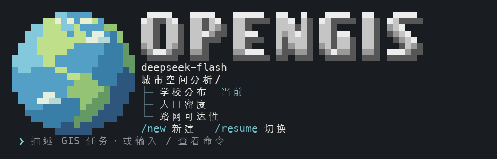

<div align="center">

# 🌍 OpenGIS-Agent

**A Verifiable Geospatial Coding & Publication-Grade Cartography Agent**

[](pyproject.toml)
[](pyproject.toml)
[](gis_agent/skills/gis-data-io-and-staging/SKILL.md)
[](gis_agent/adapters/harness_mcp.py)

[简体中文](README.md) | **English**

[Cartography Showcase](#-cartography-showcase) • [Architecture](#-architecture) • [Quickstart](#-quickstart) • [Roadmap & Contributing](CONTRIBUTION_AND_NEXT_STEPS.md)

</div>

---

## 🎨 Cartography Showcase

OpenGIS-Agent autonomously plans map projections, perceptual color ramps, layer z-ordering, and publication typography—delivering `300 dpi` figures alongside **editable `<text>` layered SVGs** ready for Illustrator / Inkscape / Figma refinement.

### 1. Publication Multi-Panel Scientific Composite
*Asymmetric 62/38 GridSpec composite in bundled SIL OFL `Source Serif 4` print typography linking seamless `0–800 in` snowfall surfaces (`build_perceptual_norm`), Amtrak exposure tiers with broken-line-free national border z-ordering, integer graticules, state rankings, and latitudinal exposure profiles (`5.90 MB` editable SVG).*


### 2. Standard Study-Area Locator Map
*Map-first research locator featuring uncolored-yet-bordered neighbor context, bundled SIL OFL `Source Serif 4` print typography, compact circular globe inset, centered framed legend, bespoke compass star + lower-zone cartographic scalebar, and integer 4-sided graticules (`8.51 MB` editable SVG).*


---

## ✨ Architecture

Rather than wrapping GIS software into hundreds of brittle JSON endpoints, OpenGIS-Agent runs a lightweight pure-Python state machine (`AgentLoopRunner` + SQLite checkpointing) with `9` KV-cache-friendly static tool schemas and `7` modular geospatial Skills (`gis_agent/skills/`). Every newly generated vector or raster artifact triggers zero-turn objective inspection (`inspect_fast` for CRS, NoData, and empty-geometry triage), executes seamlessly across standalone `uv` geospatial libraries (`GeoPandas`, `Rasterio`, `SciPy`, `Cartopy`) or optional desktop `PyQGIS`, and composes publication maps backed by automated layout and typography hygiene checks (`gis_agent/integrations/plotting/`).

---

## 🚀 Quickstart

### Install and launch

Install Git and [uv](https://docs.astral.sh/uv/getting-started/installation/), then install the global CLI tool (`opengis`) in Windows PowerShell or a macOS terminal:

```sh
git clone https://github.com/zhishimian/OpenGIS-Agent.git
cd OpenGIS-Agent
uv tool install --python 3.12 ".[cli,geo]"
uv tool update-shell
```

Reopen your terminal, `cd` into your data folder, and run `opengis`. On first launch, the terminal displays the active model and API host and prompts for a masked API key (default provider: DeepSeek). Press Enter to skip and use `/key` to connect later.



Keys are scoped to the provider and endpoint and stored in macOS Keychain, Windows Credential Manager, or Linux Secret Service across workspaces (or process-only if unavailable). Automation scripts and optional desktop QGIS setups can still configure `.env` or environment variables:

```env
DEEPSEEK_API_KEY=your_api_key_here
# Optional: enable desktop QGIS / PyQGIS processing algorithms
# GIS_AGENT_QGIS_DIR=E:/exe/qgis
```

### Try a task

Type this at the `❯` prompt to try the agent without any data files:

> Calculate the great-circle distance from Shanghai (31.23° N, 121.47° E) to Beijing (39.90° N, 116.40° E). Give the answer in kilometers.

For your own data, reference files relative to your workspace—for example, ask the agent to inspect `schools.geojson`, report its CRS and feature count, label points by `name`, and export a publication PNG/SVG map.

### Manage workspaces and sessions

| Where | Command | Purpose |
| --- | --- | --- |
| Terminal | `opengis --folder "../City analysis"` | Open a specific data folder |
| Agent | `/new schools` | Create a named session in this folder |
| Agent | `/resume` or `/resume schools` | List this folder’s sessions or continue one by name |
| Agent | `/status` | Show the model, workspace path, and output directory |
| Agent | `/help`, `/exit` | List shortcuts or exit |

Sessions default to `sessions/` and results to `outputs/<session>/` inside the workspace. Different folders can reuse the same session name (use ASCII session/folder names on Windows when invoking desktop QGIS or legacy Shapefile drivers).

### Develop from source & MCP server

```sh
uv sync --extra cli --extra geo --extra dev
uv run --no-sync opengis
```

External clients (Claude Code / Codex / Cursor / Antigravity) can launch `gis-agent-mcp` as a STDIO MCP server; from a source checkout, run `uv run --no-sync gis-agent-mcp`.

---

## 🧭 Roadmap & Contributing

Contributions across domain Skills, cartographic primitives, QGIS / Desktop UI plugins, and open GeoAI benchmarks are welcome—see **[CONTRIBUTION_AND_NEXT_STEPS.md](CONTRIBUTION_AND_NEXT_STEPS.md)** for the full roadmap and guide.
