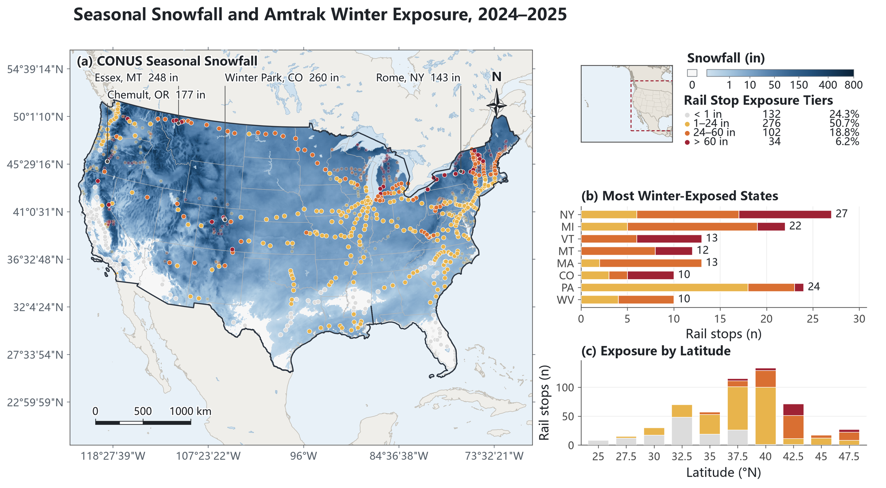
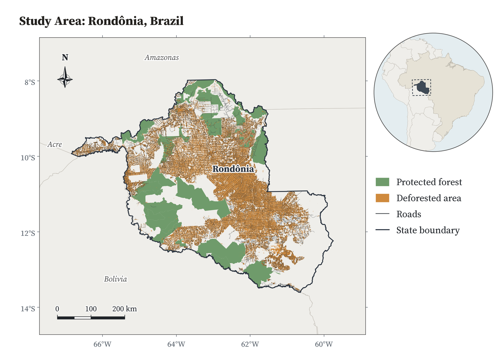
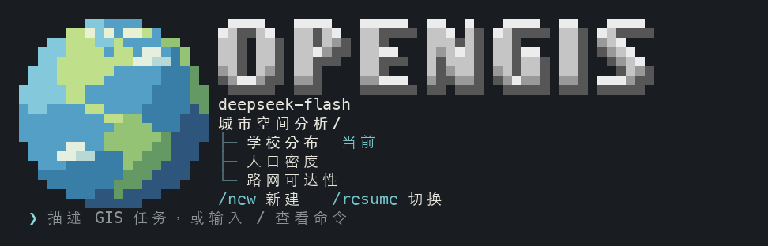

<div align="center">

# 🌍 OpenGIS-Agent

**可验证的地理空间代码生成、出版级制图与可视化人机协同 Agent**

[](pyproject.toml)
[](pyproject.toml)
[](gis_agent/skills/gis-data-io-and-staging/SKILL.md)
[](CONTRIBUTION_AND_NEXT_STEPS.md)
[](gis_agent/adapters/harness_mcp.py)

**简体中文** | [English](README.en.md)

[制图展示](#-制图展示) • [架构简介](#-架构简介) • [快速开始与环境配置](#-快速开始与环境配置) • [路线图与贡献指南](CONTRIBUTION_AND_NEXT_STEPS.md)

</div>

---

## 🎨 制图展示

OpenGIS-Agent 自动规划空间投影、感知色带、图层压盖与印刷级排版，同时输出 `300 dpi` 成图与**保留可编辑 `<text>` 图层及语义 `<g id>` 分组的矢量 SVG**（可直接导入 Illustrator / Inkscape / Figma 精修）。

### 1. 科研多联复合图
*62/38 非对称拼版，采用随仓开源字体 `Source Serif 4`，整合 `0–800 in` 连续降雪色带、Amtrak 站点冬季暴露分级、国界顶层压盖、整数经纬网与联动统计副图（`5.90 MB` 可编辑 SVG）。*



### 2. 标准研究区位图
*地图优先的标准研究区位图，包含无染色完整邻区衬底、随仓 `Source Serif 4` 印刷排版、圆形地球仪区位小图、居中线框图例、罗盘星指北针、偏下比例尺与四边整数经纬刻度（`8.51 MB` 可编辑 SVG）。*



---

## ✨ 架构简介

OpenGIS-Agent 摒弃臃肿的框架封装与上百个碎片化工具接口，采用 **“一核三环、多端同源”** 的解耦架构：
- **Ring 1（确定性地理原语与 7 套领域 Skills）**：新建矢量与栅格产物自动附带零轮次客观体检（`inspect_fast`，即时暴露坐标系、NoData 与空结果异常），支持独立 `uv` 开源空间栈（GeoPandas / Rasterio / SciPy / Cartopy，内置 Trimmed-TIN 服务区、`scipy.optimize.milp` 选址等网络分析四件套）与可选桌面 PyQGIS 双环境平滑切换，配合可组合制图原语与 5 项版面卫生质检（`gis_agent/integrations/plotting/`）稳定输出可复现成果。
- **Ring 2（无头会话引擎与 9 静态工具协议）**：纯 Python 状态机（`AgentLoopRunner` + SQLite 断点持久化），通过 9 个 KV-Cache 友好的静态工具（实测缓存命中率 **96%+**）、`EventCallback` 实时事件流、`WorkspaceContext` 空间上下文与 `request_stop()` 0.2s 协作式进程树回收驱动长任务可靠执行。
- **Ring 3（本地空间引擎服务与 OpenGIS Studio 可视化工作台）**：后端基于 **Python FastAPI + SSE** 提供大矢量视口抽稀、栅格 `WarpedVRT` 透明叠图、`Identify` 矢量/栅格同点物理值查询与 SVG 图层解析；前端界面完全采用 **React 19 + TypeScript + MapLibre GL JS** 编写，既能通过 `opengis studio` 在本地浏览器直接打开，也能通过极薄 **Tauri v2 (Rust `< 300` 行)** 原生外壳打包为独立 Windows `.exe` 桌面应用。

---

## 🚀 快速开始与环境配置

### 1. 从源码配置开发环境（推荐协作者与开发者）

先安装 Git、[uv](https://docs.astral.sh/uv/getting-started/installation/) 与 [Node.js](https://nodejs.org/)（含 `pnpm`），拉取仓库并完成环境初始化：

```powershell
git clone https://github.com/zhishimian/OpenGIS-Agent.git
cd OpenGIS-Agent
git checkout feature/v9.1-studio

# 1) 安装 Python 核心、CLI、开源空间计算栈与 Studio 本地服务依赖
uv sync --extra cli --extra geo --extra studio --extra dev

# 2) 安装 React + MapLibre 前端依赖并构建静态资源到 gis_agent/server/static/
pnpm --dir frontend install
pnpm --dir frontend run build:sync
```

初始化完成后，你可以按需求选择任意一种方式启动：

| 使用形态 | 启动命令 | 适用场景 |
| :--- | :--- | :--- |
| **① 本地可视化工作台 (`opengis studio`)** | `uv run --no-sync opengis studio --folder "你的数据目录"` | 在浏览器打开完整双栏工作台（地图画布联动、Identify 点查、框选 AOI、方案审批、成图红框圈注精修） |
| **② 极简命令行终端 (`opengis`)** | `uv run --no-sync opengis --folder "你的数据目录"` | 轻量终端多轮对话、会话管理与快速批处理 |
| **③ STDIO MCP 服务 (`gis-agent-mcp`)** | `uv run --no-sync gis-agent-mcp --project "你的数据目录"` | 挂载到 Claude Code / Codex / Cursor / Antigravity 等外部 AI IDE |
| **④ 构建独立桌面安装包 (`.exe` / `.zip`)** | `pwsh -NoProfile -ExecutionPolicy Bypass -File .\scripts\build_desktop.ps1 -UseChinaMirror` | 本地编译产出免安装 Python/QGIS 的 `OpenGIS-Studio-9.1.0-x64-setup.exe` 与便携包（需安装 Rust `1.90+`） |

> **说明**：打包产出的 `.exe` 安装包（`~164 MB`）与便携 `.zip`（`~258 MB`）内嵌了完整的便携 Python 3.12 空间运行时，已在 `.gitignore` 中忽略，**不直接提交到 Git 仓库**；开发阶段由开发者在本地按需执行 `scripts/build_desktop.ps1` 构建，正式发版时挂载至 GitHub Releases。

### 2. 全局安装 CLI 工具与配置密钥

如果只需要命令行与本地浏览器工作台，也可以通过 `uv tool` 全局安装：

```powershell
uv tool install --python 3.12 ".[cli,geo,studio]"
uv tool update-shell
```

进入任意数据文件夹输入 `opengis` 或 `opengis studio`。首次启动会引导填写 API Key（默认支持 DeepSeek，密钥加密保存在 Windows 凭据管理器、macOS 钥匙串或 Linux Secret Service 中，跨文件夹自动复用）。也可在工作文件夹 `.env` 中配置：

```env
DEEPSEEK_API_KEY=your_api_key_here
# 可选：接入本地桌面 QGIS / PyQGIS 处理算法（未安装 QGIS 时默认使用内置开源空间栈）
# GIS_AGENT_QGIS_DIR=E:/exe/qgis
```



### 3. 常用会话与终端命令

| 在哪里输入 | 命令 | 用途 |
| :--- | :--- | :--- |
| 系统终端 | `opengis studio --folder "../城市分析"` | 在指定数据目录启动可视化空间工作台 |
| 系统终端 | `opengis --folder "../城市分析"` | 在指定数据目录打开命令行交互终端 |
| Agent 终端内 | `/new schools`（或中文会话名） | 在此文件夹新建命名会话 |
| Agent 终端内 | `/resume` 或 `/resume schools` | 列出此文件夹的会话，或继续指定会话 |
| Agent 终端内 | `/status`、`/key`、`/cancel`、`/exit` | 查看状态、更新密钥、取消等待、退出 |

记录默认保存在工作文件夹的 `sessions/`，成果写入 `outputs/<会话名>/`（注：Windows 下若需调用桌面 QGIS / Shapefile 等 C++ 底层驱动，建议使用英文或数字命名会话与工作目录）。

---

## 🧭 路线图与贡献指南

我们正在围绕 **① 深水区空间分析 Skills、② 出版级流图与高密度注记、③ AI 操控的可视化与图上红框批注交互、④ 五端交付形态（含 QGIS / ArcGIS Pro 薄壳插件）以及 ⑤ GeoAgentBench 竞赛/科研评测基准** 开展共建。

详细的架构拆解、待认领任务清单（Todo List）与开发规范，请阅读 **[CONTRIBUTION_AND_NEXT_STEPS.md](CONTRIBUTION_AND_NEXT_STEPS.md)**。
