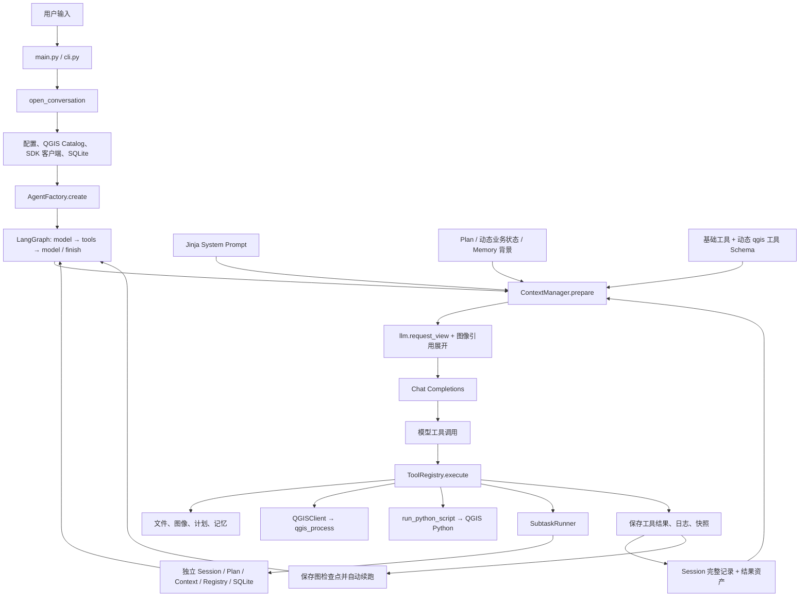

# GIS-Agent V7.8 全面审计与下一版最小方案

审计日期：2026-10-29。审计版本：`3054e0c`，提交说明为 `gis-agent v7.8`。历史实验目录保留原来的 V7.7 名称。

本轮只做调查、离线分析和设计。未调用收费模型，未改应用源码、提示词、配置、依赖和测试，未切换或回退 Git。审计生成物集中在 [outputs/v78_audit_20261029](../outputs/v78_audit_20261029/)。本机 QGIS 只执行了三个算法的 `help` 查询，没有重跑业务分析。

本文使用三种证据标记：**实测记录**来自已有请求用量、工具记录或实际产物；**源码确认**来自当前实现和只读重建；**待验证**表示尚需对照实验。性能收益均不冒充已经取得的结果。

## 1. 执行摘要

### 1.1 五个最严重的问题

| 优先级 | 问题 | 已有证据 | 对实际任务的影响 |
| --- | --- | --- | --- |
| P0 | 动态业务状态放在历史消息之前，破坏长前缀稳定性 | `ContextManager.prepare():182–186`；任务五重建出 112 个不同的第二条 system 消息，第一条 system 和工具 Schema 各只有一个版本 | 输入从 5,028 增到 238,536 token，缓存命中长期停在约 3,584 token。大量历史反复按未命中计费 |
| P0 | 小改动需要整份重写，执行接口知识反复猜测 | 任务五写文件 47 次，渲染脚本重写 16 次，共输出 186,930 个脚本字符；其中后期四行改动仍输出约 11,500 字符 | 同时增加生成费用、后续输入、截断风险和引入新错误的机会 |
| P0 | 成功执行与业务正确之间缺少低成本的核查入口 | 人均绿地公式反向；空间连接后混用 fid；路网不可达时采用直线回退。图件继续使用这些成果 | 软件可以正常运行，结果仍会改变业务含义。格式、哈希和文件存在检查无法覆盖这些错误 |
| P0 | 制图反馈长期停留在调色和排版，未识别结构错误 | 任务五保存的工程把住宅区面放在专题建筑层上方；G5-074～101 继续改灰度、红色、线宽和比例尺 | 图面精修没有修好专题遮挡，也没有恢复建筑人口数据的可靠性 |
| P1 | 默认角色委派与收尾协议成本高，收益缺少对照证据 | 缓冲复测验证器占约 82.5% 费用；整卷制图占约 80.3%，两批截断，末批三次结束失败 | 简单任务和复杂任务都承担多层登记成本；任务可长时间运行却没有形成完整交付 |

最值得先处理的层面是 **Context 请求组织、编辑与执行接口、业务核查方式**。默认子 Agent 的收缩值得作为候选基线测试。现有实验没有证明任何一种角色架构在相同条件下必然更强。

### 1.2 三次运行的事实底座

| 运行 | 主 Agent 响应 | 验证响应 | 制图响应 | 累计输入 | 累计输出 | 总 token | 历史估算费用 |
| --- | ---: | ---: | ---: | ---: | ---: | ---: | ---: |
| 首次 500 米缓冲 | 23 | 24 | 0 | 1,051,408 | 28,228 | 1,079,636 | ¥0.788251 |
| V7.7 同题复测 | 7 | 14 | 0 | 250,360 | 13,984 | 264,344 | ¥0.224885 |
| 整卷，中断成果 | 57 | 0 | 156 | 20,582,909 | 303,387 | 20,886,296 | ¥19.238735 |

费用沿用实验当时记录的空闲价：命中输入 ¥0.02/百万 token、未命中输入 ¥1/百万、输出 ¥4/百万。本文复算历史估值，账户实际账单优先。后续实验应保存当次价格快照。

缓冲两轮虽然题面和输入相同，模型选择的 `SEGMENTS` 分别为 32 和 5。圆面积近似误差分别约 0.0402% 和 1.6368%。因此，已观察到成本下降，但精度没有保持一致。下一轮必须固定几何精度后再比较。

整卷粗批为 63/100，其中分析部分 59/80。首次独立验证前已经发生 402 余额不足。保护快照 A、B 内容相同，B 没有独立验证，不能提供“有验证器后的第二个分数”。这一点直接限制了架构结论。

证据入口：[首次费用复盘](../outputs/buffer500_smoke_20261028_8b218c/cost-review.md)、[缓冲复测](../outputs/buffer500_retest_v77_20261028_63b7c5/comparison.md)、[整卷评分](../outputs/bpm_v77_paired_20261029_01/evaluation/report.md)、[整卷原始用量](../outputs/bpm_v77_paired_20261029_01/usage.json)。

### 1.3 本轮新增的四项定位

1. 任务五动态状态前置已得到源码和逐轮重建支持。缓存问题的客户端缺陷已经明确；服务端全部失配原因仍无法从旧日志完整还原。
2. 任务五 112 轮工具集合始终相同。动态 QGIS 工具增减无法解释这一段的缓存表现。
3. 当前本机 `native:joinattributesbylocation` 的 help 包含 `documentation_flags=["regenerates_primary_key"]`。适配器没有转发这项算法警告。已有知识在接口边界被丢弃。
4. 保存的 QGZ 明确记录了错误图层顺序。制图问题包含可核查的结构原因，不能全部归为审美偏好。

以上材料见 [请求分析汇总](../outputs/v78_audit_20261029/request_analysis_summary.json)、[本机算法 help](../outputs/v78_audit_20261029/native_joinattributesbylocation_help_current.json)、[图层顺序证据](../outputs/v78_audit_20261029/map_layer_order_evidence.json)。

## 2. 当前真实架构和运行路径

### 2.1 实际调用关系



图中的独立是状态隔离。当前委派在同一 Python 进程中同步等待，共用文件系统和模型客户端。QGIS 运算通过外部子进程执行。没有并行团队调度，也没有跨角色的自动知识共享。

### 2.2 一次请求怎样到达 API

1. `Conversation.send():55–59` 添加 `origin=user` 的真实用户消息。
2. `Agent.run():102–121` 保存 Session，建立本轮状态，按配置召回记忆。
3. `Agent.model():156–170` 组装计划、已用响应数、近期工具消息编号等业务状态，向 ContextManager 取得消息和 Schema。
4. `ContextManager.prepare():174–207` 投影历史、计算预算；超预算时先收缩动态工具，再尝试摘要。完整历史继续留在 Session。
5. `llm.request_view():12–42` 只保留 API 字段。最近一批 `read_image` 的图片被追加为当前请求的图像消息。
6. `llm.chat():71–96` 展开图片引用，调用 SDK，并保存 `model / usage / finish_reason`。

当前配置提供 DeepSeek、OpenAI 和兼容 Chat Completions 服务。角色共用 `factory.call`，没有单独的模型路由。项目内尚无 Skills 加载器。

### 2.3 搜索后发生什么

`search_qgis_tools` 先在轻量 Catalog 中返回最多五个候选。随后 `Agent.tools():219–227` 对每个候选调用 `load_qgis_tool`。首次加载会执行 `qgis_process help`，建立完整 Tool，加入本会话 Registry，并把 `tool_name` 写回搜索结果。

下一次 `Agent.available()` 重新组合基础工具和已发现算法。完整 Schema 进入 API 的 `tools`。搜索结果本身只包含 ID、名称、组、简述和候选函数名，参数位于工具 Schema。

当前没有单独的 `describe_qgis_tool`。发现和物化绑定在一次搜索中。整卷主会话最多提供 **92 个工具，其中 75 个为动态 QGIS 工具**。从成功发现和 Registry 缓存的实现可推得，这些不同算法各至少需要首次 help 加载。它们最终均未通过具体 `qgis_*` 函数执行。

这里已经存在两份搜索实现：Catalog 搜索是实际发现入口；`ToolRegistry.search()` 仅搜索已经注册的工具，本次主链未调用。保留 Registry 的简单容器职责即可，无需继续发展第二套发现逻辑。

### 2.4 执行、记录与恢复

`Agent.tools()` 逐个执行同批调用。开始前写 `executions[id]=started`，返回后写 `finished`。结果进入 Session；较长结果外置到资产文件。每批结束提交 SQLite 检查点，驱动自动续跑同一个图。

`recursion_limit=16` 约束单段图运行；本轮没有任务总响应上限。Session 文件哈希与检查点不一致时阻止自动重放。这项保护有价值，避免重复写数据。

脚本执行保存脚本快照、退出码、日志及哈希。实际运行的是原脚本路径，返回时核对它是否被改写。它能证明某版脚本如何执行，无法单凭这些信息证明计算含义正确。

### 2.5 重复职责和当前包装成本

| 位置 | 当前作用 | 审计意见 |
| --- | --- | --- |
| `system.j2`、`verification.txt`、`DeliveryReview.check` | 指导并强制走候选复核交付 | 模型说明和程序约束同步维护；收缩默认委派时必须同时修改 |
| `cartographer.j2`、`make_cartography_finish`、`stage_candidate` | 子任务出图、封存、复制、重开导出、再交主任务 | 执行与文件真实性保护可复用；角色专用清单往返可以退出默认路径 |
| Session、工具资产、脚本日志、SQLite | 分别保存事实、长结果、外部执行、图状态 | 各有清楚用途。文件数量本身无法证明冗余 |
| Plan、动态业务状态、工具 Schema 名称列表 | 多处重复提供当前状态 | 计划可以按变化进入历史；实际可调用集合由 Schema 与执行器负责 |
| 字体、导出、图片快照 | 专业执行与版本保真 | 保留。它们直接解决已出现的环境与观察问题 |

入口与实现：[application.py](../gis_agent/application.py)、[agent.py](../gis_agent/agent.py)、[ContextManager](../gis_agent/core/context.py)、[SessionStore](../gis_agent/persistence/sessions.py)、[模型适配](../gis_agent/integrations/llm.py)。

## 3. 完整 Tools 审计与能力缺口

### 3.1 实际注册规模

启用视觉、关闭记忆时，主任务初始提供 17 个工具；启用三个记忆工具后为 20 个。验证角色和制图角色各有 12 个初始工具，二者覆盖各自的 `finish_task`。动态 QGIS 工具另加。

本轮用实际构造函数离线导出了 [各角色完整 Schema](../outputs/v78_audit_20261029/tool_schemas_by_role.json)。没有运行任何业务工具或 Agent 循环来取得这份清单。表中“主/图”计数分别指整卷主会话与全部三个制图会话；缓冲验证单独说明。

### 3.2 逐项工具表

| 工具与入口 | 参数、真实职责和返回 | 发现的问题与使用证据 | 建议 |
| --- | --- | --- | --- |
| `calculate_distance` / `tools/builtin/distance.py` | 四个经纬度，代码返回球面距离，单位千米 | 描述未说明返回单位；与投影平面距离、路网距离含义不同。主/图均 0 次 | 保留明确用途，补齐千米单位与适用范围；不扩成通用 GIS 距离判定器 |
| `list_files` / `tools/files.py:7` | path，直接子项 | 主 1、图 6。无分页、通配和路径无效的结构化返回；大量目录可能长 | 保留；补齐实际路径、有限目录浏览和常见输入错误提示 |
| `read_file` / 同文件:17 | path、字符起点、长度、编码 | 主 2、图 19。分页有效，但找函数要靠字符偏移；原生不搜索文本；解码异常可能直接上抛 | 保留；与小型文本搜索组合。按需返回行号和命中上下文 |
| `write_file` / 同文件:42 | path、全文、overwrite | 主 24、图 58。创建方便；所有细改均需重写全文 | 保留创建职责；新增局部编辑能力 |
| `search_qgis_tools` / `catalog.py:46` | 简短英文 query，最多五项 | 主 17、图 4。按词子串打分，精确需求也混入无关类型；每个候选立即物化完整 Schema | 改进相关性和候选物化方式；先处理精确 ID、数据类型、关键词分词；本次无需重型搜索平台 |
| 动态 `qgis_*` / `adapter.py` | QGIS 参数映射为普通函数参数 | 缓冲复测第 3 次响应成功调用；整卷主会话 0 次。输出路径保护有效；算法级警告和语义说明不足 | 保留。补转发高价值警告，改进错误返回及按阶段保留的 Schema 集合 |
| `inspect_data` / `qgis_python.py:57` | source；字段、三条属性样例、CRS、数量、范围，或容器 layers | 主 8、图 17。每次启动独立 QGIS Python。明确不做全量统计和几何校验 | 保留；优先支持输入文件清单和批量接入，减少探测脚本 |
| `run_python_script` / 同文件:13 | script_path、arguments；真实退出与日志 | 主 21、图 50。全日志及快照有用；启动、初始化需每份脚本处理；无脚本执行超时参数；stdout 尾部可能截断结构结果 | 保留；将日志与可选结果文件分开；已知 PyQGIS 例程给出版本适配入口 |
| `read_image` / `tools/images.py` | path、可选 crop | 图 22。整图、裁剪和哈希实现清楚；只在紧接的一次模型请求带图 | 保留。说明重新看图会产生实际图像输入；结构检查与视觉观察并用 |
| `update_plan` / `tools/planning.py` | goal、steps 整表替换 | 主 1、图 4。主计划长期滞后；反复更新全表也有成本 | 保留；长任务以阶段和要求为单位更新；无需每个工具后更新 |
| 主 `finish_task` / 同文件 | status、summary | 基础 Schema 没有 artifacts；最终由 DeliveryReview 注入清单。问答/执行状态区分较硬 | 改进。候选单 Agent 方案须补结构化成果与未完成项，同时同步调用方和旧记录兼容 |
| `read_session_messages` / `tools/session.py` | 单条消息编号、字符偏移、长度 | 整卷未用；早期缓冲曾有 19 次回读，V7.7 证据 ID 修复后降为 0 | 保留按需追溯；不让模型为机械编号反复翻 Session |
| `search_memory` / `tools/memory.py` | query，返回来源、范围和冲突 | 整卷与缓冲均关闭记忆，无质量证据 | 保留可选。默认策略另测，不能把旧任务事实直接当当前数据 |
| `remember_memory` / 同文件 | 标题、正文、类别、标签、来源及可选作用域 | 显式写入/更新，参数较多；提供来源约束 | 保留可选；不要为本轮效率问题顺手扩建自动记忆系统 |
| `forget_memory` / 同文件 | record_id | 删除活动记忆，原始事实记录保留 | 保留可选；无需修改 |
| `verify_task` / `tools/verification.py:244` | task_id、goal、用户来源、实际文件列表 | 临时独立复核入口；整卷验证 0 次。和正式 review_delivery 的用途需解释 | 默认单 Agent 试验中停用；将方法迁到 Skill，保留历史可读性 |
| `read_verification` / 同文件 | task_id、可选消息起点及偏移 | 回读子任务结果或证据，不新调模型 | 随默认委派入口一起退出主工具集；历史材料直接留盘 |
| `review_delivery` / `tools/delivery.py` | 候选 ID、goal、来源、inputs、deliverables、previous_id、repairs | Schema 序列化约 1,045 字符。语义检查、修正链与交付准入耦合；可触发较大模型开销 | 从默认完成路径移除的候选项。取证与版本保护按实际工具契约保留 |
| `read_delivery` / 同文件 | candidate_id，读取登记和当前有效性 | 缓冲首测交付后重复回读；V7.7 已收缩模型投影 | 默认单 Agent 路线无需此入口；原候选记录保留 |
| `cartograph_task` / `tools/cartography.py:12` | 任务 ID、简报 goal、用户来源、依赖文件 | 整卷 3 次同步委派；156 个子响应。无并行收益对照 | 默认停用候选；知识、字体、运行时和例程独立保留 |
| `read_cartography` / 同文件 | task_id | 回读子任务版本；不新调模型 | 随委派入口退出默认路径 |
| `define_checks` / `tools/verification.py:86` | 六字段检查定义；已有定义固定 | 只供验证角色，定义与最终报告各写一次；对简单检查有额外往返 | 方法保留到核查 Skill；首版同会话检查无需单独登记协议 |
| 验证 `finish_task` / 同文件:120 | status、summary、checks、可选地图备注与 artifacts | ID、证据真实性保护已修复，缓冲复测一次引用成功；检查数仅表示抽查覆盖 | 专业输出保留“范围/观察/结论/未知”；去掉角色专用结束要求 |
| `read_cartography_rules` / `cartography.py:54` | rule_ids，返回条件、决策、参数、检查、限制 | 图 5 次；首轮 G5-004 一次读六条，随后再读三条，实际未保持小子集 | 与 Skill 的参考文件读取合并；规则内容继续保留、按相关问题读取 |
| 制图 `finish_task` / 同文件:69 | status、summary、artifacts | 三次提交均失败。根目录清单、指定路径和 stdout 末行格式共同增加摩擦 | 以普通执行结果和成果列表完成；协议字段由程序生成 |

工具数量不能替代质量评价。当前关键是常用动作是否直接、结果是否短而充分、错误是否可定位，以及专业决策能否取得可信事实。

还需区分执行状态与检查结论。`ok=true` 表示测量正常完成；观察值是否满足业务要求，另用结论和覆盖范围表达。没有足够事实时保留 UNKNOWN。`ok=false` 的 stdout 可以用于诊断，不能直接支撑正式 PASS。

### 3.3 值得新增的最小能力

| 候选能力 | 当前证据与最小接口方向 | 优先级及边界 |
| --- | --- | --- |
| 精确文本替换 | `edit_text(path, old_text, new_text)`；要求 old_text 恰好匹配一次，返回匹配数、变化片段和新文件哈希 | P0。先支持一次替换，匹配零处或多处时清楚返回错误。无需编辑器框架 |
| 文本搜索 | 在已接入文件或指定脚本中按字面量搜索，返回行号和少量上下文 | P1。让模型准确取得待替换片段；无需完整工作区索引 |
| 批量数据接入与元信息 | 扩展 inspect_data 接收明确的 sources 清单；每项单独返回格式、容器层、字段、CRS、数量、范围和错误 | P1。同一 QGIS 进程处理一批文件，避免逐文件初始化；不递归扫描整个磁盘 |
| 字段事实统计 | source、fields、可选 filter/key；返回非空数、空值、范围、总量、键重复和有限样例 | P1。先做矢量；计算量与选择范围明确。名称保持测量含义 |
| 关联结果测量 | 给定左右层、键和指定空间谓词，统计缺失匹配、重复和不满足关系的数量，并返回有限反例 | P1。由 Agent 选择“应当相交/应唯一”等业务断言；工具测量真实关系 |
| 稳定制图执行入口 | 复用字体、QGIS 工程/布局、实际渲染顺序、导出、预览和结构化结果文件 | P0/P1。先封装现成运行时和工程重开，保留自定义 PyQGIS 脚本通路 |

精确替换可借鉴 [Anthropic 文本编辑工具](https://platform.claude.com/docs/en/agents-and-tools/tool-use/text-editor-tool)：唯一匹配、清楚的多匹配错误、局部变更。项目使用自己的普通函数工具即可，供应商的原生工具协议无需引入。

统一 diff 适合跨多处、大范围变更，但还需要处理 hunk 定位、上下文匹配和换行差异。当前最常见的是改 API 调用、颜色和数行参数，唯一文本替换更容易实现和调试。初始整份创建仍用 write_file。

编辑工具只接受本任务可写文件范围。发生版本冲突时重新读取实际片段；保存修改前后哈希与简短差异。来源完整记录继续保留。不要由工具自动把任意 Python 异常改成“成功”。

### 3.4 文件接入体验

用户提交多个 GIS 文件时，应由接入层保存一份实际来源清单，明确绝对路径、文件组、容器层和可用的 source。Agent 首先得到这份清单及元信息入口，随后按需要检查字段和统计。

Shapefile 的 `.shp/.shx/.dbf/.prj` 属于一个数据集，FileGDB 是目录型数据源。当前委派和导出依赖登记大量使用 `Path.is_file()`，这与目录型 GIS 数据存在接口缺口。首版接入可识别文件组与目录型源，指纹由程序生成。避免让模型逐个列举数据库内部文件来拼清单。

不要把全部字段样例、所有文件全文或全盘目录塞入初始请求。先给短目录，选中数据后展开。这与现有 Catalog 的分层思路一致。

### 3.5 不建议新增的功能

当前没有证据需要：全能 GIS 断言 DSL、对所有 QGIS 参数再次实现验证器、数十个试卷专用检查工具、完整 IDE、默认多模型路由平台。人均公式的业务方向由任务理解决定；通用工具应返回样本值和单位依据。

固定结构的基础检查适合程序化。数据模型、业务假设和未知错误继续由 Agent 判断并编写脚本。这样可以保持未知任务的处理能力。

## 4. Prompt、模板和 JSON 审计

### 4.1 全部提示词文件映射

字符数为当前磁盘模板正文长度，未把 include 展开计算。重复知识按加载链判断。

| 文件 / 字符 | 谁加载、何时加载 | 当前职责与重复 | 下一版建议 |
| --- | --- | --- | --- |
| `system.j2` / 1,541 | application 创建主 Agent 时 render | 包含 gis；制图委派、候选搬运、记忆、规划、轻检、结束及验证规则混在一起 | 保留短核心行为；具体工具契约回 Schema，制图/核查方法移 Skill |
| `gis.j2` / 1,015 | 主、验证、制图模板 include | 数据、QGIS 环境、脚本生命周期、路径、单位及工具搜索 | 保留环境和来源边界；较长初始化做法与实例放执行参考，方法移 Skill |
| `qgis_tools.txt` / 732 | gis.j2 条件 include；验证角色关闭 | 多处要求每步搜索、至少两次、同回复说明；又允许脚本复用 Processing | 改成路径选择原则和两条短示例；删除固定次数考核与过强说明负担 |
| `images.txt` / 394 | gis.j2 在支持图像时 include | 图片实际发送时机、crop、图像与数值证据边界；与 read_image 描述重叠 | 工具参数及时机归 Schema；地图观察方法放制图 Skill；保留来源真实性原则 |
| `verification.txt` / 1,225 | system.j2 在 supports_subtasks 时 include | 候选登记、修正链、依赖清单、证据回读、结束核验 | 默认单 Agent 试验中退出；少量风险抽查方法移 Skill，其余属于旧协议 |
| `verifier.j2` / 1,017 | 创建验证角色及配置签名时 render | 独立原题阅读、风险抽查、define_checks、证据 ID、角色 finish | 提炼专业方法；不复制登记与完成协议 |
| `cartographer.j2` / 1,417 | 创建制图角色及配置签名时 render | 规则索引、例程、brief/design、预览、重开、manifest 与 finish | 提炼制图 Skill 的决策顺序与停止标准；执行细节归可调用例程 |
| `review.txt` / 202 | Agent.accept_finish 无 completion_check 的首个 completed | 再次要求按原题逐项复核并更新计划 | 收缩时同步处理，否则删除子工具后仍会触发这条额外往返 |
| `continue.txt` / 37 | 模型没有工具调用，Agent.tools 追加程序提醒 | 要求继续工具或单独 finish | 保留短协议提醒，记录触发次数；频繁出现时调查结束接口 |
| `summary.j2` / 385 | ContextManager.compact 经 AuxiliaryCalls 调用 | 结构化增量摘要，来源编号与事实约束 | 保留按需。此次没有触发，无证据需要重写摘要系统 |
| `memory_extract.txt` / 472 | 完成后自动记忆维护 | 从新证据提取跨会话记录，范围、冲突及来源 | 保留可选；此次未启用，对本轮花费没有贡献 |
| `json_output.txt` / 28 | AuxiliaryCalls.ask 拼在辅助调用 system 后 | JSON 格式要求 | 保留；无需再建一个统一 Prompt 框架 |

`prompts/__init__.py` 的 Jinja 环境采用 `StrictUndefined`，环境缓存且 `auto_reload=False`。同一运行中固定模板不会每轮重读，也没有向核心提示注入动态时钟。真正每轮变化的第二条 system 消息是在 ContextManager 的 Python 代码中生成。

### 4.2 四处实际干扰

**工具选择与脚本初始化同时很强。** qgis_tools 要求每个步骤直接调用具体工具；gis.j2 又详细教模型组织 PyQGIS 程序。批量业务脚本符合后一部分方法，却违反前一部分流程要求。需要把直接算法、批量 Processing、直接 PyQGIS 三种路径讲清，并用实际开销选择。

**制图包含不适合它的通用搜索要求。** cartographer 继承 gis.j2，默认带工具优先；自身随后又允许样式和标注直接用 PyQGIS。前两批还执行了四次搜索。路径选择原则应让模型知道已有工程、布局和样式工作可以直接使用相应执行接口。

**记忆说明没有跟随能力开关。** system.j2 的记忆段无条件存在。实验关闭记忆后，Schema 中没有记忆工具，提示仍介绍它们。这不会直接造成此次错误，但增加能力描述的不一致。今后只呈现实际启用能力。

**成果完整性与核查覆盖混在一起。** verification.txt 一方面要求主 Agent 检查要求和清单，一方面把业务核查交给独立角色。源码的 ready 只覆盖所选检查。需要分别表达“用户要求是否全部交付”和“哪些风险已经核查”。

### 4.3 JSON 文件、Schema 与记录的用途

| 文件或类型 | 生产者 → 消费者 / 加载时机 | 分类、重复与处置 |
| --- | --- | --- |
| `assets/cartography/rules.json` | 人工知识资产 → read_cartography_rules，按 ID 读取 | 十条条件化知识，保留到 Skill 参考资料；它没有运行轮数限制功能 |
| `assets/cartography/cases.json` | 研究提炼 → 模型按路径 read_file；创建委派时也参与资源指纹 | 案例材料，按需保留。不能因为参与签名就声称模型读过 |
| Tool.parameters / `DEFINITION_SCHEMA` / `CHECK_SCHEMA` / `MAP_NOTE_SCHEMA` | Python 工具构造 → API tools 与部分运行时校验 | 实际协议定义，当前没有独立 JSON Schema 注册中心；无需再引入一层 |
| `{session}.json` | SessionStore.save → 恢复、投影、追溯 | 完整事实消息。保留；长结果用不可变资产引用 |
| `{session}.assets/tool_results/*.json` | tool_message → project / tool_result / 证据读取 | 外置全文，减少 Session 正文。保护哈希；无需再复制全文进多个摘要 |
| `{session}.context.json` | compact → load_state | 摘要、covered 与前缀指纹。此次整卷没有该文件，没有发生增量摘要 |
| `{session}.calls.jsonl` | record_model_call → 用量统计 | 模型、usage、finish_reason；本轮主调用没有保存完整请求，缓存审计存在相应边界 |
| `.memory/records.json` | MemoryStore → recall/search/写入维护 | 私有、有范围的长期背景。保留可选，不随报告读取或复制正文 |
| `*.subtasks/.../request.json` | SubtaskRunner → 恢复/签名/来源核对 | 委派专用。候选单 Agent 默认路径不再生产；旧文件保留 |
| 同目录 `result.json` | 子任务结束 → read_result | 子任务结论、记录哈希、输出指纹。与 Session 用途不同；不应直接粘进主上下文 |
| 候选登记 `request.json` | DeliveryReview → read/check | 候选版本、输入、deliverables、修正链。退出默认角色流程后停止新增这类登记 |
| `evidence/<digest>.json` | save_evidence → 复核和交付版本校验 | 不可伪造来源快照有价值。默认同会话核查先引用现成执行 ID，按需留证 |
| `brief.json` | 模型/用户 → 制图例程与设计 | 可读的任务简报有价值；明确区分事实、用户要求和推断，避免复制整个会话 |
| `design.json`、`design_task*.json` | 模型 → PyQGIS 渲染脚本 | 参数化设计有用；当前重复手填样式和图例，容易失步。保留一份设计来源 |
| `manifest.json` | export_layout → 完成检查 / stage_candidate | 输出和环境版本由程序生成，这一方向正确；Schema 与返回值容易混淆，需简化调用契约 |
| 运行目录 `run_config.json`、`source_manifest*.json`、`usage.json`、`events.jsonl` | 评测脚本 → 审计与统计 | 实验材料。应用启动不会读取这些文件，保留在隔离目录 |
| `evaluation/*.json`、`rubric.json`、保护快照 | 评分与审计脚本 → 人类评分者 | 评测专用；不能进入受试 Agent 输入 |
| `v7.6-research/**/*.json` | 调研脚本 → 调研报告与人工筛选 | 历史研究资料；应用没有自动加载全部研究材料的入口 |

运行配置实际由 dataclass 与环境变量组装。没有一份会被默认读取的“大一统 JSON 配置”。JSON 过多的主要来源是实验与可追溯记录；优化重点应放在模型实际读取了多少重复材料。

### 4.4 最小 Prompt 组织

核心 System 只说明目标、输入保护、执行真实性、工具与数据来源、何时说明未知、如何结束，以及两个 Skill 的短索引。Tool Description 说明参数、返回、时效和错误处理。专业方法放 Skill 正文；API 用法、参考图和例程放 references/scripts。配置与记录留给程序管理。

原则只维护一个权威位置。允许核心提示短句引用某项能力，但不重复整套操作协议。首版只需要现有 Jinja、两个 Markdown Skill 和既有文件读取工具。

## 5. QGIS 三条执行路径与真实选择

### 5.1 三条路径的实际区别

| 维度 | A：具体 qgis_* | B：脚本内 processing.run | C：直接 PyQGIS |
| --- | --- | --- | --- |
| 参数生成 | 直接按 Schema 填 QGIS 参数 | 同一算法 ID 和字典，另加初始化、输入输出组织 | 还需正确选择类、方法、对象生命周期及坐标操作 |
| 常见模型往返 | 已发现算法后一次调用；首次还需搜索 | 通常写文件、执行两步；修订增加往返 | 与 B 相似，复杂布局和 API 猜测可能继续增加 |
| 运算进程 | 每个算法一次 qgis_process | 一个脚本启动一次，可串联多算法 | 一个进程可复用工程、数据与几何对象 |
| 中间数据 | 跨工具需落盘，便于检查 | 同进程可复用对象或临时层；跨脚本仍须落盘 | 同进程复用自由度高，生命周期管理更重要 |
| 试错风险 | 参数类型与路径错误；QGIS 校验 | 参数错误再加初始化、程序结构错误 | 还包含 API 版本、绑定类型、空几何和清理退出问题 |
| 错误定位 | 算法 ID、输入参数、QGIS stderr | traceback 可定位脚本行；批量脚本需标识阶段 | 同左，Qt/QGIS 原生崩溃可能没有完整 Python traceback |
| 记录 | 工具 ID、参数、结果 | 当前有源码快照、日志、退出码 | 同左；业务细步骤尚无通用阶段记录 |
| 泛化 | 适合已有 Processing 算法 | 批量数据流、组合算法和属性逻辑便利 | 特殊拓扑、网络策略、样式、布局、工程控制便利 |
| 成本 | 生成短，Schema 与多进程/落盘也有成本 | 批量可能少往返；长代码重写和调错可能更贵 | 能力广；重写大程序与版本试错成本最高 |

官方依据：[qgis_process](https://docs.qgis.org/3.44/en/docs/user_manual/processing/standalone.html) 提供算法发现、帮助和执行；[Processing Python](https://doc.qgis.org/3.44/en/docs/user_manual/processing/console.html) 使用算法 ID 和参数字典。两条通路可以执行相同 Processing 算法，业务假设和参数仍需选对。

### 5.2 历史中实际提供了什么

只读解码 SQLite 检查点，得到每轮 `callable_names` 和 `algorithms`。这些记录来自当次图状态。完整结果见 [main_responses.json](../outputs/v78_audit_20261029/main_responses.json) 和 [session_inventory.json](../outputs/v78_audit_20261029/session_inventory.json)。

| 主响应 | 搜索与下一轮工具集合 | 随后的行为 | 能支持的判断 |
| --- | --- | --- | --- |
| M03 | 聚类查询返回 DBSCAN、K-means 及若干弱相关候选；M04 有 22 个可调用项 | 写探测脚本 | 搜索存在噪声；仍有相关聚类候选 |
| M08 | 同轮搜索栅格化、分区统计、栅格计算、重投影；M09 共 42 项 | 写任务一脚本，脚本内复用 Processing | 适用工具确实已注入；批处理路线同时减少跨进程数据组织 |
| M16 | 缓冲、质心、相交、空间连接；M17 共 61 项，包含 native:buffer 和 native:joinattributesbylocation | 写任务二脚本 | 这些简单步骤可直接调用；存在强提示执行不落实问题 |
| M20～22 | 初次 fix invalid geometry 返回局部修复项；第二次才包含 fixgeometries | 改脚本 | 检索相关性确有改进空间，不能把非空结果当适用算法 |
| M24 | dissolve、最短路、选址查询；M25 共 86 项 | 写组合网络脚本 | 最短路候选不等价于完整的多设施选址与优化；脚本有实际组合需求 |
| M42～43 | 选址与近邻查询；M43 共 92 项 | 写优化脚本 | 继续扩充 Schema，同时没有直接 qgis_* 调用 |

历史 Session 没有保存发送到 API 的完整工具 Schema。当前源文件与实验结束时的 58 项源码/资产指纹一致，能够核对生成逻辑。为了检查参数质量，本轮还读取了本机同版 QGIS 的 buffer、reprojectlayer、joinattributesbylocation help，并通过真实适配器生成 [当前 Schema](../outputs/v78_audit_20261029/native_buffer_schema_current.json)。这属于同版重建，不能称为当时 HTTP 请求的逐字副本。

还有一个实际接口差异：`QGISClient.execute()` 只发送 `{"inputs": parameters}`，没有传顶层 `project_path`。已有 [环境对照](../v7.6-research/environment/findings.md) 证明 printlayouttoimage 需要工程上下文。有工程路径时成功，缺少时明确失败。当前源码仍有这项缺口，因此工程布局导出采用 PyQGIS 有充分理由。后续仅在需要具体 Processing 工程算法时补上下文传递，无需把所有脚本工作改走同一入口。

当前 `native:buffer` 有 INPUT、OUTPUT 两项必须显式提供；DISTANCE 和 SEGMENTS 等有默认值。名称、参数字典和函数名均可直接调用。缓冲复测已经走通该通路，因而“动态注入整体失效”缺少证据。

### 5.3 为什么有工具仍写脚本

**确认的条件：** 适用函数已提供；提示允许写脚本且详细说明初始化；批量任务包含自定义人口分配、排名、网络优化和数据库组织；搜索每次加入多项完整 Schema；直接路径和脚本路径都能访问相同 Processing。

**待验证的行为解释：** 模型可能更熟悉“一个脚本组织所有步骤”，也可能没有把“复用 Processing”与“调用 Registry 函数”的差异执行清楚。当前没有模型内部决策的可靠解释。正文常为空，更不能把行为动机写成已证实事实。

因此，单独把提示写得更强，仍无法消除局部编辑缺失、批处理开销和 Schema 噪声。直接调用也不会自动修好 `elderly/green_area` 公式方向或 fid 身份。

### 5.4 工具说明丢失了什么

本机 help 中，空间连接算法提供 `documentation_flags=regenerates_primary_key`。`adapter.make_tool():200–234` 的描述只取算法 ID、Catalog 名称、组和简述，参数映射也没有承载这个算法级警告。

这属于**知识已经取得，但没有交给模型**。官方 [空间连接说明](https://docs.qgis.org/3.44/en/docs/user_manual/processing_algs/qgis/vectorgeneral.html#join-attributes-by-location) 明确警告输出会重建主键/FID。下一版应把已知警告转成一两句可操作说明，并保留文档链接。仅转发警告仍不能保证模型正确维护身份，需要实际关联测量。

### 5.5 建议的路径选择原则

- 参数清楚、单项标准算法、输出要单独复用或查看时，用具体 QGIS 工具。
- 多个同构操作、大批图层、需要共享临时对象或自定义属性流程时，允许脚本内复用 Processing。简述选择理由即可。
- 布局、标注、样式、工程控制和算法接口无法表达的业务逻辑，用 PyQGIS，并优先调用已验证例程。
- 对关键假设和风险做检查；不以搜索次数或脚本行数作为完成条件。
- 新任务先识别数据与操作；精确算法已知时直接发现该 ID。候选不适用时调整查询，不要求每个步骤固定搜索两次。

下一轮对照应同时计入模型费用、QGIS 初始化、文件读写、实际精度和错误定位时间。具体工具调用次数只用于解释路径，不能作为优化成绩。

## 6. DeepSeek 缓存和上下文专项

### 6.1 五个数要分开理解

| 指标 | 本次任务五记录 | 含义 |
| --- | ---: | --- |
| 配置模型窗口 | 1,048,576 token | 配置容量，未在本轮验证服务端边界 |
| 应用请求预算 | 900,000 token | 准备请求时的本地估算阈值 |
| 最大单轮 API 输入 | 238,536 token | 实际 usage；没有超出本地阈值 |
| 112 轮累计输入 | 13,799,514 token | 同一批历史会被多次计数 |
| 累计缓存命中 | 396,672 token，2.8745% | 计费上的命中部分，无法代表内容是否有用 |

信息密度还要另外判断。保留十六版渲染程序、长说明与重复日志，会让窗口继续增长，未必帮助当前决策。

### 6.2 官方机制

DeepSeek 缓存默认开启，复用已经持久化的完整前缀单元。缓存会在请求边界、检测到共同前缀或长序列区间建立；首次出现共同前缀也可能要后续请求才能命中。服务为尽力命中，构建需要时间，未承诺 100%。没有依据把某个固定块大小当作当前服务保证。来源：[官方缓存说明](https://api-docs.deepseek.com/guides/kv_cache/)。

这些规则允许少量早期未命中，却不足以单独解释本次长期增长的全部输入为何只命中固定小前缀。客户端序列需要一并检查。

### 6.3 重建方法与可信边界

本轮使用只读 SQLite 连接解码历史图状态，以各响应前的 Session 前缀重建 Plan 和业务状态，并用当前实际构造函数生成相同角色工具。58 个历史源码/资产文件的哈希与当前一致，见 [比对记录](../outputs/v78_audit_20261029/historical_source_comparison.json)。

重建使用真实 Session 投影和 `request_view`。比较时保留图片引用及哈希，省略 base64；只输出长度、指纹和差异位置。完整敏感请求和内部推理正文没有复制进报告。

**旧日志没有完整 HTTP 请求、服务端 chat template、工具序列化后的 token 序列或缓存存储状态。** 因此，下面证明的是客户端消息结构和稳定性。它可以定位客户端缺陷，无法精确分摊每一个服务端 miss 的原因，也无法保证调整后的命中率。

### 6.4 已确认的前缀变化

实际请求开头是：

```text
system：固定 GIS/制图说明
system：当前业务状态 {plan, review_started, execution_started,
                       responses_used, latest_user_message,
                       recent_tool_messages, available_tools}
user：历史摘要与背景
其后：所有尚未压缩的历史消息
```

`responses_used` 每轮加一。`recent_tool_messages` 随每批工具变化，并按近期窗口重建。Plan 更新也会改变第二条 system。于是，即使全部历史完好追加，消息前缀仍会在历史开始前改变。

| 比较项 | 任务五重建结果 | 判断 |
| --- | --- | --- |
| 第一条 system | 112 轮只有 1 个哈希 | 固定模板稳定 |
| 工具 Schema | 同一有序 12 项；重建只有 1 个哈希 | 无动态工具变化，无法作为本段主要解释 |
| 第二条 system | 112 轮 112 个哈希 | 每轮变化，确认早期前缀失稳 |
| 相邻请求首次变化消息 | 均为第 2 条，零起点 index=1 | 差异出现在长历史之前 |
| 本地比较表示的公共前缀 | 7,913～8,941 UTF-8 字节 | 只代表本地 JSON 比较，不能换算成服务端精确缓存 token |
| 摘要 sidecar | 没有；辅助摘要调用为 0 | 本次失配无法归因于增量摘要改写 |
| 命中计数分布 | 768×1、3,328×7、3,456×1、3,584×103 | 命中几乎固定，与早期失配现象一致 |

证据：[逐轮请求指纹和前缀比较](../outputs/v78_audit_20261029/g5_request_prefix_analysis.json)、[重建脚本](../outputs/v78_audit_20261029/reconstruct_requests.py)。111 组相邻请求的输入、hit/miss、图像数量、首个变化字段和正文长度均可回查。

客户端存在明确的缓存不友好结构。它是目前最有依据的解释；“DeepSeek 服务异常导致全部低命中”仍缺少证据。

### 6.5 其余变化及其地位

**动态 Schema：** 主会话从 17 项增长到最多 92 项，搜索还会把重复算法移动到列表后端。这会影响请求工具定义的稳定性，但任务五没有发生这些变化。应分别诊断，避免混成一个原因。

**图像临时消息：** 只有最新一批 read_image 会追加实际图像。下一轮这条临时消息消失，历史保留图像引用。它会造成旧请求末部变化。变化位置比当前动态状态靠后，属于后续优化点。

**工具结果投影：** 当前 tool_limit 固定，未发生压缩；旧消息投影总体可稳定重现。若将来按每轮预算不断改旧结果长度，会继续影响缓存，应按明确阶段切换。

**长程序与推理记录：** 任务五 47 次写入共 268,536 字符，最后一次请求前全部保留在 write_file 的 tool_call.arguments 中。另有 206,280 个 reasoning_content 字符、58,931 个 reasoning token；这里只统计数量。只外置工具返回，仍会完整携带模型生成的旧程序和推理。

**供应商协议：** DeepSeek 当前 thinking+tools 协议要求按其规则回传 reasoning_content。现有适配器保留它有协议依据。未来收缩历史要按完整批次和供应商要求处理，不能直接删除该字段。来源：[官方 thinking/tool calls 说明](https://api-docs.deepseek.com/guides/thinking_mode/)。

**时间、路径、状态：** 固定模板没有每轮时间戳；输出目录在同一子任务内固定。新日志 UUID 和文件路径主要作为新工具结果追加。前置的响应计数、近期工具目录和 Plan 才是本轮已经确认的早期变化。

**服务端时机与序列化：** 可能影响剩余命中表现。旧日志不足以确认路由、序列化顺序、缓存落盘时间和淘汰情况，不继续归咎于某项未记录的机制。

### 6.6 最小 Context 改法

第一步只处理请求布局和诊断。固定核心与 Skill 索引保持稳定。用户原话和完整工具批次按历史追加。Plan 更新沿用工具结果，不在前部重复展开。确需每轮提供的当前状态放到请求尾部的程序数据视图，尽量只含变化和必要指针；响应数、哈希和完整证据目录主要留给观察器。

尾部临时视图在下一轮仍可能变化，但此前的大段历史能保持共同前缀。实际收益由服务端 usage 核实。不能只比较某个 JSON 排序或哈希就宣布缓存修好。

第二步减少新增负担。用局部编辑替代整份脚本输出；日志返回短诊断和完整路径；已经测量过的字段只引用结果。单个执行结果和图片版本保持不可变，避免每轮重新摘要同一段历史。

第三步在完成一个业务阶段后，再按需要切换工作视图：保留目标、有效要求、当前产物、关键参数、未解决风险和来源。完整原文留盘，可按源回读。现有摘要机制可作为窗口保护。当前无需立即重建大规模自动摘要系统。

工具 Schema 需要单独的可观测预算。先改检索相关性和物化范围，再评估按业务阶段保留候选。避免为了让 Schema 少而频繁切换整个集合；任何收缩都要明确下一轮实际可调用项。

### 6.7 未来最小诊断记录

每次真正发出请求前记录：请求 ID、模型与 endpoint 标识、时间、各消息 role/长度/安全哈希、Schema 名称/顺序/逐项哈希、图片数量/尺寸/内容哈希、summary 覆盖边界、估算 token、与上一请求首个变化消息及公共前缀长度。返回时关联 actual model、usage、hit/miss、finish_reason 和时长。

记录位置应在 `llm.chat` 转成最终消息表示之后，SDK 发出之前。密钥、Authorization、图片 base64、用户原始正文与内部推理正文不写入该诊断日志。若需要比较图像，使用内容哈希占位。服务器实际 token 前缀仍然不可见，报告继续注明边界。

验收需要两层：离线确认稳定历史前缀不被每轮重写；经用户授权的小规模真实调用确认命中和费用变化。只完成前一层时，状态写“客户端请求结构已修正，服务端收益待测”。

## 7. 任务五为什么用了 112 次响应

### 7.1 先纠正统计口径

| 动作 | 三批制图合计 | 任务五 112 次内 |
| --- | ---: | ---: |
| 写文件 | 58 | 47 |
| 执行脚本 | 50 | 39 |
| 脚本失败 | 21 | 13 |
| 读取图片 | 22 | 22 |
| finish_task 提交失败 | 3 | 3 |

任务五失败执行中，八次返回 `3221225477`，五次返回 `1`。这些失败包含 API 错误和退出异常，不能统一记成“QGIS 不稳定”。例如明确的不存在方法、参数类型错误，应先修正确的 Python 调用。

逐次分析见本文附录 A。原始可观察记录、每版代码差异、工具参数和结果另存 [g5_observable_trace.md](../outputs/v78_audit_20261029/g5_observable_trace.md)。这份附录覆盖全部 112 次，未仅抽取几个典型错误。

### 7.2 分阶段的进展和费用

| 阶段 | 响应 | 累计输入 | 阶段历史估值 | 实际进展 |
| --- | ---: | ---: | ---: | --- |
| 接入、规则、分类统计和环境探测 | 1～24 | 665,778 | ¥0.695306 | 数据和统计取得，但有多次 API/退出错误；没有图件 |
| 设计与首次成功渲染 | 25～42 | 1,329,772 | ¥1.412786 | 图5-1首次整段渲染正常退出；中途已存在预览 |
| 两图初稿、图例和箭头修复 | 43～73 | 3,958,107 | ¥4.029353 | 两幅图均正常输出并查看；形式较完整，数据与层序仍错 |
| 继续配色、线宽、说明、比例尺与工程核对 | 74～101 | 5,326,748 | ¥5.407719 | 没有新增必需图件，错误层序持续存在 |
| 更新计划与三次结束提交 | 102～112 | 2,519,109 | ¥2.541451 | 整理路径和副本；结束协议仍失败 |
| 合计 | 112 | 13,799,514 | ¥14.086615 | 两图留盘，子任务没有正式完成 |

这些是阶段成本归属，不能视为删掉某阶段后的确定节约额。更早停止会改变后续上下文、模型决策与图面质量。

逐轮按主要用途人工分类后：准备 9 次、API 试错 16 次、退出排查 7 次、额外视觉统计 3 次、出图及明确缺陷修正 38 次、后续视觉迭代 25 次、结束准备 4 次、结束协议 10 次。分类有判断成分，响应也可能包含多个动作；原始明细可以复核。见 [分类汇总](../outputs/v78_audit_20261029/g5_classification_totals.json)。

### 7.3 哪些修复有必要

G5-008 的 `QgsClassificationJenks.classify`、010 的 createRenderer 参数不足、012 的 range.featureCount、027 的 Alignment 类型、029 的 QFont/QgsTextFormat、040 的 DPI 方法，均有真实执行错误。修正它们是为了让程序正常运行。

G5-035 对设置 `NoGeometry` 的请求求质心，随后报 Null geometry。这是脚本自己的读取方式错误。它不足以证明原始建筑几何为空。

G5-033 已有可读初稿，仍存在图例、比例尺和注记挤占。G5-043 的说明区有越界；063 的图例色块和文字间距确有问题；068 的箭头被改成方块。这些真实缺陷值得修复。把这些调用全部删掉会损害输出。

G5-014、016、018、024、037 的退出问题需要继续定位对象生命周期。日志到达“已写结果”或“exiting qgis”，只能说明执行到了哪个位置。当前证据不足以指定某个唯一原生崩溃根因。常规成功退出检查应保留，不能采用 `os._exit(0)` 或 stdout 片段替代成功状态。

### 7.4 第一张图、第一对图与可用成果

这里必须分开三个时点：

1. **有图像：** G5-031 在 export_layout 之后才因读取 `exported['files']` 失败；033 已读到首版预览。
2. **脚本和指定 PNG 正常输出：** 图5-1 在042，图5-2 在053。图像仍有明显布局问题。
3. **形式上较完整的两张图稿：** 070/071 重绘后，072/073 查看两幅图，标题、图例、指北针、比例尺、来源均基本可读。

第三个时点仍不能算业务可用交付。建筑人口归属错误没有修复，图层遮挡也没有修复。后期长时间精修没有跨过这两个门槛。因此，不能把073作为“已经正确完成后白花的全部费用”。准确表述是：**从074起，模型继续进行了大量局部视觉调整，同时没有诊断更重要的结构和语义问题。**

本轮人工查看了保存于 Session 的 033、043、063、068、072、073、079、100、101 图像版本。图像快照指纹可从逐轮记录定位，避免把最终覆盖后的文件当成早期版本。

### 7.5 一个此前未充分定位的结构错误

最终 `scripts/render.py:224/229` 传入的顺序为：

```text
图5-1：住宅区、街道界、专题建筑
图5-2：住宅区、街道界、全部建筑、需装电梯建筑
```

`add_map():106–107` 把它原样传给 `setLayers` 并锁定。QGZ 的 LayoutItem/LayerSet 保存了同样的顺序。住宅区填充 alpha=255；图5-2的全部建筑也是不透明填色。

QGIS 渲染层序的索引 0 位于最上面。因而住宅区会盖住其下面的专题，图5-2的全部建筑还会盖住末尾选中建筑。同几何的选中楼栋即使换成更深红色，也会被上层对照填色遮住。来源：[QGIS 3.44 渲染层序 API](https://api.qgis.org/api/3.44/classQgsMapSettings.html)。

这项结论同时有脚本、工程 XML 和实际图面支持。证据见 [map_layer_order_evidence.json](../outputs/v78_audit_20261029/map_layer_order_evidence.json)。它解释了后期主题不突出的一项确定原因；不能仅用这项原因解释全部区域的显示差异，因为输入归属本身也错了。

同时，手绘图例独立维护颜色和文字，实际 renderer 在脚本中维护。G5-069 改背景后，075 才同步图例。这说明手工双份配置会增加失步风险。执行例程应从同一渲染设计生成图例和样式，先核对实际层序，再判断是否需要换色。

### 7.6 结束为什么继续失败

G5-103：委派 goal 要求 PNG 写到主任务 maps，制图 finish 又只接受本子任务目录文件。模型提交清单包含外部指定路径，被拒绝。随后104～107列目录、复制文件、打印哈希。

G5-108：完成检查寻找当前脚本与 manifest 对应的成功日志。脚本最后一行是 `RESULT {JSON}`；`make_cartography_finish():147–151` 只处理最后一行以 `{` 开头的内容，因此没有识别它。

G5-109：错误返回没有把差异明确到最后一行格式。模型增加“把 PNG 复制回子任务”的代码，整份重写脚本，仍保留 RESULT。110/111 重跑后，112再次被同一条件拒绝。

还有一个后续条件：110/111重新导出之后，模型没有再读当前整图。若只修 RESULT，仍需按当前完成协议重新核对整图版本。该条件尚未实际成为下一条报错，本文只指出源码可见的后续门槛。

结束协议造成了最后阶段的额外成本，但它发生得很晚。修复 stdout 解析不能单独消除前面近百轮试错和改图。

### 7.7 8192 上限起了什么作用

前两批制图分别在第26、第18次模型响应遇到 `finish_reason=length`。Agent 未执行其中不完整的工具调用，这项保护正确。两批没有留下完成图件。

任务五112次全部为 `tool_calls`，没有 length。因此，增加单轮输出上限无法解释或直接解决任务五的失控迭代。

增加上限或许能让前两批的大脚本完整输出，但同样可能放大代码生成费、历史输入和失败程序体量。先提供局部编辑、成熟例程和分块执行，再单独比较输出预算。不能把截断响应当成已执行脚本。

### 7.8 制图的下一步工作方式

制图 Skill 先要求列清全部图件和用途。每幅先得到完整草稿，再根据实际缺陷排序修改。错误字段、范围、图层遮挡、不可读图例和文字裁切属于高优先级；微小色差、箭头偏移和比例尺风格属于低优先级。

每次改图只需记录“缺陷、实际证据、最小动作、改后结果”。如果缺陷来自层序或数据，先处理结构。整卷尚缺十张图时，不应持续为两张图增加未经要求的统计和装饰。这个策略按需求完成度和缺陷影响判断，保留必要的多次修复能力。

现有两个例程各覆盖单一场景。任务五需要多图层、自定义页内矩形和双图比较，不能直接套入全部能力。下一版先把已有字体、工程、图层顺序、布局与导出提供为稳定执行入口，同时继续允许自定义脚本。无需预先开发完整制图引擎。

## 8. GIS 专业能力：Skills、事实测量与知识检索

### 8.1 四种缺口对应四种处理

| 缺口 | 本次证据与边界 | 优先措施 |
| --- | --- | --- |
| 检索不到知识 | fix geometry 首次检索偏向局部修复；选址查询返回空间连接等弱相关候选 | 改 Catalog 查询与精确 ID 发现；必要时查询有来源的专业材料 |
| 得到知识却未正确理解 | Script 把人均面积写成其倒数；单位没有进入实际样本核对。无法证明模型此前理解了正确公式 | 明确目标量、分子分母、单位，用真实样本代入；必要时读取方法卡 |
| 知识已提供但未执行 | 提示已要求先核对字段、CRS、单位；工具优先要求也明确。实际仍偏离 | 工作方法与低摩擦工具结合，针对高传播风险留检查结果；加长相同提示收益未知 |
| 事实或警告未通过接口提供 | 本机 help 含 FID 重建警告，Schema 没有转发；inspect_data 不提供键唯一和空间归属统计 | 先补元信息传递和普通测量，减少模型猜测 |

这些分类可以同时出现。单次失败日志不足以判断模型“本来知道但故意没做”。本文只对可观察的提供与执行作判断。

### 8.2 三条业务错误的通用修法

**人均指标。** 先用短表达式写出“目标量 = 哪个面积 / 哪个人口，单位 m²/人”，再从数据中抽取一个非零实际样本。原样本面积9776.97、人数93.98，输出应约104.03。当前0.009612的单位方向可以直接揭示倒数错误。检查应在排名与归一化之前完成，否则归一化可能把错误方向包装成正常范围。

这是一种适用于所有人均、密度、比率的办法。Skill 指导维度分析，工具提供实际字段值、空值与范围。程序不需要知道本次题目的答案。

**关联身份。** 进入空间连接、合并和拆分前，明确哪一列是稳定业务身份，检查其唯一性。输出之后检查一对多关系和未匹配，不用容器新生成的 fid 回指旧对象。对建筑归属还要检查实际几何和目标区域关系。身份统计与空间关系相互补充，总人口守恒无法单独证明分配位置正确。

原始数据允许一栋建筑匹配多个住宅区时，需根据任务选择相交最大面积、中心点归属或保留多重匹配，并说明含义。审计使用最大相交面积只是诊断口径，不能把它自动写成所有任务的默认业务规则。

**网络分析。** 说明吸附到道路顶点还是道路边、接入距离是否计入、单行和代价如何处理。不可达应保留为不可达/未知，单独报告数量。若用户允许直线替代，显式区分结果类型和距离字段。工具可以测连通、吸附距离和有限样本路径，无法自动决定某种近似是否符合题意。

题目参考解析本身有路网未求解成功和人口总量偏差。后续知识卡记录“失败现象、证据、适用前提”，不把参考答案数值当通用真值。

### 8.3 两个 Skill 具体放什么

| 内容 | gis-verification | gis-cartography |
| --- | --- | --- |
| 触发条件 | 新公式、关联身份变化、网络近似、重要汇总、发现异常、最终交付 | 用户要专题地图、修改样式、制作布局或检查导出图 |
| 正文方法 | 阅读有效要求；按传播风险选检查；单位和样本代入；稳定身份与关系；检查后再扩大范围 | 读图问题；确认主题语义；确定编码、范围和层级；先完整草稿；结构核对、看图与必要修正 |
| 最小记录 | 覆盖对象/样本、实际观察、结论、未知和执行引用 | 图件目标、使用数据版本、缺陷、修正动作、当前可交付文件 |
| 按需参考 | FID/多重匹配、单位、NoData、网络接入、守恒与抽样方法卡 | 十条规则、少量参考案例、QGIS API 对照、设计 JSON 示例 |
| 可执行例程 | 通用字段/关系测量；复杂情况仍写独立脚本 | 已验证字体初始化、样式、布局、工程重开和导出 |
| 不迁入正文的旧内容 | 委派 ID、父消息序号搬运、define_checks、证据编号猜测、候选修正链 | 子目录专用 finish、手写完整 artifacts、stdout 末行认证、stage_candidate 往返 |

这些 Skill 是专业工作方法。执行工具、Session 存储和 QGIS 环境保持独立职责。未来换角色或换前端，也可以继续使用同一套方法。

### 8.4 渐进加载如何落地

参考 [Agent Skills 的分层加载](https://platform.claude.com/docs/en/agents-and-tools/agent-skills/overview)：固定小索引提供名称和触发条件，需要时才读取正文，资料和例程继续按需展开。

项目采用当前普通文件机制即可：核心提示列两个 Skill 的短说明及路径；Agent 需要制图或核查时 read_file；正文再引用具体参考卡和可执行入口。固定脚本可以直接执行，模型无需读取其全部源码。

第一版无需注册中心、向量检索、角色成功标记或强制“已加载”往返。通过日志观察相关任务是否读到 Skill、是否实际按关键方法执行。若发现稳定漏用，再比较更强触发方式。仅看到 read_file 成功不算能力改进。

同一长任务既要验证又要制图时，正文读取会留在同一个上下文。正文应短，专业细节按需读。阶段完成后引用当前成果和未解决项，避免重复加载完整案例。

### 8.5 单 Agent 能改善什么，仍缺什么

它可能减少重新阅读数据、独立规划、角色间解释与候选搬运，主模型也能保留分析过程来诊断地图问题。现有调用链足以支持这些成本来源。

同时，它会继承自己早先的错误假设。建筑身份与公式错误也可能被主模型再次认可。取消隔离后，制图长历史还会进入主上下文。Skill 只是加载方法，没有产生第二个独立判断。

当前缓冲实验表明独立验证能取得真实测量证据，但没有证明证据质量来自角色隔离。整卷验证未运行，不能证明它能发现此次公式和 fid 错误。制图子任务读到了简报、规则和例程，仍没有修好语义与层序。隔离是否带来净收益，必须在同模型、同材料和相近预算下比较。

候选基线保留同会话的风险核查与外部程序测量。对高风险、难以判断的结果，独立复核以后可以作为用户可选能力。重启它之前，需要证明实际错误检出收益足以支付调用成本。

### 8.6 可靠知识的来源与组织

| 来源 | 适合提供 | 使用要求 |
| --- | --- | --- |
| 本机 qgis_process help / API 自省 | 当前安装版本的算法参数、枚举、版本和警告 | 优先用于真实接口；缓存按 QGIS/provider 版本区分 |
| 对应版本 QGIS/GDAL 官方文档 | API 用法、Processing 语义、算法前提和注意事项 | 固定版本链接；不要默认 testing 文档等于本机版本 |
| 经过运行的开源例程 | 工程结构、布局、数据读取和完整调用方式 | 记录 commit、许可、依赖和实际运行环境；不能只摘一段未运行代码 |
| 教材和专业书籍 | CRS、地图学、空间统计、数据模型和算法假设 | 提炼适用条件与限制；尊重版权，不复制整章 |
| 论文与专业设计案例 | 特定方法、实验前提、视觉决策与局限 | 与当前任务对齐；图好看不能证明统计或空间推断成立 |
| 本项目失败卡 | 真实错误、最小复现、诊断证据、已验证修复 | 保留来源和版本；去掉题目答案及临时数值，避免训练成记答案 |

知识卡首版只需十几到几十张。每张包含标题、触发条件、方法、反例、来源、适用版本、是否本机验证。先用明确目录和短关键词查找，能观察检索是否命中。

### 8.7 什么时候需要 RAG

先记录真实任务的知识失败。如果文档规模增长后，人工目录和关键词稳定找不到已存在的相关卡，才比较 BM25；若用户表达与文档词汇差异造成持续漏检，再加入向量检索并比较混合排序。

评价用有标准来源的问答与真实诊断任务：版本正确率、相关片段召回、错误知识引入率、最终任务改善、检索时延和输入费用。知识已经读到但公式仍写错时，应先改理解和检查流程。测量工具缺少事实时，应补事实接口。

[All-in-RAG](https://github.com/datawhalechina/all-in-rag) 提供数据处理、索引、混合检索与评估的教学路线。当前可借鉴它对检索和最终生成分别评测的思路，暂不接入它的整套依赖和存储架构。

已有 V7.6 调研的规则、案例和字体实验继续有价值。此次失败没有否定专业知识；它说明知识必须连接到真实图层、参数和观察结果，且不能代替可执行接口。

其中，environment/findings.md 记录的是调研时点，文中“字体修复尚未进入项目”已经落后于当前代码。V7.6 的 initialize_qgis 已显式注册字体，真实整卷图像的中文和数字可读。当前还应保留缺字检查、字体文件存在性和版本记录。无需因为这些制图错误就向 Agent 虚拟环境继续安装 GDAL、Cartopy 等库；QGIS 侧执行环境继续承载专业依赖。多格式导出存在不等于 SVG 文字可编辑，目标介质需要时再按实际输出验收。

## 9. 下一版最小架构候选与收尾设计

### 9.1 候选结构

```text
同一个 Agent / LangGraph 循环
  ├─ 短 System + 两个 Skill 索引
  ├─ 按需读取 verification / cartography 正文和参考
  ├─ 文件读写与局部编辑
  ├─ QGIS Catalog → 适量具体算法 Schema
  ├─ QGIS Python → Processing / PyQGIS / 成熟例程
  ├─ 数据事实测量、图像观察
  └─ Session + 不可变资产 + 现有恢复检查
```

配置、Factory、Tool、Registry、ModelReply、QGISClient、SessionStore 和 LangGraph 主循环继续复用。应用组装选择能力，核心循环不用识别“当前是地图师还是验证师”。

首版只需新增两个 Skill 文本目录、局部编辑函数，以及实际缺失的少量测量/导出入口。后续文件拆分由职责驱动，不先建立十几个抽象模块。

### 9.2 保留、调整、退出默认路径

| 处置 | 组件 | 原因 |
| --- | --- | --- |
| 保留 | Config dataclass、模型适配、Token/usage 元信息、Jinja、Tool/Registry、QGIS 进程隔离 | 职责清楚，已有真实任务验证，当前没有替换框架的必要 |
| 保留 | Session/资产、图片快照、脚本快照、日志、执行开始/结束标记、检查点一致性 | 来源、恢复和诊断依赖这些事实记录 |
| 保留可选 | 记忆与摘要 | 本轮未启用或未触发，不承担本次问题根因；单独评测 |
| 调整 | Context 请求顺序、动态 Schema 使用、阶段工作视图 | 已定位重复与前缀失稳 |
| 调整 | 文件编辑、常用测量、渲染结果契约 | 减少模型重复写程序与清单 |
| 调整 | Plan、finish_task 与成果完整性检查 | 防止计划过期和收尾死锁，保留真实完成状态 |
| 退出默认路径 | 两种 SubtaskRunner 的自动组装、六个父级委派/交付工具、角色 finish 与登记 | 建立低成本候选基线，验证角色收益后再决定是否可选恢复 |
| 保留历史可读 | 旧子会话、候选、证据、运行日志 | 不覆盖、不伪装成新架构运行，不强迁移旧检查点 |

这是一项可对照的收缩设计。实际开发应从当前版本定向修改，保留 V7.7 的输出父目录、证据 ID、返回投影，以及 V7.6 的字体和图片修复。直接 Git 回退到 V7.2 会同时丢掉这些成果，还会保留旧的首次 completed 自检逻辑。

### 9.3 finish_task 必须同步改

只删委派工具，`completion_check=delivery.check` 仍会拒绝完成。只删 completion_check，`require_review=True` 又会触发 review.txt。基础 finish 没有 artifacts 参数，原有最终成果清单还会消失。

候选接口应一次表达：结束状态、简短说明、实际成果、尚未完成/未知的要求，以及必要检查的引用或范围。程序检查文件/数据集存在、执行版本、未处理的实际错误和声明之间是否矛盾。它不强制重新启动角色，也不因需要“再检查一次”而无条件多调模型。

完整性与核查覆盖分别呈现。仅抽查一个空间关联风险时，不声明整个试卷全部正确。Plan 未完成时，先核对实际需求和产物；计划更新不能代替成果证明。

当前 `PASSIVE_TOOLS` 把 read_file、list_files、inspect_data 也视为已执行操作，因此只读问答之后可能无法用 answer 结束。源码可确认这一分类；本轮没有新增实际模型复现。下一版应明确“读取资料回答问题”和“产生 GIS 成果”的完成条件，避免只读咨询也被拉进正式交付核验。

### 9.4 哪些约束应继续由程序保证

| 通用执行契约 | 继续保留的理由 |
| --- | --- |
| 不完整 JSON/被截断调用不执行 | 防止错误调用和部分文件写入 |
| 实际提供的工具才可调用 | 模型不能凭空调用未暴露接口 |
| 输入保护、输出范围、明确覆盖行为 | 防止损坏原数据与无意覆盖 |
| 失败执行状态、日志和快照 | 保留真实异常，便于定位 |
| 图片与产物版本、哈希 | 防止用旧图片解释新成果 |
| Session/检查点一致性与执行标记 | 防止恢复时盲目重复外部操作 |

业务算法选择、抽查范围、是否继续修图、是否采用近似，应由任务要求、数据和实际证据共同决定。文件哈希相同只证明版本一致；它无法证明人口分配位置正确。

工具错误反馈还需保持直接。当前 Registry 没有执行通用 JSON Schema 校验，部分工具自行判断参数，部分 OS/类型错误会穿透到循环。可先为高频输入错误提供明确的修正信息，保留未知异常可见性。无需用宽泛异常捕获把程序缺陷统一转成继续运行。

### 9.5 长任务怎样监督

当前 Plan 仅由模型更新，整卷只更新一次。图像不断变化也不能证明用户要求正在完成。监督应围绕要求、成果和未解决缺陷，记录最近一次完成了哪项要求、关闭了什么真实问题、是否重复遇到同一错误。

低成本观察器可以直接汇总已有调用：角色/阶段费用、累计 token、缓存率、模型响应耗时、工具成功失败、当前产物版本，以及长期没有新增需求覆盖的区间。先显示事实，不再默认加一个模型判断器。

出现重复相同错误、同类改图却没有修好目标缺陷，或费用显著偏离本次约定时，暂停并给用户简短状态，由用户决定继续或改变范围。触发方式应依据具体进展和用户预算；任务总轮数保持可配置，不以任意固定次数作为统一失败标准。

脚本本身没有超时参数，与模型任务轮数是两个问题。执行器以后可支持显式超时/取消，超时保留部分文件与日志并说明状态。较长 GIS 算法允许按任务配置。不能把杀掉进程记成算法成功。

## 10. 优先级、实施顺序与最小实验

### 10.1 每类问题的可行动结论

| 级别 / 归属 | 现象与证据 | 原因与不确定性 | 候选改动、收益与副作用 | 最小验证 |
| --- | --- | --- | --- | --- |
| P0 / Context | 112个前置状态版本；缓存2.87% | 客户端早期变化确定；服务端全部失配归因未确定 | 状态后置/按变化追加，增加安全请求指纹；预计提高前缀复用。尾部消息和供应商模板仍影响实际命中 | 离线比较相邻请求；再做短真实会话验证 hit/miss，其他条件固定 |
| P0 / Tool | 渲染脚本16次重写，细改4行仍输出全文 | 缺少局部编辑是确定接口缺口；具体节约幅度未知 | 唯一文本替换和短差异返回；减少生成与历史膨胀。副作用是匹配失败需回读 | 用已保存的四行修改复现唯一/零/多匹配与版本冲突；后续一图任务比 token |
| P0 / 执行器 | 多个 API 类型错误、RESULT不被识别、图层顺序错误 | 接口契约和程序知识不足；原生退出崩溃根因未定 | 稳定导出/结果文件/渲染层序事实；成熟初始化例程。风险是参数封装过窄 | 固定两层遮挡例和现有工程重开；检查结果类型、图层顺序、图片与文件版本 |
| P0 / GIS方法+事实 | 公式倒数、fid错位已复核 | 语义与身份未在传播前核对；换角色是否提高发现率未知 | Skill要求实际样本、单位、键和空间反例；工具提供测量。风险是抽样漏错 | 人均、关联两项微任务，加入正确和故障输入，检查误报与漏报 |
| P1 / 架构 | 默认制图/验证成本高，整卷角色尚无质量对照 | 隔离收益未证实；执行和上下文缺陷同时存在 | 单Agent+两个Skill作候选基线，连同完成接口一起收缩。风险是共同盲区、主上下文扩大 | 在工具和Prompt材料相同的条件下逐项比较；保留相同核查要求 |
| P1 / Catalog | 17次发现、最多75个动态算法，具体调用0 | 注入正常；检索噪声、立即物化及批处理偏好均相关 | 精确ID/类型相关性、重要警告、按需求物化。风险是少给候选造成漏选 | 固定若干真实查询，检查相关性与Schema体量；再比较任务执行路径 |
| P1 / 文件接入 | 探测脚本和多次元信息调用 | 缺清晰接入目录；一次一进程 | 文件组/容器识别、批量元信息；减少路径猜测。风险是批量全扫太慢 | 同一小数据目录，核对数量、层、字段与逐项错误；测启动次数和时长 |
| P1 / 流程 | Plan滞后；少量图件反复修；结束失败 | 要求覆盖与缺陷优先级缺少透明视图 | 阶段更新、全部草稿优先、按真实缺陷继续。风险是过早接受低质量图 | 一图任务和短多图任务，记录首稿、缺陷闭合、未完成项及停止依据 |
| P2 / 知识检索 | 存在API、方法知识错误 | 有些知识未传递，有些未理解；尚无大库召回失败数据 | 少量有来源/版本的方法卡；达到真实漏检条件再比较BM25/向量 | 有来源的知识与诊断小集合；衡量检索及最终任务收益 |
| P2 / 无需当前修改 | LangGraph、进程隔离、快照、图片裁剪、usage | 已有有效执行和来源记录；未发现必须替换框架的证据 | 保留；新行为仅修实际接口 | 延用已有恢复与本地检查，后续接口变更时才补对应回归 |

### 10.2 分阶段实施，保持归因能力

**阶段一：请求与编辑。** 修改 Context 的状态位置与诊断，增加精确编辑。预计改动规模小到中等，涉及 Context/模型请求边界和文件工具。先离线检查，之后才做短真实调用。它们对角色架构依赖较少，可分别观察收益。

**阶段二：执行结果和风险事实。** 收敛导出协议，暴露实际图层顺序，补齐关键算法警告，提供最小字段/关联测量。预计中等规模，主要风险是数据集目录、QGIS版本、原生对象生命周期与旧日志兼容。每项使用真实小数据验证，保持故障可观察。

**阶段三：单 Agent 候选基线。** 移出默认委派和候选门槛，两个 Skill 提供方法，同步完成工具及主入口。预计中等规模，接口联动最多。旧会话与检查点留作历史，新架构用新会话。不要一边恢复旧图一边改变它的工具和完成协议。

**阶段四：检索和长任务。** 在前面条件稳定后比较 Catalog 相关性、工作视图与知识卡。整卷只在局部问题通过后运行，用于端到端验收。工作树和多角色复归均等待收益证据。

这里的规模用于安排依赖，没有承诺具体人日。实际实施前可按选定范围逐文件列修改计划。

### 10.3 五个低成本实验

| 实验 | 固定条件 | 观察变量与质量标准 | 成本与结论边界 |
| --- | --- | --- | --- |
| 500米缓冲 | 同一输入哈希、题面、CRS、输出要求；固定SEGMENTS=32及容差 | 几何有效、距离/范围、字段、输入未变；比较A具体工具与B同算法脚本 | 记录轮数、输入/输出、hit/miss、时间和路径。≤¥0.10是目标，不作为已达成事实 |
| 建筑关联 | 小数据中包含重建fid、一对多、重复业务键和边界接触 | 正确保留身份；空间反例被发现；不得静默采用未经要求的归属规则 | 先离线测量，再同一模型做微任务；答案只给评分者 |
| 人均指标 | 给定面积、人数、零人口和空值；交换字段顺序形成另一组 | 单位为面积/人，真实非零样本可核对，零/空值含义明确 | 对比方法卡/测量开关；不用整卷测一个公式 |
| 单幅专题图 | 固定数据、读图问题、尺寸、必需元素、参考与输出精度 | 标注不裁切、图例与renderer一致、主题层可见、QGZ可重开；人工盲评读图正确率 | 先比较原接口与编辑/导出改进，再分别加入知识、参考、视觉；避免一次把四项一起改 |
| 较长分析 | 同数据和要求，固定算法精度与可接受近似，记忆开关一致 | 各阶段要求和产物覆盖、关键业务断言、恢复、未解决项；比较上下文增长 | 先同角色对比请求组织，再比较单/多角色；费用观察透明，达到约定暂停条件时留盘 |

单幅图实验可按递增条件先导：原有能力；增加稳定工具；再加短规则；再加一张相关参考；最后加视觉反馈。逐步对照能帮助定位收益，但不能直接证明所有因素的独立主效应。若需要区分交互作用，再补必要的组合。任务数少时只报告先导结果。

模型相同、输入相同、温度/输出预算/工具条件清楚、起始缓存冷热记录一致。关键方案用不同任务和重复运行验证稳定性；第一次单次运行不能形成普遍结论。

### 10.4 统一验收表

- 正确性：真实成果满足任务单位、身份、空间关系和参数精度；执行成功与业务正确分别记录。
- 完成率：已完成要求/全部要求、图件数量/要求图件、未解决项；不把计划 completed 当评分答案。
- 成本：总API费用、输入/输出、命中/未命中、角色与阶段归属；失败调用和重试同样记录。
- 时间：端到端、模型、QGIS启动/执行、文件与导出时间；区分用户等待与算法耗时。
- 可靠性：错误定位、已知故障检出、误报、恢复时重复执行、原始输入保护、产物版本一致。
- 专业图件：目标信息能否快速准确读出；层序、范围、图例和单位正确；美化收益与必要修复分开。

### 10.5 报告最后的七个回答

**1. 最大的问题在模型、Prompt、Tools、Context还是架构？**

不同指标对应不同瓶颈。费用上，Context前缀组织和整份程序重写有最直接证据；正确率上，公式、身份和网络假设未形成有效核查；完成率上，制图迭代和结束协议阻塞明显。模型也犯了真实错误，但目前没有控制实验能把误差归结成某个模型的能力上限。架构把这些开销叠加并放大。

**2. 单 Agent + Skills 可能改善哪些问题？**

减少委派重读、重新规划、角色说明、候选搬运与多套结束流程。专业方法可以按需读取，主过程保留分析线索。收益属于待验证候选，必须同时处理完成接口。

**3. 取消子 Agent 后仍有哪些问题？**

动态状态前置、Schema膨胀、整份重写、API猜测、原生退出异常、错公式、错fid、网络近似、图层遮挡和不清楚的停止标准都会继续存在。主模型的共同盲区还可能增强，需要真实测量和有针对性的核查。

**4. 哪些改动最有望同时改善准确率和成本？**

精确编辑能减少修错时重写并引入新错；稳定的制图/测量入口能减少API猜测并提供正确事实；在高传播风险处做样本、身份和空间关系核查，能够减少错误继续传播到排名、制图和报告。各项需要小任务验证。

**5. 哪些模块已经足够好？**

Tool/Registry的简单组合、QGIS环境隔离、ModelReply与usage记录、图像裁剪和哈希、原始Session/资产分离、脚本日志快照、执行标记和LangGraph恢复保护。它们构成下一版的可复用底座。记忆与摘要在本次没有收益证据，也没有必要跟随这轮问题一起推翻。

**6. 只准实施三项会选什么？**

第一，修请求前缀并记录安全诊断，解决已经定位的重复输入成本。第二，补局部编辑与稳定执行结果，缩短写程序、改程序、认领结果的循环。第三，建立精简同会话风险核查：两个短Skill配已有/少量事实工具，在单位、身份与图层结构处取得证据，并同步收缩默认角色及完成协议。这三项分别覆盖输入、执行、正确性与结束链；每项分开验收。

如果要求每一项只改一个很小模块，先做“状态后置、精确替换、算法警告转发”三个独立补丁。架构收缩随后单独排期，不把它伪装成一行开关。

**7. 什么证据支持以后再引入子 Agent、RAG或工作树？**

子Agent需要证明：在同模型、同资料和相近预算下，独立上下文能检出同会话持续漏掉的错误，或有实际并行收益。RAG需要证明：可靠知识已存在，但目录/关键词持续漏检，检索改进能提高最终任务表现。工作树需要证明：错误确需局部回溯，输入/步骤/产物身份稳定，重复重算消耗已超过记录依赖的维护成本。

当前更合适的下一步是先取得这些小实验结果。V8.0仍可保留为研究方向，本轮不增加它的实现。

## 附录 A：任务五全部 112 次响应

下表中的“API试错”包含造成错误的脚本版本及相应执行；“视觉迭代”表示后续配色/版式修改，其收益没有经过读图对照。它不自动等于毫无价值。“出图修正”也不表示最终业务结果已经正确。

| 响应 | 类别 | 实际动作与效果 | 输入 | 缓存命中 | 输出 |
| --- | --- | --- | ---: | ---: | ---: |
| G5-001 / 消息1 | 准备 | 读取简报和设施示例；取得任务、数据入口与例程。 | 5,028 | 768 | 137 |
| G5-002 / 消息4 | 准备 | 读取分级设色示例及运行时前段；尚未开始制图。 | 7,362 | 3,328 | 134 |
| G5-003 / 消息7 | 准备 | 读取运行时中段；继续理解导出接口。 | 10,658 | 3,328 | 78 |
| G5-004 / 消息9 | 准备 | 读取运行时尾段和六条规则；已能看到 export_layout 返回结构。 | 12,654 | 3,328 | 555 |
| G5-005 / 消息12 | 准备 | 列图件目录并检查建筑人口数据；属于必要接入。 | 15,116 | 3,328 | 1,182 |
| G5-006 / 消息15 | 准备 | 检查住宅区和待装电梯建筑元信息；读取成功。 | 17,297 | 3,328 | 2,153 |
| G5-007 / 消息18 | API试错 | 更新计划并写统计脚本；调用了不存在的 Jenks classify 方法。 | 21,072 | 3,328 | 2,222 |
| G5-008 / 消息21 | API试错 | 统计失败：QgsClassificationJenks 没有 classify；退出码同时为 3221225477。 | 23,863 | 3,328 | 150 |
| G5-009 / 消息23 | API试错 | 重写统计脚本，改用 createRenderer；下一轮暴露参数不足。 | 24,584 | 3,584 | 1,316 |
| G5-010 / 消息25 | API试错 | 统计失败：createRenderer 参数不足；尚无可用分类结果。 | 25,967 | 3,584 | 150 |
| G5-011 / 消息27 | API试错 | 再次重写统计；新增 range.featureCount 调用。 | 26,696 | 3,584 | 1,592 |
| G5-012 / 消息29 | API试错 | 统计失败：QgsRendererRange 没有 featureCount。 | 28,357 | 3,584 | 150 |
| G5-013 / 消息31 | API试错 | 改为自行统计类别；修掉 featureCount 调用。 | 29,274 | 3,584 | 1,242 |
| G5-014 / 消息33 | 退出排查 | 执行仍崩溃；只有弃用警告，不能将警告认作崩溃根因。 | 30,591 | 3,584 | 150 |
| G5-015 / 消息35 | 退出排查 | 增加阶段日志并重写统计脚本；用于定位执行阶段。 | 31,195 | 3,584 | 1,458 |
| G5-016 / 消息37 | 退出排查 | 日志已到 exiting qgis，退出仍崩溃；计算成功和进程成功需分别判断。 | 32,728 | 3,584 | 150 |
| G5-017 / 消息39 | 退出排查 | 重组统计脚本以调整生命周期；继续尝试正常退出。 | 33,410 | 3,584 | 1,640 |
| G5-018 / 消息41 | 退出排查 | 已写 stats.json，进程仍崩溃；未解决退出异常。 | 35,100 | 3,584 | 150 |
| G5-019 / 消息43 | 退出排查 | 读取已落盘统计作为线索；这条读取成功不能证明前次脚本正常完成。 | 35,719 | 3,584 | 167 |
| G5-020 / 消息45 | 准备 | 读取剩余规则并列 Program Files；后者被本次评测路径权限拒绝。 | 37,239 | 3,584 | 5,382 |
| G5-021 / 消息48 | 准备 | 写环境探测脚本，定位 QGIS 箭头资源。 | 43,118 | 3,584 | 474 |
| G5-022 / 消息50 | 准备 | 环境探测成功；取得 SVG 文件名和资源路径。 | 43,662 | 3,584 | 89 |
| G5-023 / 消息52 | 视觉扩展 | 写住宅区汇总统计，用于地图说明；主任务并未要求这些额外摘要统计。 | 44,282 | 3,584 | 6,453 |
| G5-024 / 消息54 | 视觉扩展 | 汇总产生数据后退出崩溃；本轮没有修复生命周期。 | 50,806 | 3,584 | 153 |
| G5-025 / 消息56 | 出图修正 | 写两幅图的设计 JSON，确定范围、颜色、布局及输出路径。 | 51,694 | 3,584 | 6,462 |
| G5-026 / 消息59 | 出图修正 | 首次写约 1.23 万字符渲染脚本；进入自定义布局实现。 | 58,290 | 3,584 | 3,653 |
| G5-027 / 消息61 | API试错 | 渲染失败：setHAlign 接收的 Alignment 类型不兼容。 | 62,013 | 3,584 | 152 |
| G5-028 / 消息63 | API试错 | 重写渲染脚本，处理对齐问题，同时改动多个无关片段。 | 62,830 | 3,584 | 3,622 |
| G5-029 / 消息65 | API试错 | 渲染失败：setStyleFont 收到了 QgsTextFormat，接口要求 QFont。 | 66,521 | 3,584 | 152 |
| G5-030 / 消息67 | API试错 | 改图例字体参数；处理已知接口错误。 | 67,335 | 3,584 | 3,484 |
| G5-031 / 消息69 | API试错 | export_layout 已生成预览；后续读取返回值不存在的 files 键失败。 | 70,890 | 3,584 | 152 |
| G5-032 / 消息71 | 出图修正 | 列出已有图件，确认预览和工程确已落盘。 | 71,895 | 3,584 | 160 |
| G5-033 / 消息73 | 出图修正 | 首次看图；有可读的图5-1初稿，图例、比例尺和注记仍有布局缺陷。 | 72,172 | 3,584 | 205 |
| G5-034 / 消息75 | 视觉扩展 | 新增热点窗口统计脚本；准备补充局部读图信息。 | 73,670 | 3,584 | 4,547 |
| G5-035 / 消息77 | API试错 | 热点脚本禁用了几何读取却求质心，报 Null geometry。 | 77,281 | 3,584 | 155 |
| G5-036 / 消息79 | API试错 | 移除 NoGeometry 并检查空几何；改正本次读取方式。 | 77,995 | 3,584 | 1,019 |
| G5-037 / 消息81 | 退出排查 | 热点统计已产生输出，退出仍为 3221225477；未定位根因。 | 79,088 | 3,584 | 155 |
| G5-038 / 消息83 | 出图修正 | 调整两份设计的图幅、图例、说明和来源区；解决初稿拥挤。 | 79,898 | 3,584 | 5,270 |
| G5-039 / 消息86 | 出图修正 | 重写渲染脚本，调整图例、箭头和导出路径；仍需执行验证。 | 85,327 | 3,584 | 3,503 |
| G5-040 / 消息88 | API试错 | 渲染失败：QImageWriter 没有 setDotsPerMeterX。 | 88,893 | 3,584 | 152 |
| G5-041 / 消息90 | API试错 | 将 DPI 元数据写到 QImage；修正导出接口。 | 90,175 | 3,584 | 3,564 |
| G5-042 / 消息92 | 出图修正 | 图5-1首次整段渲染正常退出并写出指定 PNG；尚有视觉问题。 | 93,805 | 3,584 | 152 |
| G5-043 / 消息94 | 出图修正 | 查看图5-1；图例下方与箭头、比例尺仍相互挤占，说明文字有越界。 | 95,695 | 3,584 | 698 |
| G5-044 / 消息96 | 出图修正 | 调整两份设计的版面矩形和长说明；针对拥挤问题。 | 97,670 | 3,584 | 4,975 |
| G5-045 / 消息99 | 出图修正 | 改图例字号、箭头对齐和背景；整份重写约 1.15 万字符。 | 101,782 | 3,584 | 3,411 |
| G5-046 / 消息101 | 出图修正 | 重渲染图5-1成功；返回弃用警告，退出码为零。 | 105,267 | 3,584 | 152 |
| G5-047 / 消息103 | 出图修正 | 查看当前预览；为下一轮图例调整提供图面。 | 106,778 | 3,584 | 95 |
| G5-048 / 消息105 | 出图修正 | 改图例样式 API、字号和箭头尺寸；同时更换背景颜色。 | 108,160 | 3,584 | 5,669 |
| G5-049 / 消息107 | 出图修正 | 图5-1渲染成功；没有执行错误需要处理。 | 112,893 | 3,584 | 152 |
| G5-050 / 消息109 | 出图修正 | 再次查看图5-1，继续处理说明区布局。 | 114,308 | 3,584 | 195 |
| G5-051 / 消息111 | 出图修正 | 仅为说明文字增加断行，仍重写整份设计 JSON。 | 115,781 | 3,584 | 3,301 |
| G5-052 / 消息113 | 出图修正 | 图5-1重新导出成功。 | 118,150 | 3,584 | 152 |
| G5-053 / 消息115 | 出图修正 | 图5-2首次正常导出；两幅指定 PNG 均已产生。 | 119,581 | 3,584 | 158 |
| G5-054 / 消息117 | 出图修正 | 首次查看图5-2，图例色块与文字间距不足。 | 121,020 | 3,584 | 82 |
| G5-055 / 消息119 | 出图修正 | 读取图5-2局部，核对建筑显示；一次有针对性的放大观察。 | 122,365 | 3,584 | 2,255 |
| G5-056 / 消息121 | 出图修正 | 读取另一处建筑局部；未增加新产物。 | 124,097 | 3,584 | 556 |
| G5-057 / 消息123 | 出图修正 | 裁剪检查图例与指北针，继续定位可读性缺陷。 | 124,938 | 3,584 | 816 |
| G5-058 / 消息125 | 出图修正 | 裁剪检查说明区，观察文字布局。 | 126,100 | 3,584 | 320 |
| G5-059 / 消息127 | 出图修正 | 给图5-2说明断行并调整红灰颜色；仍保留原图层顺序。 | 126,801 | 3,584 | 1,968 |
| G5-060 / 消息129 | 出图修正 | 修改箭头标签位置和图例色块尺寸；整份重写约 1.17 万字符。 | 128,480 | 3,584 | 3,486 |
| G5-061 / 消息131 | 出图修正 | 重渲染图5-1成功。 | 132,034 | 3,584 | 152 |
| G5-062 / 消息133 | 出图修正 | 重渲染图5-2成功。 | 133,460 | 3,584 | 152 |
| G5-063 / 消息135 | 出图修正 | 查看图5-2；图例文字确与色块挤靠，支持继续修复。 | 134,880 | 3,584 | 82 |
| G5-064 / 消息137 | 出图修正 | 改用手绘图例，移除自动图例；同时误将箭头头部画成矩形。 | 136,271 | 3,584 | 6,311 |
| G5-065 / 消息139 | 出图修正 | 两份设计新增手绘图例条目，手工复制分类与背景样式信息。 | 141,645 | 3,584 | 2,908 |
| G5-066 / 消息142 | 出图修正 | 图5-1重渲染成功。 | 144,721 | 3,584 | 152 |
| G5-067 / 消息144 | 出图修正 | 图5-2重渲染成功。 | 146,160 | 3,584 | 152 |
| G5-068 / 消息146 | 出图修正 | 查看图5-1；图例已改善，但指北针头部成为方块。 | 147,574 | 3,584 | 87 |
| G5-069 / 消息148 | 出图修正 | 将箭头改为三角字符并更新背景与图例线样；修复真实符号缺陷。 | 148,959 | 3,584 | 5,488 |
| G5-070 / 消息150 | 出图修正 | 图5-1成功重渲染。 | 153,516 | 3,584 | 152 |
| G5-071 / 消息152 | 出图修正 | 图5-2成功重渲染。 | 154,934 | 3,584 | 152 |
| G5-072 / 消息154 | 出图修正 | 看图5-1，标题、图例、箭头和来源已基本可读；专题遮挡仍存在。 | 156,356 | 3,584 | 87 |
| G5-073 / 消息156 | 出图修正 | 看图5-2，两幅形式完整的图稿都可观察；数据正确性和图层顺序仍未通过。 | 157,731 | 3,584 | 716 |
| G5-074 / 消息158 | 视觉迭代 | 微调箭头位置与字号，渲染脚本仅改六行，输出仍包含整份脚本。 | 158,732 | 3,584 | 4,295 |
| G5-075 / 消息160 | 视觉迭代 | 更新图例背景颜色、说明措辞和坐标文本；没有修复专题遮挡。 | 162,090 | 3,584 | 2,939 |
| G5-076 / 消息163 | 视觉迭代 | 重渲染图5-1成功，沿用错误图层顺序。 | 165,166 | 3,584 | 152 |
| G5-077 / 消息165 | 视觉迭代 | 重渲染图5-2成功，沿用错误图层顺序。 | 166,589 | 3,584 | 152 |
| G5-078 / 消息167 | 视觉迭代 | 查看图5-1指定交付 PNG，版本有据可查。 | 167,994 | 3,584 | 81 |
| G5-079 / 消息169 | 视觉迭代 | 查看图5-2指定 PNG；红色主题仍不突出。 | 169,366 | 3,584 | 2,860 |
| G5-080 / 消息171 | 视觉迭代 | 把背景边线和街道线调淡；改九行，未调整层序。 | 172,510 | 3,584 | 4,414 |
| G5-081 / 消息173 | 视觉迭代 | 同步设计中的图例颜色，并改说明、红色与对照灰色。 | 175,985 | 3,584 | 2,984 |
| G5-082 / 消息176 | 视觉迭代 | 图5-1重渲染成功。 | 179,106 | 3,584 | 152 |
| G5-083 / 消息178 | 视觉迭代 | 图5-2重渲染成功。 | 180,526 | 3,584 | 152 |
| G5-084 / 消息180 | 视觉迭代 | 查看图5-2，继续以配色方式处理显示问题。 | 181,912 | 3,584 | 82 |
| G5-085 / 消息182 | 视觉迭代 | 再次改变住宅区填色和边线；四行变化重写约 1.15 万字符。 | 183,297 | 3,584 | 4,639 |
| G5-086 / 消息184 | 视觉迭代 | 同步图例色块和对照建筑灰度；结构问题仍未修复。 | 186,997 | 3,584 | 2,988 |
| G5-087 / 消息187 | 视觉迭代 | 图5-1重渲染成功。 | 190,124 | 3,584 | 152 |
| G5-088 / 消息189 | 视觉迭代 | 图5-2重渲染成功。 | 191,545 | 3,584 | 152 |
| G5-089 / 消息191 | 视觉迭代 | 查看图5-1，未形成需求缺陷已经关闭的判断。 | 192,958 | 3,584 | 81 |
| G5-090 / 消息193 | 结束准备 | 查看图5-2并写工程重开核查脚本；其中交付路径推导有误。 | 194,332 | 3,584 | 2,904 |
| G5-091 / 消息196 | 视觉迭代 | 再次调整背景、图例线宽及电梯建筑描边；继续保留错误层序。 | 197,581 | 3,584 | 4,568 |
| G5-092 / 消息198 | 视觉迭代 | 再次更换红灰配色并同步图例；没有新增必需图件。 | 201,211 | 3,584 | 2,988 |
| G5-093 / 消息201 | 视觉迭代 | 图5-1重渲染成功。 | 204,361 | 3,584 | 152 |
| G5-094 / 消息203 | 视觉迭代 | 图5-2重渲染成功。 | 205,791 | 3,584 | 152 |
| G5-095 / 消息205 | 视觉迭代 | 裁剪查看图5-2主体；本轮检查未识别背景遮挡的结构原因。 | 207,197 | 3,584 | 112 |
| G5-096 / 消息207 | 结束准备 | 看图5-1并执行工程重开脚本；正常退出，但检查报告含错误路径 exists=false。 | 208,577 | 3,584 | 747 |
| G5-097 / 消息210 | 视觉迭代 | 将比例尺改为三段窄条并调色；属于版式选择，收益未经读图测试。 | 211,800 | 3,584 | 4,479 |
| G5-098 / 消息212 | 视觉迭代 | 图5-1重渲染成功。 | 215,340 | 3,584 | 152 |
| G5-099 / 消息214 | 视觉迭代 | 图5-2重渲染成功。 | 217,018 | 3,584 | 152 |
| G5-100 / 消息216 | 视觉迭代 | 查看图5-1最终交付 PNG。 | 218,641 | 3,584 | 81 |
| G5-101 / 消息218 | 结束准备 | 查看图5-2并写设计说明；两幅图仍沿用错位建筑数据。 | 220,002 | 3,584 | 2,067 |
| G5-102 / 消息221 | 结束准备 | 更新计划为完成；这是任务五的第二次计划更新。 | 222,401 | 3,584 | 1,179 |
| G5-103 / 消息223 | 结束协议 | 首次 completed 被拒：清单含子任务目录外的指定交付文件。 | 222,844 | 3,456 | 2,585 |
| G5-104 / 消息225 | 结束协议 | 列子任务根目录，定位可提交文件。 | 225,458 | 3,584 | 217 |
| G5-105 / 消息227 | 结束协议 | 列样式与子目录，准备重新整理清单。 | 225,902 | 3,584 | 153 |
| G5-106 / 消息230 | 结束协议 | 新增复制脚本，将指定交付 PNG 复制回子任务目录。 | 226,241 | 3,584 | 851 |
| G5-107 / 消息232 | 结束协议 | 复制成功，并额外打印复制哈希。 | 227,163 | 3,584 | 91 |
| G5-108 / 消息234 | 结束协议 | 第二次 completed 被拒：未找到匹配的渲染记录；最后一行为 RESULT 前缀。 | 227,976 | 3,584 | 2,688 |
| G5-109 / 消息236 | 结束协议 | 重写渲染脚本，仅增加子任务副本；没有改掉 RESULT 输出前缀。 | 230,710 | 3,584 | 4,290 |
| G5-110 / 消息238 | 结束协议 | 图5-1重跑成功；增加副本，结束协议关键问题仍在。 | 235,068 | 3,584 | 152 |
| G5-111 / 消息240 | 结束协议 | 图5-2重跑成功；随后未重新读取最新整图。 | 236,810 | 3,584 | 152 |
| G5-112 / 消息242 | 结束协议 | 第三次 completed 再次被同一渲染记录条件拒绝；下一请求遇到余额不足。 | 238,536 | 3,584 | 2,855 |


## 附录 B：审计材料和可重复性

- [历史源文件指纹比对](../outputs/v78_audit_20261029/historical_source_comparison.json)：58项文件与实验结束时一致。
- [各会话实际工具集合和调用统计](../outputs/v78_audit_20261029/session_inventory.json)：从只读检查点与Session恢复。
- [各角色完整基础工具Schema](../outputs/v78_audit_20261029/tool_schemas_by_role.json)：离线构造，未运行工具。
- [任务五逐轮请求分析](../outputs/v78_audit_20261029/g5_request_prefix_analysis.json)：哈希、长度、变化字段与真实usage。
- [任务五逐轮可观察差异](../outputs/v78_audit_20261029/g5_observable_trace.md)：工具参数、结果与代码差异，不含内部推理正文。
- [任务五完整结构记录](../outputs/v78_audit_20261029/exam_map_g5_responses.json)：112次响应，保留usage及证据路径。
- [保存工程的真实图层顺序](../outputs/v78_audit_20261029/map_layer_order_evidence.json)：读取QGZ内XML和样式配置。
- [本机空间连接help](../outputs/v78_audit_20261029/native_joinattributesbylocation_help_current.json)：包含FID重建警告。
- [受保护文件检查](../outputs/v78_audit_20261029/protected_files_check.json)：与本轮开始时比较，报告完成后生成。
- [审计自检](../outputs/v78_audit_20261029/audit_validation.json)：67项受保护文件未变，44个应用Python文件语法解析通过，112条附录连续且本地链接有效。

本轮用量来自历史API返回。没有用离线token估计替代真实账单。请求比较使用同版源码重建，未冒充线上原始HTTP抓包。评分参考、评分脚本和本审计发现均没有反馈给原受试Agent。
