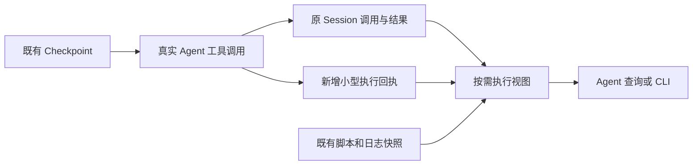
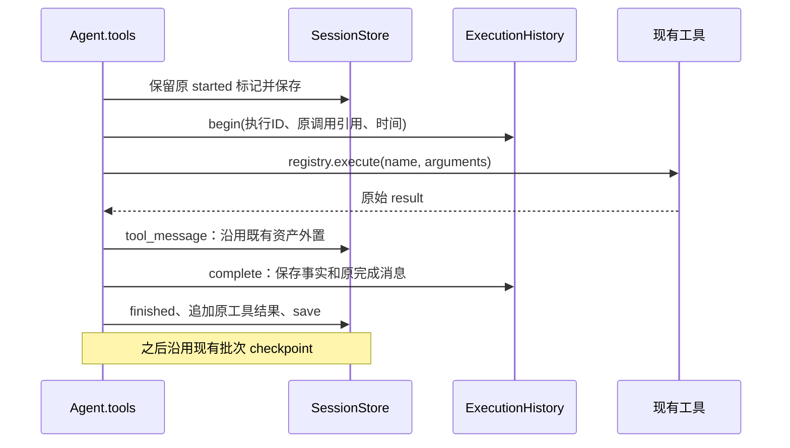

# V8.0：真实执行历史与按需上下文

日期：2026-11-01。设计基线：V7 `5d82e58`。本文保留实施前的详细设计。V8.0 已完成四个切片，实际接口、故障策略与验收结果见 [实施报告](v8.0-execution-history-implementation.md)。V8.1 仍未实施。

配套文档：[V8.1 自主修复](v8.1-autonomous-repair-design.md)。旧调研和旧工作树草案保留；本次开发顺序以这两份文档为准。

## 1. 决策与成功标准

V8.0 给现有 Code Agent 增加一种能力：按工具、脚本、成果路径和错误查回真实执行，取得继续工作的少量必要信息。

实现采用现有 Session 加少量执行回执。暂不新增工作流 SQLite、WorkflowRunner、业务图、人工审批或自动验证。

第一步先从现有 Session 构建只读执行视图。随后在 `Agent.tools` 的真实调用边界自动补时间、执行身份和完成回执。模型无需为普通操作调用 prepare/finish。

验收分两层：

- 工程机制：准确找到调用、参数、代码版本、结果与错误；未知信息明确显示；普通任务的模型响应数保持不变。
- Agent 效果：模型是否更快定位问题、减少探查和重写。这个效果需要后续同任务实测，静态查询测试无法证明。

### 1.1 范围

覆盖当前 Session 中的工具调用。Python 整段脚本对应一次执行；脚本内部十个算法默认仍为一次。标准 QGIS 调用对应一次执行。文件编辑也保留真实调用，查询时可以筛选。

本版提供：

1. 历史查询与分页详情。
2. 自动执行 ID、开始/结束时间、耗时和调用状态。
3. 已有脚本、日志、工具资产与实际输出的关联。
4. CLI 只读历史入口。
5. 为 V8.1 留出明确的记录扩展点。

本版不承诺：恢复任意 Python 内存、复原已覆盖的 GIS 文件、自动推断全部依赖、局部重算、自动缓存、未知写入自动重放。专业核查继续由模型按任务选择。

## 2. 重审旧设计：哪些判断改变了

### 2.1 最可能改变架构的六项发现

| 审查问题 | 源码与证据 | 本次决定 |
| --- | --- | --- |
| 是否已有大部分事实？ | Session 保存完整调用参数，`tool_result` 可展开外置结果；Python 已保存代码和日志 | 先提供检索投影，完整事实继续使用原存储 |
| 是否需要回到旧模型状态？ | Agent 当前可能已知道失败原因；LangGraph 回放会重做后继模型和工具 | 修复默认在当前对话进行，历史只提供证据 |
| 是否需要独立数据库？ | 现有竞赛 Session 为约 1～1.5 MB，工具数约百次 | 当前没有引入第二个 SQLite 的必要；采用小型 JSON 回执 |
| 是否需要自动细分代码？ | 真实脚本常为上百行，很多修复只改 1～3 行 | 保留脚本黑盒，复用现有精确编辑；昂贵边界按需提升 |
| 缓存收益是否已证实？ | 三份竞赛轨迹没有相同成功脚本哈希的直接重复；脚本内重复前缀仍可能存在 | 不根据历史脚本数量推算缓存收益 |
| 记录越多是否越好？ | 模型已有摘要与外置结果；再加入整图和长记录会重复消耗 | 完整历史落盘，查询返回受限片段；不增加常驻执行清单 |

### 2.2 与旧材料的关系

| 原决定 | 处置 | 理由 |
| --- | --- | --- |
| 保留有效上游、修复分支、新目录 | 保留到 V8.1 | 能服务局部纠错 |
| prepare_workflow_step / finish_workflow_step | 删除普通执行要求 | 每步两次管理调用缺少收益依据 |
| fork_workflow | 保留不可覆盖的修订思想，取消独立必调工具 | 创建一次修复时自动形成修订即可 |
| 独立 WorkflowStore SQLite、完整事件状态机 | 推迟 | Session 已有事实，当前没有并发调度与订阅需求 |
| WorkflowRunner 负责所有调用 | 修改 | V8.0 无需新执行器；V8.1 只增加有界的局部重放函数 |
| 每个可继承节点必须有 PASS | 删除 | 执行复用与专业证明分开；不增加逐步核查协议 |
| 子 Agent、review_delivery、候选交付协议 | 舍弃旧接口 | V7.9 后这些接口已删除，不能从 V7.6 草案恢复 |
| Context 压缩、Session、Checkpoint | 直接复用 | 已实现且有回归测试 |
| QGIS 插件、人工持久等待、原生作业控制 | 留到后续切片 | 本次两版先完成历史与局部修复 |

上述调整限定当前两版。此前关于客户端解耦和缓存边界的结论继续有效。

## 3. V7 实现核对

| 文件与符号 | 已有能力 | 实际缺口 |
| --- | --- | --- |
| `agent.py:Agent.tools` | 参数检查、started/finished、串行调用、逐项保存结果 | 没有按执行检索入口；异常中断时只能看到 started |
| `agent.py:Agent.resume/verify_record` | 检查版本与 Session 哈希；拒绝不确定重放 | 它保护技术续跑，无法恢复外部计算状态 |
| `persistence/sessions.py:SessionStore` | 原消息、外置资产、工具批次、usage | 缺少执行时间、简洁执行目录和成果来源索引 |
| `persistence/evidence.py:tool_result` | 展开结果并验证资产哈希 | 应直接复用，不能另写一套不校验的资产读取 |
| `tools/session.py:make_session_tool` | 按消息序号单条读取 | 不支持按脚本、错误或成果定位；不会展开资产 |
| `tools/qgis_python.py:run_python_script` | 快照、真实参数请求文件、日志、退出码、结构化结果 | 执行原脚本；快照无法完整证明运行中未发生瞬时修改；任意 I/O 未声明 |
| `integrations/qgis/script_entry.py` | 还原 argv、脚本目录与项目搜索路径 | 复制快照后直接执行可能改变 `__file__` 和相对路径语义 |
| `integrations/qgis/adapter.py:make_tool/execute_algorithm` | 真实 Schema、输出约束、实际 outputs | JSON Schema 本身没有保留全部 QGIS 输入/目标语义 |
| `tools/files.py:edit_file/search_text` | 唯一替换、版本检查、短 diff | 已足够承担常规代码修复，无需新增 patch 工具 |
| `core/context.py:ContextManager.prepare/project` | 外置结果、摘要、来源、稳定前缀、动态尾部 | 缺少可直接检索执行的工具；压缩算法无需重写 |
| `application.py:Conversation/AgentFactory` | send/resume、依赖组合 | 只读查看应能绕过模型与 Catalog 初始化 |
| `cli.py:chat` | 同步交互及技术恢复 | 无离线历史命令 |
| `core/memory.py:MemoryStore` | 跨 Session 记忆 | 与当前执行事实不同，不将临时错误自动写成长期经验 |

当前控制图仍为 model → tools → model / finish。V8.0 保持图和 `RunState.version=790`；仅增加可选记录字段与查询工具。旧检查点继续按原保护条件恢复。

### 3.1 真实轨迹带来的优先级

本轮只读核对结果位于 `outputs/v80_v81_design_20261101/evidence-audit.json`。

- V7.9.0 缓冲加制图：73 条消息、38 个工具请求、11 次 Python 请求、6 次 edit_file。核查脚本的一次修订只变 3 行，下一次只变 1 行。已有精确补丁路径确实在使用。
- V7.9.2：186 条消息、98 个工具请求、31 次 Python 请求、18 次 edit_file。289 行路网脚本三次相邻修订各变 1 行。不能把“更会修代码”理解成重新开发编辑器。
- V7.9.3 下午：135 条消息、74 个工具请求。`s05_task1c.py` 在三角剖分约 116.67 秒、插值约 436.78 秒后因数组索引失败；这些数值来自原 stdout，阶段时间是累计时间。没有中间持久化时，历史记录无法把已消失的内存结果找回来。
- 后来的 `s08_task1d.py` 使用存在式 `tin_30m.npy` 缓存。它证明模型会主动保存昂贵结果；文件存在无法证明输入、采样政策和代码仍相同。

本轮审计还发现 V7.9.0 后段两次运行使用未变代码，但缓冲成果已重新生成。代码相同不能独立证明可跳过这两次运行。

## 4. 存储职责：复用 Session，补执行回执



Session 继续保存“模型说了什么、调用了什么、工具返回了什么”。执行回执补充“这次调用何时进入执行、耗时多少、关联哪些物理记录”。查询视图从二者生成。

选择文件回执有两个明确原因：执行可能在工具结果进入 Session 前中断；V8.1 一个批处理工具内部会产生多个真实子执行，它们没有各自的模型消息。回执因此有独立事实价值，不能只当可随意丢弃的搜索缓存。

不复制整份 Session、脚本正文、stdout 和大型工具结果。每次回执通过来源引用关联原件。查询列表是派生结果，可以重建。

```text
sessions/<session>.json                         现有
sessions/<session>.assets/tool_results/...      现有
sessions/<session>.assets/executions/
  e000042_00.json                               新增：一次调用回执
outputs/<session>/python_logs/<uuid>/...        现有脚本与日志
```

V8.0 不建设 JSONL 事件总线。每个回执使用现有 `write_json` 原子替换，只有 started → terminal 的单向更新；terminal 后保持只读。原子替换不等于跨文件事务，也不保证突然断电后的所有磁盘数据都已持久化。

## 5. 最小数据模型

### 5.1 执行身份

同一 Session 内用 `e{assistant_index:06d}_{call_slot:02d}`。call_slot 对应原 assistant 的 tool_calls 顺序。ID 不依赖模型自填编号，也不只使用可能跨消息重复的 tool_call_id。

示例 `e000042_00` 指 assistant 消息 42 的第一个调用。修改或裁剪原消息会使来源指纹不匹配，查询报出损坏；本版不支持直接编辑 Session 历史。

V8.1 子执行采用 `r_<repair_id>_s00`。根结果保存 repair_id 与子执行引用，同一修复结果可被多个根查询引用。ID 只定位执行，不表达业务依赖或步骤顺序。

### 5.2 回执示例

```json
{
  "version": 1,
  "execution_id": "e000042_00",
  "origin": "agent_tool",
  "call_ref": {"assistant_index": 42, "call_slot": 0, "tool_call_id": "call_x", "sha256": "<原调用指纹>"},
  "tool": "run_python_script",
  "started_at": "<UTC时间>",
  "finished_at": "<UTC时间或null>",
  "elapsed_ms": 1234.5,
  "state": "succeeded",
  "result_ref": {"tool_message_index": 43, "tool_message_sha256": "<指纹>"},
  "completion_message": {
    "role": "tool", "tool_call_id": "call_x", "tool_name": "run_python_script",
    "execution_id": "e000042_00", "content": "<原有限工具结果>",
    "asset": {"version": 1, "format": "json", "path": "<session>.assets/tool_results/<id>.json", "characters": 12345, "sha256": "<资产指纹>"}
  },
  "facts": {
    "script": {"path": "<原脚本>", "snapshot": "<已有快照>", "sha256": "<已有哈希>", "execution_mode": "original_path"},
    "logs": {"stderr": "<已有路径>", "stdout": "<已有路径>"},
    "inputs": [],
    "outputs": [],
    "dependency_completeness": "unknown"
  }
}
```

completion_message 保存完整原 tool_message 对象；没有 asset 时省略该键。示例中的占位值在执行时替换为真实值。

完成消息只复制有限内容和资产引用，用于保存“结果已返回、Session 尚未配对”的现场。大型结果沿用 `tool_message` 既有外置路径；不再复制原 JSON。完成消息中的输入输出路径来源为实际结果，不把模型声称的路径当已生成成果。

started 回执不含 completion_message。V8.0 查询可以列出 orphan completion，但不能据此自行修补 Session 或推进 Checkpoint。

### 5.3 状态

| state | 判定 |
| --- | --- |
| rejected | JSON、可用工具或协议检查未通过，没有进入 registry；直接从 Session 派生，无需新增开始回执 |
| started | 已保存执行意图；它无法证明子进程已实际启动 |
| succeeded | 工具明确报告 ok=True；只说明工具报告成功 |
| failed | 工具明确报告 ok=False，包括非零退出 |
| returned | 工具正常返回，但结构没有明确成功标记；例如搜索列表 |
| raised | 本机观察到异常并重新抛出；外部副作用仍可能发生 |
| unknown | 重开后只有 started、来源冲突或完成消息不完整，不能判定实际结果 |

配对状态单独派生为 paired / orphan / conflict。文件当前仍存在、输入是否改变、专业结论是否可靠，也单独表示。旧 succeeded 不因文件后来被删而改写成 failed。

历史 V7 记录没有时间时返回 null。缺少可解析结果的旧记录标 unknown，不猜测耗时或默认成功。

## 6. 自动记录流程



实施后的 start 顺序为先 Session.started，再尝试 begin，再执行。关键 Session 写入失败仍停止；辅助 begin/complete 写入失败告警后继续，不降低原 V7 可用性。缺少回执的执行仍可从完整 Session 回查，时间缺失保持未知。此策略调整的测试依据见实施报告。

在 complete 写入前，保留现有 search_qgis_tools 的候选更新与 finish_task 的 accept_finish 逻辑。保存模型实际收到的最终工具消息，不因记录功能改变这些状态转换。

意外异常只在真实执行边界记录异常类型、短诊断和时间，随后原样抛出。记录失败也显式暴露；不得吞掉错误、改返回码或触发自动重试。进程被强杀时无法运行异常处理，重开后保留 unknown。

异常 traceback 较长时保存到同一 executions 目录的 `<execution_id>.traceback.txt`，回执保存路径和哈希。只记录异常栈，不转储局部变量和整个环境。执行记录沿用 Session 的本机私有范围，不自动进入长期记忆或 Git。

不对 history 查询结果再次全文建搜索索引。查询固定在调用开始时的历史快照，避免将本次查询的 started 记录和返回内容循环收录。

## 7. 两种执行通道如何记录

### 7.1 标准 QGIS

原调用参数是第一事实。实际输出采用 `QGISClient.execute` 返回的 outputs；不猜测图层名。省略参数保留 omitted 状态，记录工具定义指纹；不能把当前默认值冒充当时实际值。

建议给 `Tool` 增加可选内部字段 `execution_metadata: dict | None = None`，仅在动态 QGIS `make_tool` 填入：algorithm_id、参数 QGIS 类型、destination 参数名和定义指纹。这个字段不进入 `Tool.schema()`。四个现有位置参数和 run/execute 接口保持兼容。

它解决 JSON Schema 无法准确表达 QGIS source/destination 语义的问题。不能通过读中文 description 或反射 partial 的私有结构判断输入。若暂未加入该字段，首个切片可以只记录原参数和实际 outputs，输入语义标 unknown。

source 参数可能是 URL、数据库、项目图层或表达式。仅将能够可靠解析的本地文件记为 known reference，其余保留不完整标记。参数中出现字符串路径仅形成线索，不形成已证明依赖。

### 7.2 自由 Python

复用已有 script_snapshot、script_sha256、request.json、stdout/stderr 和 result_path。arguments 从原真实调用与 request.json 互相核对。快照缺失时返回缺失状态，不能自动拿当前脚本替代历史版本。

执行器目前运行原脚本，cwd 为脚本目录。V8.0 不改变此行为。记录 `execution_mode=original_path`，并保留 script_changed；原路径前后哈希相同也不能证明进程期间未发生改写。

结构化 result 中的路径可以列为 reported output；stat 只说明当前观察到文件。stderr 中提到的路径不自动成为输入。静态扫描或 AST 只可辅助检索，不自动标 dependency_completeness=complete。

如果进程异常未返回正常字典，日志和快照可能已存在，但 Agent 尚未得到它们的确定路径。本版不能保证把该孤立日志目录准确关联到调用。按时间找到的目录只作 candidate，后续受控重放再补明确执行目录。

### 7.3 文件编辑与输入版本

write_file/edit_file 的结果已有 path、previous_sha256、sha256、diff。按相同路径和哈希连接编辑与运行快照，可显示“这次修改之后运行了哪个版本”。这类连接表示代码版本关系，不推导 GIS 数据流。

V8.0 默认不哈希全部 GIS 输入输出，也不复制大数据。回执中的文件观察包含路径、大小、mtime 和来源；`content_sha256` 只有实际测量或既有回执提供时填写。stat 无法证明历史版本；查询必须带 observation_time 和 identity_strength。

## 8. Agent 查询接口

只新增一个工具 `execution_history`，同时承担列表和详情。已有 `read_session_messages` 继续用于用户原话；`read_file`、`search_text` 用于原文件详情。

```python
def execution_history(
    execution_id: str | None = None,
    query: str | None = None,
    tool: str | None = None,
    status: str | None = None,
    offset: int = 0,
    limit: int = 5,
    section: str = "summary",
    cursor: int = 0,
    max_characters: int = 4000,
) -> dict: ...
```

- execution_id 有值时读取一个执行；其他条件用于检索。
- section：summary / arguments / result / error / links。长内容以 cursor 分页，最大 8000 字符。
- query 使用大小写折叠后的字面量词匹配，优先级为准确执行 ID、脚本/成果路径、工具名、错误尾部。暂不做 embedding、语义搜索和全文日志扫描。
- 多个过滤条件取交集。列表默认倒序；limit=1～20。默认排除普通 history/read/list 控制噪声，显式 tool 过滤可查看。
- 相同路径前后多次执行全部保留。不能用路径相同折叠不同代码版本。
- 先返回覆盖范围及结果总数，不静默截掉唯一相关项。不能确定依赖时明确说明。

```json
{
  "ok": true,
  "matches": 2,
  "items": [{
    "execution_id": "e000032_00",
    "tool": "run_python_script",
    "status": "failed",
    "script": "<work>/verify.py",
    "error": "AttributeError: <实际异常末行>",
    "code_sha256": "<快照指纹>",
    "previous_same_script": "e000028_00",
    "sources": {"assistant_index": 32, "tool_message_index": 33},
    "dependency_completeness": "unknown"
  }],
  "next_offset": null
}
```

这能把“刚才哪个核查脚本失败”转为一次查询。它没有代替模型判断异常原因。

最短使用方式：当前错误已包含脚本和行号时直接 edit_file；错误关联早期步骤、结果来源丢失或上下文已压缩时才查询历史。不要求每次失败先查历史。

## 9. Context 与 CLI

### 9.1 ContextManager

不修改摘要算法、Memory、tokenizer 和已有历史边界。查询结果作为普通工具消息，沿用外置和投影。

回执 ID 放入工具消息的本地元数据 `execution_id`，`SessionStore.project` 仍过滤该额外字段。普通成功结果不自动包一层新 JSON，也不改变现有 outputs/result 访问方式。

为让模型知道入口，只增加工具描述；首次接入可在 System 中加一条短说明：“需要定位早期执行、代码版本或错误时，按需查询 execution_history；已有信息充分时直接继续。”这属于未来实施建议，本轮不改真实 Prompt。

首版不持续注入最近执行列表。查询会返回 ID；没有 ID 时可以按工具、路径或错误查找。若真实测试证明反复找不到最近失败，再单独评估短失败链接，不预先加入常驻摘要。

### 9.2 CLI

```powershell
python main.py chat --session demo
python main.py history --session demo --limit 5
python main.py history --session demo --query dem --status failed
python main.py history --session demo --execution e000042_00 --section arguments
```

注意 Typer 当前只有 chat 一个命令，单命令模式会折叠命令名。新增 history 后，上述命令名才成为正式语法；实施时同步检查 `main.py --help` 和 `main.py chat --help`，更新实际启动说明。不要无意让旧启动器失效。为旧的无子命令 chat 调用提供一个小兼容入口，或在本版明确迁移并同步所有仓库调用方；首选保留兼容。

history 直接创建 SessionStore 和执行视图，不经过 open_conversation，不加载 API Key、tokenizer、QGIS Catalog 或 Memory。它允许查看未完成批次，但不调用 `SessionStore.load()` 强行要求批次完整；只读诊断不能被现场的不完整批次挡住。

目录解析可复用 `config.py:configured_path`，只读取 project/session_root 所需路径，不构造会检查 QGIS 启动器的完整 AppConfig。Typer 兼容建议使用带 invoke_without_command 的根 callback 承接原 project/session 选项；只有没有子命令时调用 chat。以实际旧调用方式做 CliRunner 回归后再确定最终写法。

## 10. 文件与内部接口

| 位置 | 新增/修改 | 为什么需要 |
| --- | --- | --- |
| `persistence/executions.py` | 新增 `ExecutionHistory`：派生列表、回执读写、来源校验 | 现有按序号读取无法完成检索，也缺少调用时间；不另拆索引、仓储、服务三层 |
| `tools/history.py` | 新增一个薄工具定义 | 向现有注册表提供受限查询；它不运行 GIS |
| `agent.py:Agent.tools` | 自动 begin/complete、执行 ID | 只有这里同时知道真实调用、原消息位置和最终工具消息 |
| `application.py:AgentFactory.create` | 组合 history；历史工具加入基础集合 | 沿用现有依赖组合，不创建新 Agent |
| `tools/base.py:Tool`、`qgis/adapter.py:make_tool` | 第二阶段才加可选内部 QGIS 执行元信息 | 保留真实 source/destination 语义，不扩展模型 Schema |
| `cli.py` | history 只读命令与 chat 兼容 | 用户无需启动模型即可看现场 |
| `tests/test_execution_history.py` | 新增相关离线测试 | 覆盖定位、资产、部分批次与低开销 |

内部签名草案：

```python
@dataclass
class ExecutionHistory:
    store: SessionStore

    def rows(self) -> list[dict]: ...
    def begin(self, assistant_index: int, slot: int, metadata: dict | None = None) -> str: ...
    def complete(self, execution_id: str, tool_message: dict, elapsed_ms: float) -> None: ...
    def raised(self, execution_id: str, error: Exception, elapsed_ms: float) -> None: ...
    def query(self, **filters) -> dict: ...
```

rows 对旧 Session 只派生，不补写历史。读取大结果用 `tool_result`，读取脚本/日志用已有路径与摘要限长。进程内可按 SessionStore 的本次 save 代数缓存派生列表；第一版直接重建也可以。不要凭 mtime 相同长期信任索引。

调用与工具消息采用一次线性扫描配对，按 assistant 批次区分相同 call_id。列表先用工具名和参数路径筛选，再按需展开匹配结果；禁止每次查询都全文读取全部 stdout。查询复杂度与候选数、资产读取量一起测量。

诊断列表读取原 Session JSON 并检查顶层形态，再按需展开匹配项。`read_record()` 目前会先检查全部资产是否存在；不能让某个不相关资产丢失挡住全部诊断。列表将该项标为 missing/corrupt，详情仍沿用 tool_result 的强校验。SessionStore.load 的严格行为保持。

Agent 可选新增 `history: ExecutionHistory | None = None`，放在现有默认字段之后。AgentFactory 注入同一个实例；旧测试或外部构造方不传时仍走原流程。Tool 的可选内部字段同样放在四个现有参数之后，不改变旧位置参数。

begin 重复 ID 且来源相同可回读；来源不同报冲突。它不返回“应重新执行”。是否调用工具始终由现有 Agent 流程决定。

## 11. 中断与异常矩阵

| 边界 | 应看到什么 | V8.0 行为 |
| --- | --- | --- |
| Session.started 后、begin 前 | 旧执行标记但无回执 | unknown，不自动运行 |
| begin 后、进入工具前 | 意图存在 | 无法仅靠该记录证明未执行 |
| 子进程运行或已写部分文件 | started，可能已有日志 | 保留现场，不把文件存在当完成 |
| 工具抛异常 | raised 和原异常；硬杀时可能只有 started | 继续沿用 V7 拒绝不确定重放 |
| 完成回执保存后、Session 结果前 | orphan completion | 允许只读查回；V8.0 不修补历史 |
| Session 已完整、Checkpoint 落后 | 可能 verify_record 失败 | 原保护保持；V8.1 只对受控局部重放提供窄恢复 |
| 日志或资产被修改 | 哈希不符 | 报 corrupt；不悄悄使用当前文件替代 |

## 12. 逐步实施与免费验收

每个切片独立提交，相关实现和测试一起回退。运行产物不会因 Git revert 自动删除。

### 切片 0：只读历史

**第一处代码：新增 `persistence/executions.py` 的 `ExecutionHistory.rows()`。** 从已有 Session 的 assistant/tool 配对生成执行行。此时不改 Agent，也不新增写入。

用旧失败快照制作小型临时 Session，测试同消息多调用、跨消息重复 call_id、外置结果、错误检索、未完成批次。只复制最小结构，不将竞赛数据或敏感路径提交测试。

验收：返回准确原参数和源位置；`SessionStore.project`、message_units 及现有 resume 行为完全不变。

### 切片 1：自动回执

在 `Agent.tools` 现有 registry.execute 边界加入 begin/complete。ToolRegistry.execute 与工具返回原结构保持。异常诊断记录后重新抛出。

用固定模型回复序列隔离模型，执行真实小文件写入和读取。对比关闭/启用历史的同一任务：模型回复数、工具次数、最终结果相同。故障注入只用于存储边界，证明写入后崩溃不会自动重放。

### 切片 2：QGIS 与 Python 关联

增加内部 QGIS 元信息，引用已有 Python 快照、request 和日志；使用临时 GeoPackage 与小型 GeoTIFF，记录实际文件。输入输出只做已声明的轻量观察，默认不新增全量哈希。

验收快照和源码被修改后仍能区分历史版本；缺失资产与原脚本瞬时修改的能力边界准确；未知路径不被伪装为完整依赖。

### 切片 3：Agent 与 CLI 可用

注册唯一查询工具，列入 PASSIVE_TOOLS。CLI history 在没有 API Key 和 QGIS 启动器时也能读已有 Session；保持 chat 启动兼容。模拟 Context 压缩后仍能按脚本/错误回查，不重新发送完整 Session。

### 必要回归

1. `test_v6_result_archive_and_schema_budget`、`test_v6_summary_cache_and_original_message_readback`。
2. `test_sqlite_resume_protects_version_and_tool_results`、`test_v71_uncertain_tool_execution_is_not_replayed`。
3. `test_single_agent_buffer_can_finish_and_read_only_question_can_answer` 的固定回复版本；仍为原来的四次回复。
4. 工具原返回为 list、dict、ok=False、异常四条路径，确认不改变模型可见结构。
5. 工具调用 JSON 被截断时没有 begin、没有物理执行；保留原拒绝行为。
6. 两个完成消息资产相同不重复复制；query 不能读取任意 Session 之外的资产。

未来实施运行 `python -m pytest tests -k "not live"`，并核对本地 pytest fixture 不连接外部模型。当前设计轮不运行应用回归。

## 13. 开销与可证伪目标

模型侧新增一个短工具 Schema。普通任务无需调用它；自动记录不产生新模型请求。查询仍会消耗一次或多次响应，必须把它计入修复成本。

本地开销包括两次小 JSON 替换、有限来源校验和列表构建。默认不读完整日志、不扫描全部输出目录、不哈希大 GIS 文件。100 次执行的回执体积应与小型元信息同量级；不把 Session 大结果复制 100 次。

先记录真实值，再调整预算。建议首轮警戒值：本地元信息额外写入每调用不超过 16 KB（原结果资产除外）；1000 条执行的列表查询 p95 小于 200 ms；普通小型 GIS 任务额外墙钟低于 5% 或 50 ms/调用，以较宽者作诊断阈值。它们是拟定验收阈值，尚无产品测量。

本轮审计脚本中的内存过滤微秒值只测已构建 Python 列表，不含 Session 读取、资产校验和模型往返，不能作为上述性能证明。

如果真实任务几乎不需要回查，V8.0 可能只有可观测性收益。如果模型反复查询相同内容，费用可能上涨。V8.1 需要用局部修复把可查信息转为可执行行动。

## 14. 外部依据与下一步

本轮只补查影响取舍的资料，没有重做 GIS 论文综述。

- [SWE-agent ACI](https://github.com/SWE-agent/SWE-agent/blob/main/docs/background/aci.md)：工具交互形态影响修复效率。项目已具备精确编辑，应优先补历史定位。
- [SWE-agent trajectory inspector](https://swe-agent.com/latest/usage/inspector/)：执行轨迹可用于诊断；查看轨迹和模型自主使用轨迹需要分别评价。
- [Anthropic Context Engineering](https://www.anthropic.com/research/effective-context-engineering-for-ai-agents)：采用按需读取与精简上下文；本项目已有摘要，不重复建设。
- [LangGraph Persistence](https://docs.langchain.com/oss/python/langgraph/persistence)、[Time travel](https://docs.langchain.com/oss/python/langgraph/use-time-travel)：Checkpoint 管理线程状态，回放会执行后继调用。

以上资料在 2026-11-01 访问。源码事实与历史轨迹支持“先可检索”的优先级；模型成本与自主完成率收益仍待实验。首个编码任务仅为切片 0，完成后再接自动记录。

### 本轮已经完成的免费检查

`outputs/v80_v81_design_20261101/static-probes.json` 记录 6 项现有行为检查：外置结果可准确读取、额外元信息被模型投影过滤、不完整 Session 可只读查看、不完整工具批次仍被拒绝、现有 edit_file 可在副本上修补、CLI help 不启动模型。六项通过。

本机核对为 LangGraph 1.2.18、SQLite saver 3.1.2、Typer 0.27.3。上述检查只验证复用基础；尚未实现本文的查询、回执和 CLI 新命令，也没有执行 V8 产品测试或收费模型任务。
