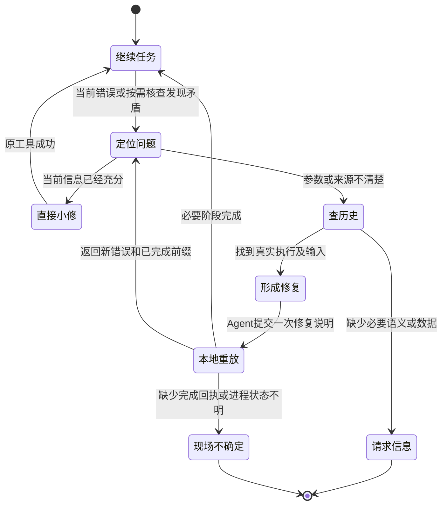
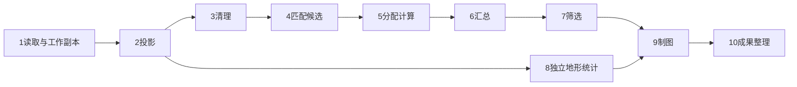

# V8.1：自主纠错与局部重放

日期：2026-11-01。基线：V7 `5d82e58` 与待实现的 [V8.0 执行历史](v8.0-execution-history-design.md)。状态：详细设计，未实现、未做真实模型测试。

本文将“局部重放”限定为重新执行必要的外部计算。在当前对话保留模型已有认识，使用历史事实修订代码或参数，再继续原任务。

## 1. 本版到底增加什么

新增一个可选行动入口 `local_replay`。Agent 可一次提交小型修复说明：要修哪个真实执行、改哪些参数或代码、使用哪些已存在输入、重算哪些明确依赖的阶段。

程序保存修订、分配新目录、核对输入、应用精确补丁，并连续执行已有定义的必要阶段。每个阶段复用现有 QGIS/Python 通道，返回一份短结果。阶段之间无需模型请求。

普通执行继续使用直接 QGIS 工具与自由 Python。没有重复计算价值、错误原因已经明确的短脚本，可以直接用原 edit_file 和 run_python_script 修复。local_replay 不成为每次错误的必经入口。

### 1.1 成功标准

1. 一个已知三阶段流程中修正中间参数，上游保留，相关后继重算，新结果与完整重算相符。
2. 模拟单 Agent 能根据工具反馈主动查历史并发起修复，无需用户指定出错节点。
3. 修复代码与旧成果保持可读，新尝试不覆盖旧版本。
4. 对不完整依赖、部分文件和未知副作用，返回明确边界，不伪称自动恢复。
5. 确定性计算不增加逐阶段模型请求；记录全部管理、查找和重放成本。

第 2 项的固定回复测试只能证明接口闭环。模型是否真正更善于定位问题，仍需真实任务对照。

### 1.2 本版不做的工作

不做全任务规划器、自动 AST 拆图、任意函数内存恢复、自动回放旧 LLM 决策、自动多分支搜索、独立审核模型、GIS 专业规则引擎和逐步 PASS 审批。

本版也不承诺运行中任意暂停、原生作业安全取消、CLI 关闭后后台持续运行、正式 QGIS 插件。长作业仍按现有同步调用工作；状态不确定时保留现场。进程控制需要单独切片。

## 2. 对 V8.0 的依赖

V8.0 必须先提供：稳定执行 ID、实际调用参数引用、结果资产读取、脚本和日志链接、开始与完成回执、来源校验、未知状态及历史查询。

V8.1 扩展 V8.0 回执，不重建 Session：

- origin 增加 `replay_child`，通过 repair_id 与根结果中的引用关联真实根工具执行。
- 受控子执行补充真实参数、冻结代码、声明输入的内容身份和具名输出。
- 多个子执行由一个 root 结果汇总。子执行不伪装为模型调用，不向 Session 插入没有 assistant 对应的 tool 消息。
- 原 Session 中只有一个 local_replay 调用及其一个结果；详细子执行回执在原 executions 目录中。

没有独立 WorkflowRunner 类，没有新增 SQLite。增加一个小型 `core/replay.py` 模块，其中用普通函数组合依赖检查和现有执行器。这个组合逻辑确实需要编写；现有 registry.execute 只运行一次工具，不会绑定多阶段新输出或保留修订。

## 3. 当前上下文与历史状态

| 对象 | 本版用途 |
| --- | --- |
| Session | 保留原要求、已知原因、实际往返；修复追加到当前 Session |
| LLM 当前上下文 | 继续利用已获得的认识；只回查必要事实 |
| Context 摘要 | 仍由原 ContextManager 管理；修复结果是正常工具结果 |
| LangGraph Checkpoint | 继续当前 model/tools 控制图，恢复程序执行边界 |
| 执行回执 | 定位真实调用和确认哪个外部尝试完成 |
| 代码快照 | 作为修订源，支持小补丁；无法代替输入数据快照 |
| GIS 成果版本 | 记录具体物理文件，复用前重新核对 |
| 修复说明 | 只描述此次选定阶段的依赖与变更，不冒充完整任务 DAG |

发现第 5 步错误时，默认保留第 10 步时的认识，查回第 5 步资料。回到过去 checkpoint 会重新触发后继模型/API，且不会把外部文件自动还原。[LangGraph Time travel](https://docs.langchain.com/oss/python/langgraph/use-time-travel)

回放旧模型状态仅适合单独研究“不同历史决策”的离线实验。它不进入正常局部修复 API。

## 4. 自主修复的状态过程



这些是应用行为说明，不新增一个对应的 LangGraph 状态节点集合。Agent 仍在原 model/tools 往返中行动。

### 4.1 什么时候查历史

适用信号包括：结果与原要求矛盾、下游字段与上游不一致、找不到中间成果来源、当前脚本已经多次修改、同一个错误再次出现且缺少新诊断。

普通 SyntaxError、明确 traceback 或已知参数拼写错误可直接修。是否需要查历史由模型判断。工具返回失败不会自动召唤反思模型。

查询顺序采用最小信息：准确执行 ID 或脚本/成果路径 → 真实参数与错误末段 → 必要代码片段和相邻版本。不要先读取整份 Session。

### 4.2 避免无变化重试

修复回执保存参数/代码指纹和错误指纹。同一个 repair_id 与相同说明重复提交时回读原结果，包含 failed 结果；不偷偷再次启动计算。

模型要再试，需生成新的 repair_id，并提供发生变化的补丁、参数、输入或诊断理由。暂不设置固定最大尝试数。完全相同的失败签名可返回上次结果和“无新变化”的提示，仍允许模型说明外部条件已改变后显式重试。

错误指纹只作诊断，不用于判断业务等价。不同数据触发相同异常不能自动合并。

### 4.3 何时询问人

本版沿用 finish_task(needs_input)，问题应包含已有证据、缺少信息和可继续部分。没有可靠配准对应关系、业务归属政策缺失等可以询问。字段拼写和普通代码错误优先自主处理。

持久人工等待和独立分支继续执行放到后续版本。本版不把 needs_input 宣称为已实现的 interrupt/resume 人机协议。

## 5. 最小修复数据模型

只引入三个短数据形态，初期同放 `core/replay.py`，不为它们拆仓储或服务。

```python
@dataclass(frozen=True)
class ReplayStep:
    step_id: str
    source_execution: str
    inputs: dict
    changes: dict
    outputs: dict[str, str]

@dataclass(frozen=True)
class RepairPlan:
    repair_id: str
    parent_repair: str | None
    reason: str
    steps: tuple[ReplayStep, ...]
    targets: tuple[str, ...]
    accepted_inputs: dict

def replay(plan: RepairPlan, history: ExecutionHistory,
           execute: Callable, output_dir: Path) -> dict: ...
```

source_execution 指真实历史调用，不要求模型重写标准算法的完整定义。changes 可覆盖现有 QGIS 参数、脚本 argv、精确补丁或新脚本引用。类型互斥检查在本地进行，不能将 Python 补丁用于 QGIS 节点。

每个步骤可以多个输出。所有声明输出齐备后才发布该阶段的完成回执。执行成功与当前数据仍可用分开保存；专业判断与抽查可在普通工具结果中保留，不新增质量审批表。

子回执使用 V8.0 的 version=1 和 origin=replay_child 扩展：`repair_id`、`step_id`、`resolved_call`、`signature`、`input_versions`、`output_versions`。ID 采用 `r_<repair_id>_s00`。resolved_call 保存真正传给执行器的参数。它没有虚构的 Session tool_message_index；结果通过同一资产目录的 JSON 引用或小型内联结果保存。completion_message 仅用于实际根工具调用。

这样 replay 函数只需显式接收 plan/history/execute/output_dir。无需借全局变量取得当前 Agent tool_call_id，也无需改变 ToolRegistry.execute 的签名。根工具返回的 repair_id 和 execution_refs 建立关联；重复查询相同 repair 的新调用引用同一批子记录。

最小文件版本形态为：`{"path":"<绝对路径>","sha256":"<内容哈希>","size":123,"selector":{"layer":"<层名>"},"captured_at":"<UTC>","producer_execution":"<ID或null>"}`。普通 stat 观察不能放进这里冒充内容版本；旧观察仍保留在 V8.0 facts 中。

## 6. 唯一新增 Agent 行动接口

```python
def local_replay(plan: dict) -> dict: ...
```

接口接收实际 JSON 对象。它在本地冻结说明并执行，无需模型先调用 prepare，也无需 finish。短计划直接放入调用，避免为管理文件多一次模型请求。CLI 离线重放可以从 JSON 文件读取同一对象。

首次 Schema 仅允许下面的有界结构：

- repair_id：1～40 个字母、数字、下划线或横线。
- parent_repair：可选，已有修复 ID。
- reason：短说明。
- accepted_inputs：已存在输入的具名引用及采用理由。
- steps：非空，step_id 唯一；source_execution 必须可读取。
- targets：本次要求完成的 step_id。
- steps.inputs：具名绑定，引用 accepted_inputs 或本次其他步骤的具名输出。
- steps.changes：QGIS parameter_overrides；或 Python 的 patches/candidate_script 与 job_parameters。patches 与 candidate_script 互斥。
- steps.outputs：输出参数/端口名 → 新目录下相对文件名。

请求大小沿用现有上下文和工具结果预算。首次只用小型子图验收，不额外规定全任务的步骤数或模型响应数。

所有静态检查先于 GIS 启动：拒绝重复 ID、自环/循环、不存在的输入端口、缺少 target、重复目标路径，以及逃出本次目录的输出。先求 targets 的依赖闭包，再执行；不能只按模型提交的列表顺序猜依赖。

### 6.1 三阶段修正调用

```json
{
  "repair_id": "buffer_fix_1",
  "parent_repair": null,
  "reason": "原要求500米，历史缓冲调用实际为50米",
  "accepted_inputs": {
    "projected": {"execution_id": "e000010_00", "output": "OUTPUT", "adopt_current": true, "reason": "采用当前已读取的投影副本"},
    "districts": {"path": "<input>/districts.gpkg", "layer": "districts"}
  },
  "steps": [
    {
      "step_id": "buffer",
      "source_execution": "e000014_00",
      "inputs": {"INPUT": {"accepted": "projected"}},
      "changes": {"parameter_overrides": {"DISTANCE": 500}},
      "outputs": {"OUTPUT": "buffer.gpkg"}
    },
    {
      "step_id": "overlay",
      "source_execution": "e000018_00",
      "inputs": {"INPUT": {"step": "buffer", "output": "OUTPUT"}, "OVERLAY": {"accepted": "districts"}},
      "changes": {},
      "outputs": {"OUTPUT": "overlay.gpkg"}
    }
  ],
  "targets": ["overlay"]
}
```

工具以实际 Schema 检查 source_execution 的算法、参数与目标项。解析后真实调用为原参数合并 changes，再覆盖已绑定的输入和新输出。禁止 changes 同时给已绑定的 INPUT 或 OUTPUT 另一个值；冲突必须明确报错。

原来未显式传入的默认参数，在首次提升时按当前定义物化为有效配置，并记录“首次提升采用当前默认”。它不能冒充当时省略参数的历史值。已生成的受控配置下次重放不随新默认偷偷变化。

若算法定义已经变化或 source_execution 对应 Schema 不可用，返回 needs_revision。模型可以另选算法；程序不猜替代。

根结果的固定字段为 `ok/status/repair_id/completed/reused/failed/pending/outputs/execution_refs`。outputs 以 step_id 再按端口索引实际路径。完整参数、补丁和日志留在回执。status 取 completed / partial / failed / unknown / needs_revision；这是工具结果状态，不直接设置 finish_task 或整个 Session 的 outcome。

local_replay 在一个 assistant 批次中单独调用。这使 10.4 节的窄恢复可验证。计划直接放在调用参数中，多个 GIS 阶段在该调用内部连续执行，模型无需为它们另交管理请求。

## 7. 依赖从哪里来

### 7.1 三种可靠程度

| 级别 | 来源 | 可做什么 |
| --- | --- | --- |
| observed | 调用参数、工具报告路径、代码文本中的线索 | 定位问题、提出依赖候选；不自动宣称覆盖所有下游 |
| declared | Agent 对此次修复明确绑定输入/输出，程序核对路径和类型 | 在选定子图内执行、失效和继承；信任其声明完整性 |
| controlled | 声明的本地输入已固定、代码冻结、输出独占、环境与辅助依赖已记录 | 在明确假设下复用受控计算和恢复完成回执 |

这些是工程范围标记。自由 Python 的声明完整性无法由程序普遍证明。没有操作系统沙箱时，程序也无法保证代码绝不读写未声明路径。

标准 QGIS 可从真实 source/multilayer/destination 类型得到较好的输入输出候选，但项目变量、表达式、外部脚本和数据库仍可能引入额外依赖。首版只接收受限的本地文件算法子集，其他调用继续走自由路径。

### 7.2 下游失效规则

对已声明子图，修改节点及其可达后继全部进入本次重算集合。共享上游和无关分支保留。多输出节点首次按节点整体失效，不推断哪个字段只影响哪个端口。

对普通历史，只列出观察到的消费者，不承诺全部消费者。若第 7 步 opaque Python 可能还读取第 5 步文件，程序返回 `dependency_coverage=incomplete`，由模型补读代码、声明边界或保守扩大修复范围。

未知依赖不能被处理成“没有依赖”。自动重放停止在第一个无法明确绑定输入的阶段，返回已完成前缀和待澄清范围；其他自由任务仍可继续。

```python
affected = descendants(changed_steps, declared_edges) | changed_steps
ready = topological_order(target_closure)
for step in ready:
    bindings = resolve_inputs(step)
    if not bindings.complete:
        return partial_result("needs_revision", step)
    if matches_successful_receipt(step, bindings):
        reuse_outputs(step)
    else:
        execute_one_in_new_directory(step, bindings)
```

这是待实现的核心伪代码。流程只遍历选定子图，不调用模型，不调度全任务。

## 8. 数据版本与可复用边界

### 8.1 V8.0 历史能证明到哪里

V8.0 默认未对全部 GIS 数据做历史哈希，也未复制中间成果。它记录路径与来源，无法普遍证明“当前文件仍是第 4 步当时的版本”。

首次把旧成果提升为修复输入时：

1. 查回对应真实调用及结果；核对当前文件与记录的基本事实。
2. 若已有完成时内容指纹，重新核对相同版本。
3. 若只有路径/stat，由模型明确采用当前文件，记录 adopt_current 与理由。
4. 固定当前输入版本和指纹，标 `historical_identity=unverified`，从这个时间开始建立受控版本。

这属于采用当前已存在数据，不能记为“历史计算缓存已验证命中”。若原文件已覆盖且无副本，V8.1 不能找回过去内容；需要重新取得输入或重算。

adopt_current 仅在首次提升不充分历史时使用，不成为每步审批。专业适用性仍由模型结合已有事实判断。

### 8.2 首版支持的数据

只支持关闭的本地 GeoPackage、单文件且自包含的 GeoTIFF、普通 JSON/CSV/NPY 和 UTF-8 脚本。输入引用保留图层/波段等选择器。活动 GPKG、数据库、网络源、VRT、未保存图层和包含未管理 sidecar 的栅格不自动复用。

Shapefile 原始输入可以先通过现有能力产生工作 GPKG；首版缓存机制不顺带建设全格式数据版本系统。

关闭 GPKG 按全文件加 layer/filter 选择器核对。任何层变化保守失效。发现 WAL/SHM 或无法确认写入状态时拒绝封存，不能只对主文件哈希。[SQLite WAL](https://www.sqlite.org/wal.html)

GeoTIFF 需要确认 mask、aux、worldfile 等外部依赖。首版无法确认自包含时不自动缓存，可先生成独立工作副本。CRS、NoData、transform、波段和选择窗口进入输入身份。

### 8.3 保留版本

```text
outputs/<session>/repairs/<repair_id>/
  plan.json                     冻结的本次说明
  code/<step_id>/script.py       修正版主代码
  inputs/...                    必要输入工作副本或引用清单
  attempts/<step_id>/<attempt>/
    request.json
    buffer.gpkg / dem.tif / ...
    stdout.txt / stderr.txt
    result.json
```

执行回执继续位于 Session 的 executions 目录，以上输出目录保存实际计算材料。plan 引用对应回执，不复制第二份完整调用日志。

小型可变外部输入先复制至该修订目录并哈希。大的受管理上游成果可以引用旧 attempt 路径，使用前后核对内容；单宿主不修改该旧路径。检测到运行中变化时，新输出不发布为可复用成功版本。

这是一种可信本机代码约定。外部进程仍可修改文件，哈希前后检查无法检测所有瞬时改写。若任务要求更强保证，应复制输入或使用真正的只读快照；本版不宣称沙箱隔离。

### 8.4 复用签名

同一受控阶段的候选键包括：

`算法/冻结主代码 + 显式辅助代码 + 规范化有效参数 + 具名输入内容指纹及选择器 + 相关运行环境 + 固定随机策略`

输出目录、执行时间、repair_id 不进入内容键。输出端口名进入配置。省略参数和 null 不混同；JSON key 排序不改变数组次序。路径映射按具名输入处理，不能对任意代码做全局字符串替换。

缓存只在当前 Session 的 repair 家族内查找，且要求：完整成功回执、全部输出仍相符、实现和输入相同、依赖声明覆盖所需范围、没有未知外部副作用。一次失败 attempt 不成为缓存命中源。

环境记录解释器、启动器、QGIS/GDAL/PROJ/GEOS 和实际依赖库版本、项目助手指纹。首次受控运行探测一次并复用；环境发生变化或无法确认时关闭自动复用。相同版本号不能证明所有二进制相同，因此首版限同一受管理本机环境；不承诺跨机器可复现。

这里不要求每个产物先有专业 PASS。已知某版本方法错误时，模型修订对应阶段；调用相同算法的可重复性不证明业务语义正确。

## 9. 自由 Python 如何执行和修补

### 9.1 黑盒脚本

普通 500 行脚本仍直接运行，V8.0 记录一次。若没有可用中间数据，后段失败通常需要整体重新执行。仅靠代码快照无法跳过已消失的前段内存。

如果中间 DEM 已落盘，模型可以读取历史与代码，确认适用范围，写一个只处理后段的脚本。此时复用已有文件，不要求预先把原脚本拆成所有算法节点。

### 9.2 最小补丁

local_replay 可接受：

```json
{
  "patches": [{
    "expected_sha256": "<被选历史脚本的指纹>",
    "old_text": "<完整且唯一的出错片段>",
    "new_text": "<修正片段>"
  }]
}
```

程序将源快照复制到新 code 目录，再调用现有 edit_file 对副本应用补丁。expected_sha256 每个补丁按连续版本核对；多个补丁时后续可省略 expected_sha256，由程序在同一受控副本上顺序执行，任何非唯一匹配都停止。旧脚本不修改。

对代码已经在当前工作文件中修好的情况，接受 candidate_script 引用并冻结。这样不要求模型重复输出整份脚本。对于复杂重写，模型仍可以使用 write_file 生成新实现。

### 9.3 可重放脚本的轻契约

自动绑定多阶段输入时，Python 接受一个明确 job JSON，其输入、参数、输出使用绝对路径。脚本通过 sys.argv[1] 读取，向现有 GIS_AGENT_RESULT_PATH 写普通 JSON。

```json
{
  "inputs": {"dem": "<固定输入>/dem.tif"},
  "parameters": {"water_level": "<任务实际值>"},
  "outputs": {"result": "<新attempt>/result.gpkg"}
}
```

这个 job 只传递资源和参数。任意方法仍在自由 Python 中实现。

受控通道执行冻结后的代码，cwd 为新 attempt 的工作目录。它与旧 run_python_script 的原路径模式明确区分。脚本若依赖原目录的 `__file__`、相对路径、旁置配置或动态 import，必须显式外置/复制依赖后才可提升；程序不静默改这些语义。

job_parameters 只能修改该脚本实际读取的 job 参数。原脚本若没有 job 接口，模型需先提供适配补丁或 candidate_script；程序不能根据新参数自动改写原脚本常量。任意 argv 脚本仍可以通过原 run_python_script 自由运行，首版不承诺自动重绑任意 argv 的文件路径。

首版可重放脚本限主脚本、显式 job 和已声明的本地辅助文件。复杂插件、动态环境和不可确定的数据库读取继续走普通自由通道。默认外部副作用不允许自动重放。

Processing/PyQGIS 初始化继续复用 run_processing 与 execution.md。新增局部重放不再提供第二套 QGIS 生命周期助手。

## 10. 存储、LangGraph 与中断恢复

### 10.1 修订与分支

repair_id 自动形成修订，parent_repair 表示前一次修复。无需单独调用 fork_workflow，也无需维护全任务的当前分支指针。

r2 可以引用 r1 已成功的上游回执，修正 r1 的失败节点。旧目录保持。两次修复是否构成替代关系由 parent 和实际输入引用表达；没有自动选最佳分支。

### 10.2 普通失败

native 返回非零、脚本异常退出、缺少输出时，记录 failed 并返回：已完成阶段、失败阶段、错误、日志和未运行后继。Agent 在当前上下文决定再修、换方法、继续其他工作或请求信息。

Python 退出后已有部分文件仍属于失败现场。不能只因某个 TIFF 可读就把失败阶段整体标 succeeded。模型可以另行检查并采用当前文件作为新输入，保留其未完成来源，不把它冒充原成功回执。

### 10.3 崩溃矩阵

| 边界 | 可以确认的事实 | 行为 |
| --- | --- | --- |
| 修复计划冻结、子执行尚无启动意图 | 无对应执行开始记录 | 同一请求可继续尚未启动的部分；启动记录写失败时停止 |
| 有启动意图但无完成回执 | 是否运行/结束不明确 | unknown，禁止自动重放或覆盖；先检查进程和现场 |
| 前几个子执行完成，后继明确失败 | 已完成前缀有回执 | 新修订继承前缀并只修失败及相关后继 |
| 文件写出、子完成回执前崩溃 | 文件存在，完成未证实 | unknown；不会命中缓存 |
| 子完成回执存在，根结果尚未产生 | 子结果可查 | 确认没有未知子执行后，可重建批次摘要并继续未启动部分 |
| 根完成回执存在，Session 工具结果未保存 | 真实结果可核对，图状态可能落后 | 仅走下述窄恢复，不能普遍放开 verify_record |

复用已经完成的子结果需要核对其签名和输出。完成回执与文件没有跨资源原子事务；文件和回执一起损坏时保留 unknown。

### 10.4 Session 配对的窄恢复

这部分必须晚于局部重放机制，并单独验收。首个局部重算原型可以保留 V7 的严格拒绝，不能因此宣称已经支持全部进程崩溃恢复。

恢复能力只覆盖**一个 assistant 批次中只有 local_replay 一个调用**的场景。plan 直接作为该调用参数，因而不需要额外 prepare/finish 请求。普通多工具批次仍按 V7 保护处理。

开始前，根回执保存 checkpoint 的 record_hash、原 assistant 调用指纹、此前消息前缀指纹、repair_id 与 plan 哈希。完成后保存精确的 completion_message。

恢复需同时核对：

1. 同 Session/thread、相同唯一调用、相同计划和 checkpoint 基准。
2. 原消息前缀未变；assistant 除已知 execution 注记外未变。
3. Session 尾部只缺少该结果，或已经有与回执完全相同的结果；不存在新用户输入或额外调用。
4. 根回执完整，全部需要成功的子阶段有可信完成记录，输出当前身份仍匹配；失败终态也可以原样恢复，但不能伪装成功。
5. 没有运行中或未知的子执行，没有数据库等未受控副作用。

程序最多补上同一条工具结果，重建已完成 tools 边界，更新 model_index、record_hash、execution_started，其他状态沿用当前 checkpoint。随后继续当前模型，不重新执行原生计算。

通过正式的 graph.update_state(..., as_node="tools") 提交该边界，并同步处理 Plan 恢复和 Session 批次完整性。禁止直接改 SQLite checkpoint 内部表。恢复操作重复执行不得追加第二条结果。

新增检查点流程版本 810。旧 790 仅保留原恢复路径；对旧 hash 不匹配的记录不自动升级。实现需明确新旧版本分流，不能统一忽略版本或哈希。

## 11. 三个完整场景

### 11.1 重投影 → 50 米缓冲 → 叠加，后发现应为 500 米

**记录。** 原三次调用分别为 p、b、o。V8.0 自动保存真实参数，b.DISTANCE=50；代码/输出链接、错误和消息来源均可查询。不会将自然语言目标中的 500 改写成实际执行值。

**发现。** 当前模型从用户要求或轻量检查发现尺度矛盾。按缓冲成果路径查询 b，读取真实参数和输出来源。模型判断只需改 b，p 继续适用，o 是消费者。

**提升。** 若 p 已有受控输出身份，则核对并引用；若它来自普通 V8.0 历史，首次采用当前投影副本，记录 adopt_current 的边界。题目中的原始数据不修改。

**执行。** 模型提交第 6.1 节的一个 local_replay 调用。程序新建 r1，执行 b'=500 和 o'，p 不运行。两个子阶段各有回执，旧 b/o 文件保留。

**继续。** Agent 读到新路径后按风险做必要检查或直接继续任务。它无需重新搜索三个算法或重新生成全部脚本。

模型额外决策的可实现范围：已掌握参数和依赖时一轮提交修复；需要回查时通常先一轮查询，再一轮提交；后续检查与交付另计。这是路径分析，不保证真实模型固定只用两轮。

离线证明：同一组小数据独立完整运行 p→b500→o；比较图层 CRS、稳定属性和几何，使用明确容差/拓扑相等。GPKG 文件字节可能因内部布局不同而不相同，不能只比较整个文件哈希。统计 p 在修复路线实际启动 1 次，b/o 各重算 1 次；完整重算路线会再次启动 p。

### 11.2 DEM → 水文 → 坝址的大脚本最后报普通错误

**初始情况。** 一个自由 Python 脚本整体执行，历史 ID 为 x。代码包含读点、生成 DEM、水文数组、坝址计算和输出。坝址末尾发生 KeyError。

可以恢复到哪里，取决于已保存事实：

| 现场 | 能力 |
| --- | --- |
| DEM/水文只在内存中 | 代码可修，内存不可恢复；仍需重算 |
| DEM 已写出，但整个调用失败，缺少输入指纹 | 可查当前 DEM 并作为新输入；模型需判断它是否适用，不能自动记为成功前缀 |
| DEM 与水文已有完整受控回执 | 核对后直接复用，只运行坝址后段 |
| 输入或插值网格已变、DEM 不完整、关键配置无法确认 | 重算相关前缀，或说明缺少依据 |

**最小修复。** 模型用 execution_history 定位 x 的 traceback 和快照。当前代码已知时直接用 search_text/edit_file 修复；进入 local_replay 时在新副本应用相同小补丁，不要求重写 500 行。

**按需提升。** 如果反复运行昂贵前缀，模型可以把“读取已保存 DEM → 水文/坝址”写成一个新的后段脚本，明确 job 输入。进一步需要改坝址而保留水文时，再将后段拆为两个阶段。无需第一次就拆成所有 GIS 算法。

**失败再试。** r1 的坝址后段失败，但其受控水文阶段成功；r2 引用 r1 的水文结果，修补字段错误，仅重跑坝址。若水文本身错误，则从水文起重算；原 DEM 可继续采用。

历史 V7.9.3 的 436 秒累计插值后数组错误说明这类边界可能有价值。然而当时没有持久化该数组，不能把这 436 秒直接算成本版已可节省的时间。

### 11.3 十步任务完成后发现第 5 步错误

设真实依赖为：



每个方框代表一个实际工具/脚本调用，内部可以多操作。V8.0 记录 e1～e10；这些 ID 并不天然证明上图依赖。

1. 模型在当前检查中发现第 5 步公式或归属政策错误。用户无需指定节点。
2. 查询问题字段或成果路径，读取 e5 参数、代码快照、原要求来源，必要时查 e4/e6。
3. 核对第 1～4 步可用文件。普通旧文件首次采用时明确版本边界；已受控文件核对指纹。
4. 建立选定子图：5→6→7→9→10；第 8 步作为不变输入。若第 9 步是无法确认依赖的黑盒，先读其代码或停止自动续算，不能猜测无影响。
5. 用小补丁或参数更改创建 r1；一次提交 5/6/7/9/10，程序连续执行。
6. 如果 7 因新字段名失败，返回 r1 的 5/6 已完成、7 失败、9/10 未运行。模型保持当前原因知识，形成 r2，修 7，继承 5/6，执行 7/9/10。
7. 回到原任务的当前上下文，取得新版交付路径。旧 e5～e10 仍可读，但不再被当作本次修正成果。

不必重做第 1～4、8 步的模型选择和计算。也不自动假设“第 5 步之后所有步骤都必须重算”；失效依据为已声明依赖。声明不完整时采用保守扩大范围或停在边界。

若采用旧 checkpoint 回放，后继模型可能重新搜索、重写和选择不同方法，且仍面临原文件覆盖问题。本版采用当前知识加历史证据，避免主动丢失已经知道的错误原因。两条路径的真实 Token 差异需要在相同输入和模型条件下测量。

## 12. 模型与程序的职责

| 事项 | 决策主体 |
| --- | --- |
| 判断题意、发现语义矛盾、选择算法 | 原单 Agent |
| 找到历史执行、读取短证据 | Agent 发起，程序准确检索 |
| 判断旧成果是否专业适用、首次采用未充分记录文件 | Agent，必要时用户 |
| 修改公式、代码、方法或近似 | Agent |
| 生成 ID、复制代码、精确补丁检查、目录分配 | 程序 |
| 已声明子图的依赖闭包、参数绑定、输出检查 | 程序 |
| 符合条件的结果复用、连续重放、回执恢复 | 程序 |
| 专业核查范围 | Agent 按任务需要选择现有 Skills/工具 |

确定性输出检查仅包括声明文件齐备、读取/身份符合接口条件等。不会对所有 GIS 分析自动判断正确。

## 13. 具体模块与改动顺序

| 位置 | 修改内容 | 现有设施为何不足 |
| --- | --- | --- |
| `core/replay.py`，新增 | 数据类、说明校验、依赖闭包、绑定、修订与顺序执行函数 | registry 仅执行单次调用，不保留多阶段输入关系 |
| `tools/history.py` | 增加 local_replay 的薄定义，查询入口保留 | 需要一个让 Agent 发起局部行动的工具；不再新增四个管理工具 |
| `persistence/executions.py` | 支持子执行、repair 引用、受控完成回执 | 子执行没有独立 assistant/tool 消息 |
| `tools/qgis_python.py` | 保留原 run_python_script；提取共享进程运行部分，增加内部 frozen/job 模式 | 当前运行原路径，不满足受控代码身份；普通接口不能被静默改语义 |
| `integrations/qgis/script_entry.py` | 接受内部冻结脚本与 cwd/search-path 约定 | 保留原模式测试；新模式明确 `__file__` 边界 |
| `application.py:AgentFactory.create` | 给 replay 注入执行回调、history、输出根 | 复用动态 load_qgis_tool 与现有 Python launcher，不创建全套新工厂 |
| `agent.py:Agent.tools` | 给 local_replay 分配根执行；保持真实结果 | 普通工具继续原路径 |
| `agent.py:Agent.resume` | 最后切片加入单调用受控配对，流程版本 810 | 原严格 hash 校验不能自行区分可信完成回执 |
| `cli.py` | repair-status 只读；后期 replay JSON 本地入口 | 避免只为查看/重算已知计划创建模型客户端 |
| `tests/test_local_replay.py` | 几何与数组微例、故障窗口和计数 | 现有恢复测试只覆盖完整 Session 和未知执行拒绝 |

不修改模型供应商、输出预算、Memory、Context 压缩算法、制图引擎、QGIS Catalog 检索策略。System 最多补一句可选修复入口，Skills 可提供一个短使用例；不加入必须读历史或必须拆图的指令。

内部 execute 回调仅允许 `qgis` 和 `python` 两种计算来源。QGIS 使用当前 load_qgis_tool 与原 execute_algorithm 验证，Python 使用原进程通道的新内部模式。不能让修复说明调用 remember_memory、finish_task 或任意控制工具。

## 14. 免费离线开发切片

每个切片可独立提交和回退；保留之前的运行产物。

### 8.1-a：最小参数修复

输入 V8.0 三次真实执行记录，普通函数接受明确的两个阶段，修正缓冲并重跑叠加。先不接模型工具、不接恢复、不做通用缓存。只有本地临时 GPKG。

验收：真实调用计数、几何与独立完整重算一致、输出不覆盖、原上游文件不变、参数未知项被拒绝。用错误 50 与正确 500 只是合成测试，不进入生产专业规则。

### 8.1-b：补丁与 Python 后段

复用 edit_file 在副本修改。用合成小数组模拟“昂贵前缀已保存、后段普通错误”，不运行真实大型插值。计数文件证明前缀是否真正少执行；不靠 sleep 比较宣称算法加速。

验收：补丁唯一性、旧哈希拒绝、__file__/相对路径边界、JSON 参数、字段错误与真实非零退出。没有保存前缀时明确要求整体重算。

### 8.1-c：受控版本与局部复用

加入输入与实现签名、parent_repair、具名多输出、依赖闭包。仍只在 Session 的修复家族内复用。

验收：同参数复用 0 次原生启动；改中间参数仅重算后继；改辅助代码、同大小同 mtime 的输入改动、GPKG 任一层改动、栅格 NoData/网格改动均失效；损坏/缺失一个输出拒绝复用。第一次运行的 I/O 成本必须单列。

### 8.1-d：单 Agent 工具闭环

注册 local_replay。用固定回复模拟“收到错误→主动查询→提交修复→继续任务”，检查模型 Schema、工具批次和动态 QGIS 调用兼容。这个测试隔离外部模型，不能称为真实自主推理验证。

验收：一次 local_replay 内两个或更多阶段执行，不额外请求模型；普通无错误缓冲仍走 V7 路线，回复数不因机制增加。复杂代码仍可自由运行。

### 8.1-e：中断与安全配对

在真实文件写入后、子回执前、根回执后及 Session 结果前分别注入进程退出。先使用独立 Python 子进程模拟崩溃，保留现场。不要只 mock 返回成功。

验收：仅完成回执不足时 unknown；root 完整时配对一次；重复恢复不重复 GIS；前缀/计划/代码/输出篡改拒绝；旧 790 不放开；普通有副作用脚本保持拒绝重放。SQLite 关闭重开后同 Session 可继续。

这五个切片全部通过，才称 V8.1 最小闭环完成。早期切片成果可以先用，但应准确说明尚无 crash reconciliation。

## 15. Token、时间与存储成本

### 15.1 统一测量

分别记录：模型响应、命中/未命中输入与输出 Token、历史读取字符、工具调用、原生启动、GIS 计算时间、哈希/复制/落盘时间、恢复至可继续状态的时间、最终任务结果。

`C_model = Σ[(I_miss·P_miss + I_hit·P_hit + O·P_out)/10^6]`

`T_repair = T_model + T_lookup + T_bind/hash/copy + T_recompute + T_receipt`

记录 overhead 与节省的计算，不能只报告缓存命中数。模型思考是否计入输出按实际供应商 usage 处理。

### 15.2 五种比较

| 条件 | 模型额外动作 | 计算与 I/O |
| --- | --- | --- |
| V7 自由 Python | 原有读代码、补丁、再运行；也允许其自己保存缓存 | 公平保留其批处理和自救能力 |
| V8.0 自动历史 | 普通任务 0 次管理请求；回查时新增查询 | 增加小回执，默认不哈希全部 GIS 文件 |
| V8.1 查历史定位 | 可能减少无关 Session/目录读取，也可能多一轮查询 | 尚未减少计算 |
| V8.1 修复与局部重放 | 已知方法一次提交批次；后继无需逐个 LLM 规划 | 少算有效上游，增加哈希/复制/回执 |
| 完整重执行 | 重用当前已知方法，允许一次脚本批处理 | 全部相关计算重做；不能故意让基线逐操作请求模型 |

首次短任务可能更慢。若只节省一次毫秒级处理却新增查询与大文件复制，local_replay 不应启用。对昂贵前缀，净时间收益条件为：避免重算时间大于哈希、快照、状态及新增交互开销。

即使没有调用新工具，两个新 Schema 也会增加请求输入。验收需测量 Schema 增量及前缀缓存费用，不能把“没有新增响应”表述成“没有新增 Token”。工具说明保持短，详细契约按需读取；若基本 Schema 已挤压现有动态 QGIS 候选预算，先缩减接口描述，再评估按需暴露。

### 15.3 真实模型评测，另行授权

离线通过后，选择三个小任务：无错误控制、后段代码错误、下游发现早期参数错误。再增加一个模型自然产生错误的任务，避免全部依赖组织者指定修复点。

固定模型/输入/要求与起始源码，分别比较 V7、仅 V8.0、V8.0+8.1。小规模配对重复，预算预先约定。受试模型看不到答案或评分标准；独立检查最终文件。

要分别报告：错误发现率、定位准确性、修复成功率、是否正确采用旧成果、无效历史查询、重复失败、Token 和原生时间。记录模型未使用历史但成功修复的路径，不按接口采用率打分。

若只看到工具轨迹更整齐，没有完成率或成本改善，应保留事实查询能力并缩小重放覆盖范围。

## 16. 十项明确取舍

| 问题 | 推荐与拒绝理由 |
| --- | --- |
| 独立 WorkflowRunner？ | 无需常驻类或新调度框架。需要一个小型 replay 函数组合明确阶段；原 registry 不承担依赖绑定 |
| 新 SQLite？ | 两版均不必新增。Session 复用对话事实，小回执保存执行事实，JSON 计划保存修订。多写者/高频订阅出现后再评估 |
| 工具历史足够 V8.0？ | 足够支持参数/结果检索；不足以提供旧时间、完整隐式依赖与任意文件版本，补记录并保留 unknown |
| 默认 DAG？ | 默认真实调用历史；只有选定修复范围形成显式小 DAG |
| fork 思路？ | 保留 parent_repair 和引用继承；无独立必调 fork 工具、全局当前分支和搜索算法 |
| prepare/finish？ | 普通调用自动记录；一次 local_replay 在内部完成意图/结果。模型不为每步记账 |
| 恢复哪种上下文？ | 当前对话加必要历史证据。旧 LLM checkpoint 回放不作为常规修复 |
| 自主性如何产生？ | 错误反馈提供线索，history 降低定位成本，patch/local_replay 提供可执行行动；是否采用和修什么仍由原模型决定 |
| 如何控制 Token？ | 无管理轮次的普通路径；受限查询；批量确定性执行；不常驻整图、不恢复全部旧对话 |
| 哪些暂缓？ | 插件、正式图形编辑、持久人机等待、长作业控制、自动代码依赖、全局缓存、分布式、多 Agent、强制专业审核 |

## 17. 最强反对意见与尚未证实项

**模型本来就能复制旧文件和改脚本。** 成立，本版必须和允许自由编程、自建缓存的 V7 比较。工程价值在定位更便捷、版本更明确与受控阶段复用；不能用“多了一个 DAG”证明自主能力提升。

**显式输入仍会漏。** 成立。普通历史不自动缓存，受控契约依赖可信本机代码与完整声明。面对动态数据库或文件副作用应回到自由执行并保留不确定状态。

**新增查询可能让模型更犹豫。** 只给准确入口和少量实例，不要求每次失败读历史。若无关查询增多，先改描述或缩小默认结果，避免继续加全局流程。

**仅提高可重复性，语义错误照样传播。** 成立。原模型仍需判断公式、关联、网络和地形语义；现有 Skills 提供知识，局部重放帮助它在发现问题后更便宜地修复。机制无法保证模型主动发现所有错误。

**一次 JSON 修复仍然可能很长。** 首版只描述变化阶段与绑定，源实现引用已有执行。若十阶段说明比直接写一个修复脚本更贵，模型可以使用自由脚本。不要用工具接口限制未知方法。

**文件回执也有一致性问题。** 是，窄恢复需逐边界测试；无法证明时保留现场。引入 SQLite 也无法让外部 GIS 文件与进程天然具有同一事务。

## 18. 来源和下一轮首个任务

- [Bazel Remote Caching](https://bazel.build/remote/caching)：借鉴具名输入/输出、命令/环境和产物身份。其可复用前提不能直接套给任意自由脚本。
- [DVC Pipelines](https://doc.dvc.org/user-guide/pipelines/running-pipelines)：借鉴阶段式重算，不引入 DVC 运行时；延续上一轮已读资料。
- [QGIS 3.44 Model Designer](https://documentation.qgis.org/3.44/en/docs/user_manual/processing/modeler.html)：阶段与依赖可组合，但本版不依赖 .model3 转换及未通过的序列化探针。
- [LangGraph Time travel](https://docs.langchain.com/oss/python/langgraph/use-time-travel)、[Persistence](https://docs.langchain.com/oss/python/langgraph/persistence)：继续当前控制图与受保护恢复。
- [V8.0 来源与本地证据](v8.0-execution-history-design.md)：SWE-agent ACI、按需上下文、原 Session 与真实脚本差异。

本轮重新访问的官方资料日期为 2026-11-01；DVC/QGIS 沿用上一轮研究，未据此新增版本 API 承诺。所有实际新接口必须用当前安装版本离线验收。

**下一轮编码先完成 V8.0 切片 0：从现有 Session 构建准确执行视图。** 然后接自动回执。V8.1 的首个实验是 8.1-a 的真实三阶段参数修复，在无需模型参与时证明上游少执行、最终数值相同，再接模型行动接口。
