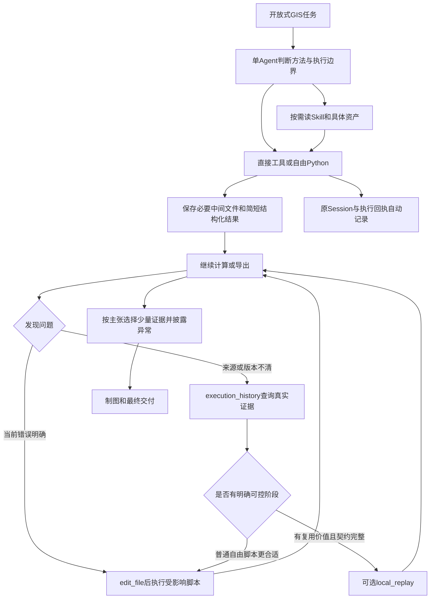

# GIS-Agent V8.3：专业代码资产、阶段化执行与按需修复

日期：2026-11-02。状态：详细设计，尚未实施。

设计基线：`feature/v8-workflow`，HEAD `2c20dbd`。本轮开始时Git只有既有的HANDOFF修改。主项目位于 `E:/vscode/gis-agent`，第十三届联合测试位于 `E:/vscode/test/v81_exam13_pm_20261101_01`。

本文统一描述一个完整V8.3。代码、Skills、Prompt和历史考试成果保持原样。本轮只新增设计、研究辅助材料及交接记录；没有安装依赖、调用模型或重跑试卷。

## 1. 执行摘要

V8.3应把现有能力连接成一条实际可用的路径：

**选择适用资产 → 自由编程 → 在高价值边界保存结果 → 用运行事实定位问题 → 选择直接修补或受控重放 → 用已有事实交付。**

核心交付包括：

1. 三个短Skill入口，指向有实际代码价值的专题参考、反例和示例。
2. 有明确边界的网络分析资产：拓扑、接入、方向、平行边、最近设施、服务区和选址。
3. 数据I/O与阶段化Python范式，避免末尾格式导出拖累已完成计算。
4. 稳定分类、几何类型和分配残差检查，减少“脚本成功但结论不成立”。
5. 很小的Harness补充：近期执行引用、历史摘要中的有界输出线索、准确的路径事实和错误提示。

继续复用单Agent、LangGraph、Session、Context、现有执行器和local_replay。普通执行不增加阶段登记工具。V8.3不增加Agent工具，不新建调度器或工作流存储。

**最重要的架构取舍：普通阶段保存与受控缓存保持不同可信边界。** 已有文件可以帮助模型继续计算；只有输入、代码、参数、环境和完成回执符合V8.1契约时，程序才自动复用。方法是否适合任务、是否需要检查，仍由模型判断。

89分联合实测证明了整体任务完成能力，未证明新历史/重放工具已产生净收益。V8.3的成功标准是新任务的专业结果、完成率和总成本改善，Skill阅读次数只作为过程证据。

## 2. 当前事实与本轮新增核验

### 2.1 已有能力应直接复用

| 当前文件 | 已实现能力 | V8.3处理 |
| --- | --- | --- |
| `agent.py` | model/tools/finish循环、调用配对、截断保护、810受限恢复 | 保留控制图和恢复边界 |
| `application.py` | 组装工具、Skill索引、ExecutionHistory与local_replay | 保留组装方式 |
| `core/context.py` | 摘要、外置结果、稳定Schema排序、动态状态置后 | 只加有界执行引用，不重写上下文 |
| `persistence/sessions.py` | 原消息、资产、来源哈希和模型投影 | 原记录与投影职责不变 |
| `tools/files.py` | 文件读取、搜索、唯一匹配编辑、SHA核对 | 继续作为代码修改入口 |
| `tools/qgis_python.py` | 原路径执行、脚本快照、日志和结构化结果 | 普通执行语义不变 |
| `integrations/qgis/python_runtime.py` | run_processing初始化及正常清理 | 分析示例直接复用 |
| `persistence/executions.py` | 执行ID、参数、结果、日志、受限查询 | 增加简短输出事实，保留分页与校验 |
| `core/replay.py`、`persistence/repairs.py` | 输入封存、冻结代码、小依赖闭包、修复家族缓存和窄恢复 | 核心安全语义保持 |
| `integrations/plotting/runtime.py` | 字体、PNG/SVG/PDF导出、预览、manifest | 增加可测量诊断，不接管视觉设计 |

### 2.2 第十三届轨迹支持的问题

完整Session含249条消息，116次主响应、131次工具调用、17次失败。另有1次默认记忆提取。三个Skill描述与历史/重放工具从初始请求就可见；实际只展开了制图Skill及API/Gotchas。

| 现象 | 真实依据 | 判断 |
| --- | --- | --- |
| 人口准备运行4次、累计664.56秒 | M09/11/13失败，M15成功；events工具时间 | 计算与最终I/O耦合，确有返工空间 |
| 医疗第一版3次、改进版6次 | M25—47及代码快照 | 有真实纠错，也有专业假设被遗漏 |
| 41次Python执行累计1500.69秒 | tool_end逐项配对 | 原生计算与I/O是主要墙钟部分 |
| 制图44轮、16次脚本执行、8次执行失败 | M62—105 | 不能全部归为美化；基础组件仍不稳定 |
| 29个住宅区约991.30人未分配 | `05_task5.py:47,75`及独立事实 | 计算已发现异常，最终披露不足 |
| 50站成果保留为社区面 | `04_task4.py:136`、`09_map_task4.py:57` | 输出数据模型与符号不一致 |
| history/replay均未调用 | 全调用轨迹 | 缺少采用证据，不能据此判断无价值 |

详细复盘见 [v81-exam13-diagnostic-review.md](v81-exam13-diagnostic-review.md)。89分及Codex87分均为非官方开发自评，两次扣分口径和路网核查深度有差异。本文不拿分差作架构收益证据，也不改原评分。

### 2.3 本轮免费探针改变了哪些设计判断

证据目录：`outputs/v83_design_research_20261102/`。

| 本轮确认事实 | 对设计的影响 |
| --- | --- |
| 当前pyogrio可写、重读两要素GPKG及FileGDB | 不能把历史M11推广为pyogrio始终不能写GDB，也不应默认改造一个自制OGR写入器 |
| 原始字符串ID `9007199254740993`、`0007`保留；空值和中文名称可读 | 证明当前小样本通道可行；未证明任意字段类型、编码和大数据都可靠 |
| QGIS 3.44.9最短路小样本返回60米道路成本，两端接入共50米 | 直接调用成熟算法仍需明确成本范围；110米完整路程不能由60米直接代替 |
| Shapely精确近边与最近中点在合成例上选择不同 | 最近中点近似应有明确适用边界 |
| NetworkX反图多源查询正确选择含设施接入成本的医院 | 确认当前版本可执行建议的核心方法 |
| SciPy的min_only接口可用 | 最近设施通常无需对每家设施各跑一次Dijkstra |
| QgsClassificationJenks在三值小例得到正确两类 | 可作离线交叉检查；不把QGIS引入默认Matplotlib出图流程 |
| 普通执行ID存于消息元数据，但SessionStore.project会过滤它 | 可以在末尾动态状态提供近期引用，减少ID发现成本 |

本轮没有复现历史M11的完整导入顺序、全部字段和异常现场。它当时失败是事实，今天小样本成功也是事实。精确历史根因保持待查，设计围绕同后端真实写读探针展开。

### 2.4 本机可用版本

实际解释器为 `E:/exe/qgis/bin/python.exe`，通过现有 `python-qgis-ltr.bat`启动。版本和模块位置记录在 `local-api.json`：

| 库 | 本机版本/状态 |
| --- | --- |
| QGIS | 3.44.9 |
| GeoPandas | 1.0.1，用户级Python312目录 |
| Shapely | 2.1.2，QGIS Python目录 |
| NetworkX | 3.2.1，用户级Python312目录 |
| SciPy / NumPy | 1.17.1 / 2.4.3，QGIS Python目录 |
| Matplotlib | 3.10.8 |
| Rasterio / pyogrio | 1.4.3 / 0.12.1 |
| osgeo GDAL / pyogrio GDAL | 本次均报告3.12.3 |
| Fiona、OSMnx、momepy、spopt、mapclassify、jenkspy | 当前QGIS解释器未发现 |

网上stable文档对应NetworkX 3.7、Shapely 2.2等较新版本。本文推荐调用以本机探针为准，不直接承诺新文档全部参数可用。另一个Conda环境中的库不计为本解释器可用依赖。

## 3. 原则与重要取舍

| 问题 | V8.3决定 | 理由 |
| --- | --- | --- |
| 每个GIS操作拆脚本？ | 按昂贵、稳定、可独立重试的边界划分 | 拆得太细会增加进程、I/O及模型往返 |
| 普通阶段要RepairPlan？ | 不需要 | 已有文件和JSON参数足以表达普通脚本 |
| 所有脚本自动缓存？ | 不做 | 隐藏依赖与外部副作用无法普遍推断 |
| Skill正文自动注入？ | 不做；建立适度偏好 | 索引已可见，需提高资产收益与入口清晰度 |
| 新增通用路由工具？ | 不新增Agent工具；提供普通代码资产 | 保留多种算法和数据模型选择 |
| 全部导入OSMnx/momepy/spopt？ | 作为参考和可选后端，不成为默认依赖 | 当前基本库足够实现精选范式，完整栈增加部署成本 |
| Jenks继续让模型现写？ | 使用成熟jenkspy及薄包装 | 已确认自写递推错误，维护成本有真实依据 |
| 彻底简化重放安全校验？ | 保留 | 字节身份、完成回执、代码冻结直接决定能否复用 |
| 新增简版RepairPlan语法？ | 本版不增加 | 两种计划语法会扩大哈希、恢复和冲突解释成本；先通过范例和历史入口降低准备成本 |
| 修改普通工具结果结构？ | 保留原返回；执行引用放末尾状态 | 避免包装原dict/list引起调用方退化 |
| 换工作流引擎？ | 保留现有Harness | 没有证据表明调度框架能解决本轮失分 |

Bazel把输入、输出、命令和环境纳入action身份，这一思想适合解释受控复用前提；它无法证明任意Python依赖已经完整声明。本版不引入Bazel运行时。[来源S26](https://bazel.build/remote/caching)

## 4. 整体协作方式



图中判断均由原模型完成。程序不替每一步再调用模型。Skills提供专业方法与代码，执行历史提供事实，local_replay处理已明确的修订和文件身份。

### 4.1 三种执行粒度

| 情况 | 推荐组织 | 不必额外做的工作 |
| --- | --- | --- |
| 小型单步、预计很快 | 一个脚本或直接工具 | 无额外阶段清单、历史查询或缓存 |
| 多步但共用内存、重算便宜 | 一个脚本中的函数与少量中间结果 | 无逐函数文件化 |
| 昂贵前段、易变后段、最终格式复杂 | 计算阶段保存稳定中间文件；后段/导出单独脚本或执行模式 | 无完整任务DAG |
| 多次修订且有明确依赖、需保留版本 | 将选定范围提升为受控job，使用原local_replay | 无全任务迁移 |

拆分依据为预期重试成本、可复用性、内存/文件体积和外部副作用。行数不能代表这些因素。

### 4.2 阶段是否值得保存

粗略条件：

`预计避免的重算时间 > 写出 + 重读 + 核对 + 修改组织方式的时间`

一次性很便宜的计算可以不保存。大型栅格保存会消耗大量磁盘和时间，也应估计预算。空间索引、打开的图层对象和数据库连接不能直接跨进程复用。

## 5. 阶段化Python详细范式

### 5.1 推荐的普通脚本形态

采用熟悉的JSON设置文件，复用 `run_python_script(script_path, arguments=[job_path])`。不增加Schema参数或新执行工具。

```json
{
  "inputs": {"prepared": "/work/prepared.gpkg"},
  "parameters": {"source_layer": "objects", "field": "value"},
  "outputs": {"features": "/work/derived_v1.gpkg"}
}
```

代表性代码草案：

```python
def main(job):
    source = read_input(job["inputs"]["prepared"],
                        layer=job["parameters"]["source_layer"])
    result, facts = calculate(source, job["parameters"])
    path = job["outputs"]["features"]
    write_new_output(result, path)
    confirm_readback(path)  # 当前格式必要的最小核对
    return {"outputs": {"features": path},
            "metrics": facts, "warnings": [], "assumptions": []}

if __name__ == "__main__":
    job = json.loads(Path(sys.argv[1]).read_text(encoding="utf-8"))
    value = main(job)
    Path(os.environ["GIS_AGENT_RESULT_PATH"]).write_text(
        json.dumps(value, ensure_ascii=False, allow_nan=False), encoding="utf-8")
```

这里的读取、计算和检查由任务代码实现；没有新增固定GIS步骤。`outputs`采用现有ExecutionHistory能够识别的字段。它只提供结果引用，不自动提升输入依赖或缓存资格。

### 5.2 分离计算与最终格式

示例目录：

```text
work/
  scripts/prepare.py
  scripts/analyze.py
  scripts/export.py
  jobs/prepare.json
  jobs/analyze.json
  jobs/export.json
  intermediate/prepared.gpkg
  intermediate/analysis.gpkg
  delivery/result.gdb/
```

并非每次都需要三份脚本。可以使用同一脚本的显式 `compute` / `export`模式。关键在于导出模式只读取已完成结果，不隐式重复分析；多阶段可以由一次已确定的Python调用依次执行。

失败后保留原退出状态和部分文件。普通脚本不以“文件存在”作为自动续算条件。恢复时核对输入、参数、方法、代码及必要环境事实；若没有历史内容身份，只能说明采用当前文件，不能声称它与过去执行时完全一致。

### 5.3 正常保存与受控复用

| 事项 | 普通阶段 | 受控阶段 |
| --- | --- | --- |
| 代码组织 | 自由；JSON只作推荐 | sys.argv[1]读取inputs/parameters/outputs |
| 输入身份 | 程序可检查当前文件，依赖完整性unknown | 现有封存、内容指纹及显式依赖 |
| 代码版本 | 普通快照，原路径执行，身份not_proven | 冻结候选或快照补丁，核对SHA |
| 副作用 | 模型自主判断和披露 | outputs_only声明，可信本机条件下执行 |
| 自动缓存 | 不提供 | 原修复家族内满足签名及完成回执后复用 |
| 中断恢复 | 原Session保护，不自动重放未知工具 | 原810窄恢复和关键记录校验 |

这一差别写入 `references/staged-python.md`，与 `integrations/qgis/replay.md`相互引用。普通示例应能自然改为受控job，避免第二套参数格式。

### 5.4 昂贵前段与后段错误的完整路径

1. `prepare.py`生成已保存的中间数据，返回具名outputs。
2. 后段报错。近期执行引用给出真实执行ID；模型直接修复，或通过history查快照、参数、错误和输出。
3. 模型判断前段输入与方法未受后段错误影响，检查当前成果是否仍适用。
4. 普通修复：修改后段，用该成果继续。原记录不因此变为受控缓存。
5. 需要冻结与版本继承时：准备明确JSON输入输出的候选脚本；用read_file取得其SHA，声明辅助模块；调用一次local_replay。
6. 程序连续执行所需阶段，核验产物，返回completed/reused/failed/pending及执行引用。
7. 原Agent在当前上下文继续，无历史LLM决策回放。

允许一次直接编辑比准备计划更便宜。没有保存的Python内存，V8.3仍无法恢复。

### 5.5 受控计划示意

以下ID和路径为说明占位符，实际必须使用工具返回的真实值：

```json
{
  "repair_id": "repair_new", "parent_repair": null,
  "reason": "后段字段修订，保留已核对的中间输入",
  "accepted_inputs": {"prepared": {"path": "/work/prepared.gpkg"}},
  "steps": [{
    "step_id": "derive", "source_execution": "<real_execution_id>",
    "inputs": {"prepared": {"accepted": "prepared"}},
    "changes": {
      "candidate_script": "/work/scripts/derive_job.py",
      "expected_sha256": "<actual_sha256>",
      "job_contract": true, "side_effects": "outputs_only",
      "job_parameters": {"source_layer": "objects"},
      "deterministic": true
    },
    "outputs": {"features": "derived.gpkg"}
  }], "targets": ["derive"]
}
```

`deterministic`需要真实判断，不能作为所有例程的默认常量。导入的本地辅助模块还须在dependencies中声明。脚本从job读取路径，不能继续写旧GDB或访问未声明配置。

## 6. Skills的采用机制与具体文字

### 6.1 官方资料带来的取舍

OpenAI建议精确而短的description、把入口作为路由，并重新审视过度约束。Anthropic强调Gotchas、可复用代码和按需上下文。两者支持资产优先及渐进加载，不构成DeepSeek会自动采用的保证。[S01](https://developers.openai.com/blog/rethinking-skills-and-prompts-for-gpt-6-astra)、[S03](https://claude.com/blog/lessons-from-building-claude-code-how-we-use-skills)

Skill索引当前只需name、description和路径。继续遵循标准frontmatter，compatibility保持顶层。不增加自动分类器、全局读取计数阈值或跨Skill依赖解析器。[S04](https://agentskills.io/specification)

### 6.2 建议description

三个正文仍采用英文，中文任务照常使用。

```yaml
name: gis-spatial-analysis
description: >-
  Build multi-step GIS analyses with tested I/O, staged Python and network
  examples. Consult before custom routing, spatial allocation or costly
  raster/vector workflows. Skip metadata questions and schema-sufficient
  single operations. Use gis-verification for evidence and gis-cartography
  for map output.
```

```yaml
name: gis-verification
description: >-
  Test consequential GIS claims with small counterexamples, allocation
  balances and coverage checks. Use when formulas, assignments, routing
  assumptions or approximations affect downstream results. Reuse established
  evidence; styling belongs to gis-cartography.
```

```yaml
name: gis-cartography
description: >-
  Create and revise thematic maps with tested Matplotlib examples, fonts,
  classification and export helpers. Use for requested maps, overlays and
  multi-panel figures. Check actual geometry and legends; skip data-only
  analysis and numeric verification.
```

这些文字强调实际资产、适用决策和相邻边界。实施时需核实所称资产确实存在，不能先把“tested”写进尚未通过验收的资源。

### 6.3 入口组织

SKILL.md每个保持短路由。不要在入口复制全部网络知识。建议采用“当前问题→资源→可执行入口”表，用户一次只读相关行。

分析Skill关键正文草案：

```text
For a nontrivial analysis, prefer the relevant tested pattern before
rebuilding environment-specific I/O or a graph algorithm. Read only that
resource. Keep ordinary small operations direct.

Use one script when work is cheap or tightly coupled. Persist an expensive
stable stage before a volatile export or downstream step. Saved files are
not automatically verified caches.
```

验证Skill关键正文草案：

```text
Choose evidence that could falsify the claim. A connected graph does not
prove real access; conserved totals do not prove spatial ownership.
Reuse existing results. Carry consequential unmatched counts, residuals
and uncertain assumptions into the final delivery.
```

制图Skill关键正文草案：

```text
Verify the actual geometry behind a symbol and share one classification
result between colors, labels and legends. Preserve a requested method.
When an image looks wrong, check the corresponding data or Artist fact
before changing style. Fix observed defects together.
```

### 6.4 System Prompt建议替换文字

保留当前I/O、工具、记忆和结束协议。用以下短段替换原Skill概括和历史句，不追加一份长操作规程：

```text
非平凡空间分析优先参考相关Skill中的已验证代码、环境约定和反例，再组合自己的方法；
只读取当前需要的资源。简单明确且Schema足够的操作可直接执行。
昂贵或容易返工的计算可按稳定输入输出保存阶段成果，避免导出失败重算前段。
版本或来源不清时用execution_history；明确依赖且有复用价值的阶段可用local_replay，
普通代码小修继续编辑执行。已发现的关键异常、未匹配数量和近似限制应进入交付说明。
```

这建立偏好，保留选择权。图面极简和完整方法说明主要留在Skills。不要将主观“看起来会错”作为自动加载三个Skill的条件。

### 6.5 如何判断采用有效

记录四层证据：metadata被提供；正文/参考被读取；脚本被运行、导入或方法被改写采用；新结果更好。代码重用可通过导入、执行参数和关键方法对照确认，不仅做文件名或字符串匹配。

Outcome、Process、Style、Efficiency分别评价。阅读而不采用、采用但更贵、少读而正确，都需如实记录。[S02](https://developers.openai.com/blog/eval-skills)

## 7. 路网专题：专业知识与实现选择

### 7.1 道路线与真实交通拓扑

道路中心线只提供几何和部分属性。图需要表达实际可通行连接。线在二维相交不自动代表可换路；桥梁、隧道、立交、交通方式、门禁和层级都可能阻止连接。Shapely索引忽略Z，不能据二维最近或相交推断立体通行。[S05](https://shapely.readthedocs.io/en/stable/strtree.html)、[S06](https://wiki.openstreetmap.org/wiki/Key:layer)

建议分开记录：原始几何、采用的拓扑规则、修复候选和实际新增连接。小缝隙可能是数字化误差，也可能是真实断路。容差应来自精度、道路尺度或外部依据；不以“全图连通”为修复成功标准。

道路已经分段且端点拓扑可信时，primal图的节点是交叉口/端点，边是道路。dual图把道路作为节点，连接或转角作为边，更适合转向/形态问题，不能把它的跳数直接当米制路程。momepy提供两种转换，但转换函数不能替未知数据完成正确noding。[S07](https://docs.momepy.org/v0.11.0/api/momepy.gdf_to_nx.html)

单向需区分几何坐标顺序与实际通行方向。禁止转向依赖进入边和离开边，仅有节点+普通边权无法普遍表达；可用边状态图或具有该能力的路由系统。OSM的restriction关系是另一类输入，不能从oneway字段推导全部限制。[S08](https://wiki.openstreetmap.org/wiki/Relation:restriction)

### 7.2 图类型和道路身份

默认参考范式保留 `MultiDiGraph` 的 `(u,v,key)`和road_id，按任务显式设双向。普通Graph/DiGraph只存一条节点对边。平行路最小权重归并只适用于相同通行状态、相同接入语义、可互换且成本可加的路段。

保留成本、几何和道路身份的一致性。不能只取最小cost却保留另一条道路的geometry。单向、收费、桥梁/地面、道路中间设施接入、转向和交通方式都可能阻止归并。

OSMnx使用MultiDiGraph、维护完整几何并提供拓扑简化；简化删除的是非必要中间节点。不要用简化后端点直线长度重写沿线真实长度。其最近边实现使用STRtree，借鉴空间索引及边身份保留。[S09](https://osmnx.readthedocs.io/en/stable/user-reference.html)、[S10](https://github.com/gboeing/osmnx/blob/main/osmnx/distance.py)

### 7.3 几何接入与地图匹配

一次设施点的几何接入与连续GPS轨迹地图匹配不同。轨迹匹配还涉及连续性、观测噪声和合法路径，不在本版短例范围。

点接入至少需要以下事实：原位置、候选道路、投影位置、沿路比例、接入距离、交通方式、距离阈值和选择理由。最近节点容易绕过近边；最近路段中点也会漏掉很长但实际贴近的线。

采用Shapely STRtree的完整线几何查询。`query_nearest(..., all_matches=True)`保留几何并列，`max_distance`用于有依据的接入范围。并列对象可能来自同路双向边，也可能来自不同高度道路；几何并列不自动表示两条路都可接入。[S05](https://shapely.readthedocs.io/en/stable/strtree.html)

道路先按适用交通方式和等级属性过滤。一次性收集同一条道路上的全部投影比例后，排序、去重并分段，保留方向和road_id。只在线段成本与长度成比例时按比例切成本；固定收费、转向惩罚或分段速度变化需要对应模型。

QGIS director可把附加点接到边并插入节点，但POINT_TOLERANCE与路网节点间TOLERANCE是不同参数。前者限制点离网络多远，后者涉及拓扑合并。[S11](https://documentation.qgis.org/3.44/en/docs/user_manual/processing_algs/qgis/networkanalysis.html)、[S12](https://docs.qgis.org/3.44/en/docs/pyqgis_developer_cookbook/network_analysis.html)

### 7.4 接入成本和最近设施

距离口径：

`完整距离(i,j) = 对象i接入距离 + 路网内部距离 + 设施j接入距离`

时间口径需分别换算步行、驾车、等待或入口成本，不能把米与秒相加。单个需求的固定接入成本通常不改变其设施排序，但影响阈值和服务区；设施侧不同接入成本会改变最近设施。

对需求到设施的有向成本，不能直接从设施在原图正向传播。应在反图上从设施做多源搜索；设施接入可建成终端边，使其自然进入初始成本。QGIS的吸附距离阈值只负责接入许可，不自动把接入距离计入TRAVEL_COST；本机小例及3.44源码均支持这一边界。[S13](https://github.com/qgis/QGIS/blob/release-3_44/src/analysis/processing/qgsalgorithmshortestpathpointtopoint.cpp)

**需要额外防止的隐蔽错误：设施或需求的接入边不能变成任意道路间捷径。** 设施节点作为终端汇点，需求节点作为起点；多候选接入不得让车辆通过医院节点跨到另一条原本不连通的道路。这个边界进入示例测试。

无接入候选、被道路规则排除、可接入但图上不可达、超过时间阈值分别表示。SciPy在limit外也返回inf，不能把所有inf都解释为拓扑断开。

### 7.5 算法和性能

| 需求 | 起点 | 推荐思路 | 边界 |
| --- | --- | --- | --- |
| 一对点 | 一次 | Dijkstra；有可证明下界时A* | 欧氏启发式需与成本单位匹配；时间启发式要合理最高速度 |
| 最近设施 | 多设施 | 反图多源Dijkstra，设施终端成本已纳入 | 保留原始ID；并列不能宣称唯一 |
| 少量OD矩阵 | 多行/列 | 分批单源，选择更少一端并正确处理方向 | 评估矩阵内存与不可达 |
| 大规模阈值可达 | 多源/需求 | cutoff/limit、稀疏结果和局部查询 | 截止阈值不等于不连通 |
| 最短时间 | 单源/多源 | 速度转时间，再选可用算法 | 不会自动拥有转向、实时或公交时刻表 |

NetworkX便于保留语义和多重边；SciPy适合已经验证的稀疏数值图。SciPy的 `min_only=True`可返回多源最近距离及source；非对称权重不应使用directed=False。COO重复坐标在转CSR时求和，必须先按模型处理平行边。[S14](https://networkx.org/documentation/stable/reference/algorithms/generated/networkx.algorithms.shortest_paths.weighted.multi_source_dijkstra.html)、[S15](https://docs.scipy.org/doc/scipy/reference/generated/scipy.sparse.csgraph.dijkstra.html)、[S16](https://docs.scipy.org/doc/scipy/reference/generated/scipy.sparse.coo_matrix.html)

非负加权图通常可用Dijkstra，参考复杂度约 `O((V+E)log V)`；对F家设施逐一搜索约乘F，多源最近查询可避免这一因子。此估算不等于实测加速；Python对象开销、建图、点接入和写出可能更贵。

### 7.6 典型GIS应用的语义

| 应用 | 应计算的对象 | 容易混淆的结果 |
| --- | --- | --- |
| 最近医院/消防站 | 指定方向和成本的最近设施及路径 | 欧氏最近、吸附点最近、完整行程最近 |
| 等时/等距离服务区 | 成本阈值内可达节点、部分道路及边界 | 可达道路缓冲面不等于严格可达地块 |
| 网络Voronoi | 沿网络到设施成本最小的划分 | 社区按最近医院dissolve只是在社区单元上的分组 |
| 覆盖盲区 | 未覆盖需求及其人口/规模 | 与图上孤立道路数量不同 |
| p-median | 人口或需求加权总成本最小 | 与最坏距离最小不同 |
| p-center | 最坏服务成本最小 | 与平均距离最小不同 |
| 最大覆盖MCLP | 给定设施预算和阈值下覆盖需求最大 | 与所有对象最近站分配不同 |
| 2SFCA | 设施容量与周围需求竞争，再汇总各需求的可用供给 | 最近医院距离不能代替容量竞争指标 |

spopt展示了网络成本矩阵与欧氏矩阵的不同结果，并提供设施选址模型及测试。V8.3借鉴“先构造语义明确的OD矩阵，再选择优化目标”，不默认引入MILP求解环境。[S17](https://pysal.org/spopt/notebooks/p-median.html)

2SFCA参考形式：`R_j=S_j / sum(P_k, d_kj<=t)`，`A_i=sum(R_j, d_ij<=t)`。阈值、供应量单位和出行方向需来自任务；距离衰减扩展需对应方法依据。医院容量缺失时不能凭空计算容量型可达性。[S18](https://www.niu.edu/landform/papers/Wang_Luo2005.pdf)

动态拥堵、出发时刻、公交换乘和道路限制属于进一步扩展边界。本版不自建动态交通模型。

### 7.7 停止修补和报告不确定性

出现以下情况时，应保留未解决状态或另列假设情景：缺乏真实道路连接依据；最近几何候选属于不同层级且无法判定接入；只有无限增加容差才能获得有限结果；输入缺少决定性方向或限制属性。

可以继续完成不依赖该结论的部分。无需为了每个普通属性缺失询问用户，但不能把未经证明的连接当作已知事实。

## 8. 精选路网代码资产设计

### 8.1 资产边界

只提供普通Python函数和完整示例，不注册新工具，不建立自有图序列化平台。使用NetworkX图、GeoDataFrame和CSV/GeoPackage表达输入输出。真实数据加载、ID、CRS和拓扑规则由任务明确。

拟新增：

- `scripts/network_access.py`：有限的建图、精确接入、分段、最近设施及阈值道路范式，可运行或导入。
- `scripts/network_cases.py`：微型反例，可全部离线执行。
- `scripts/network_location.py`：小OD矩阵上的选址/覆盖示例，穷举只用于极小规模教学与真值。

现有 `parallel_edges.py`保留为短入口，可调用或复用新反例，避免维护两套同义实现。

### 8.2 接口草案

```python
def build_primal(lines, *, road_key, direction, cost,
                 level_fields=(), topology="already_noded_endpoints"):
    """Return MultiDiGraph and node/edge facts. No automatic crossing noding."""

def project_to_edges(points, edges, *, point_key, edge_key,
                     max_distance, eligibility=None):
    """Return all nearest eligible matches and unmatched/ambiguous ledger."""

def split_at_positions(graph, edge_positions, *, cost_model):
    """Split each affected physical edge consistently; retain keys/direction."""

def nearest_facilities(graph, demand_nodes, facility_nodes, *, weight):
    """Demand->facility cost; graph includes explicit terminal access costs."""

def reachable_arcs(graph, origins, budget, *, weight, cost_model):
    """Return full/partial reachable directed arcs, not a guaranteed land polygon."""
```

这些函数的输入前提必须在同文件顶部写清。`already_noded_endpoints`拒绝宣称自动补全交叉口。无有效CRS、非有限/负成本、缺稳定ID、无方向解释或不支持的分段成本时给明确错误。level_fields缺失只说明采用二维假设，不能假造高程拓扑。

### 8.3 精确接入代表代码

```python
tree = shapely.STRtree(eligible_edges.geometry.to_numpy())
pairs, distances = tree.query_nearest(
    points.geometry.to_numpy(), max_distance=max_distance,
    all_matches=True, return_distance=True)
point_pos, edge_pos = pairs
fraction = shapely.line_locate_point(
    eligible_edges.geometry.to_numpy()[edge_pos],
    points.geometry.to_numpy()[point_pos], normalized=True)
```

返回的是位置索引，需映射稳定point_key/edge_key。空输入、空几何和没有候选的点可能没有返回行，不能仅按pairs长度写回原表。退化零长线、道路方向与并列候选需单独处理。

### 8.4 最近设施代表代码

```python
reverse = graph.reverse(copy=False)
dist, paths = nx.multi_source_dijkstra(
    reverse, sources=sorted(facility_nodes), weight=weight)
rows = []
for demand_id, node in demand_nodes.items():
    if node not in dist:
        rows.append((demand_id, None, None, "unreachable"))
    else:
        facility = paths[node][0]
        rows.append((demand_id, facility, dist[node], "reachable"))
```

正式示例中facility_nodes是独立终端节点；graph已经包含设施接入边。路径在反图中返回，展示正向路径时需反转并恢复具体边key。默认只返回一个代表解，不证明最近设施唯一；ties_checked需明确。非同类型节点标签先统一可排序ID，避免sorted在混合类型上报错。

### 8.5 示例清单与反例

| 示例 | 输入和核心输出 | 核心算法/库 | 必测反例与边界 |
| --- | --- | --- | --- |
| N1线网到图 | 已分段线、road_id、方向、成本→图及边台账 | GeoPandas+MultiDiGraph | 高架交叉不连通、缺少交点节点、反向道路、同端点平行路 |
| N2点到边 | 需求/设施点、候选道路→投影比例、距离、匹配状态 | Shapely STRtree | 最近中点错误、等距不同层级、离网过远、零长边 |
| N3含接入最近设施 | 已验证图+独立终端→最近设施、分段成本、未达台账 | 反图多源Dijkstra | 接入成本反转选择、单向反图、终端不能桥接道路、并列 |
| N4服务区 | 网络及预算→完整/部分可达弧 | 受限最短路+比例分段 | 预算落在边中间、不可逆方向、非线性成本拒绝比例切分 |
| N5网络选址 | 有ID、单位和方向的OD矩阵+需求权重→选址及目标 | 小规模穷举；生产可选择已有优化库 | 欧氏与网络解不同、不可达列、零权重、不可行p |
| N6模型敏感性 | 同一小图的两组明确拓扑/容差假设→结果差异 | NetworkX/SciPy | 连接跨越屏障后结果突变，不以全连通作为真值 |

所有示例用合成或可公开复核的微型数据，不使用比赛路径、字段、医院编号或答案。代码允许复制和改写；方法不同的任务可以直接编写新算法。

### 8.6 研究过的开源实现及实际借鉴

| 项目与实现 | 已阅读的测试/位置 | 借鉴及限制 |
| --- | --- | --- |
| QGIS 3.44网络分析 | `src/analysis/processing/qgsalgorithmshortestpathpointtopoint.cpp`；`tests/src/analysis/testqgsnetworkanalysis.cpp` | 点吸附、容差、Dijkstra、速度策略；成本仍需解释，未自动支持全部转向规则 |
| OSMnx | `osmnx/distance.py`；`tests/test_osmnx.py`的test_nearest、test_save_load、test_routing相关检查 | 边ID、精确空间索引、图往返及路径测试；部分测试会联网，不能直接放进免费隔离回归 |
| momepy | `momepy/utils.py`；`momepy/tests/test_utils.py`的primal/dual/directed/roundtrip | 不同图类型及源身份的往返；不自动证明线网拓扑正确 |
| pgRouting | `doc/withPoints/withPoints-family.rst` | 沿边fraction、cost/reverse_cost和侧向接入语义；借鉴接口，不引入PostGIS服务 |
| spopt | `spopt/locate/p_median.py`；`spopt/tests/test_locate/test_p_median.py` | 目标模型、成本矩阵及独立小真值；MILP依赖暂不进入默认环境 |
| jenkspy | `tests/test_jenks.py` | 非有限输入、类数、极值和已知断点测试；只用于分类，不扩展成地图框架 |

这些是已读代码和行为参考，没有在本机运行其完整上游测试。源码main可能继续变化；本轮抓取记录和内容摘要保存在研究目录。实现时固定依赖版本，独立编写小测试；复用代码需保留相应许可信息。

## 9. 三个Skills的最终目录与职责

```text
gis-spatial-analysis/
  SKILL.md
  references/
    patterns.md             # 路线、身份与跨层组合，缩短现有网络段
    data-io.md              # 三个Skill共享的I/O参考
    staged-python.md        # 普通保存、job与受控提升
    networks.md             # 网络专题短路由
    network-topology.md     # 拓扑、方向、平行边、简化
    network-access.md       # 几何接入、成本、最短路径
    network-applications.md # 服务区、选址、2SFCA及边界
    gotchas.md
    terrain-imagery.md      # 保留已有有效内容
  scripts/
    reproject_clip.py       # 保留
    spatial_join.py         # 补双向覆盖事实，兼容原输出
    parallel_edges.py       # 保留短反例入口
    terrain_counterexamples.py
    io_roundtrip.py
    staged_compute.py
    network_access.py
    network_cases.py
    network_location.py

gis-verification/
  SKILL.md
  references/checks.md      # 保持短检查模式，链接网络和I/O
  scripts/
    geometry_facts.py
    identity_audit.py
    precision_example.py
    validation_split.py
    allocation_balance.py

gis-cartography/
  SKILL.md
  references/api.md
  references/design.md
  references/gotchas.md
  references/review.md
  scripts/vector_map.py
  scripts/choropleth.py
  scripts/raster_composite.py
  scripts/classify_values.py
```

专题文件负责不同阅读问题，networks.md只路由，不复制全文。三个Skill都可引用analysis的data-io；共享初始化继续只维护 `integrations/qgis/execution.md`。不新增第四个综合Skill。

每个新脚本须包含依赖、完整CLI设置、实际输入/输出、非零退出行为和适用边界。先通过免费真实文件测试，才在description中称为tested。核心入口只列最有用资产，不把该目录树整个复制到System。

## 10. GIS数据I/O方案

### 10.1 后端与格式不能混淆

| 层次 | 作用 | 需要核对 |
| --- | --- | --- |
| GDAL/OGR | 栅格/矢量驱动和低层读写 | 实际绑定版本、驱动能力、数据类型 |
| GeoPandas | 几何表和常用文件接口 | 指定engine、layer、index策略及真实列 |
| pyogrio | GDAL矢量数组I/O | 其绑定可用驱动、空值/类型转换、实际写读 |
| Fiona | 另一种矢量I/O接口 | 当前未安装；不能默认存在或共享同一GDAL |
| Rasterio | 栅格窗口、mask和地理参考 | 其GDAL版本、transform、dtype、NoData、sidecar |

GDAL文档区分OpenFileGDB矢量写入与栅格读取。不能从“支持GDB”推断任意栅格写入能力。[S19](https://gdal.org/en/stable/drivers/vector/openfilegdb.html)、[S20](https://gdal.org/en/stable/drivers/raster/openfilegdb.html)

pyogrio能力取决于其实际GDAL，空值整数可能变成浮点，部分格式未被完整测试。严格64位业务ID需要实测整数/空值路径，必要时显式使用字符串，而非静默容忍精度损失。[S21](https://pyogrio.readthedocs.io/en/latest/supported_formats.html)、[S22](https://pyogrio.readthedocs.io/en/latest/known_issues.html)

### 10.2 三种路径表达

```text
物理容器：/work/results.gpkg
QGIS图层source：/work/results.gpkg|layername=objects
GeoPandas：read_file('/work/results.gpkg', layer='objects')
绘图登记：inputs=('/work/results.gpkg',)
```

FileGDB使用.gdb目录作容器。不要把 `results.gdb/objects`当作普通文件。日志中应分开dataset_path与layer。运行时不猜测并修复任意伪路径，错误应指出预期的地址类型。

纯矢量文件使用ogr.Open或OpenEx的vector标志。gdal.Open默认栅格路径不能当作任意容器万能读取入口。多图层先枚举实际层，输出按重开后的真实Schema继续。

### 10.3 io_roundtrip脚本设计

```python
def probe_vector_io(directory, *, engine, driver, geometry_kind,
                    fields_case, creation_options=None) -> dict:
    """Write fresh tiny data through the intended backend and reopen it."""
```

输入案例包括非ASCII值与字段、长字段、null、整数、64位ID、字符串前导零、单/多部件。返回真实解释器、库路径/版本、驱动、成功阶段、实际列映射、数据类型、值与几何对照。字段被截短或重命名时输出映射；有冲突则明确失败。

Shapefile应包含必要sidecar，传统DBF字段名与类型限制需显式说明。本机GDAL3.12.3不应假定已具备新文档3.13的扩展字段名行为。[S23](https://gdal.org/en/stable/drivers/vector/shapefile.html)

探针只用于新格式/后端/类型组合或真实I/O故障，不每个脚本都重复跑。不能将一次Point+string成功外推到所有面层、曲线和字段。

### 10.4 是否需要通用写入器

V8.3暂不把比赛gisutil生产化。当前微例已经证明标准pyogrio路径可用，应先建立正确示例和真实目标Schema探针。若特定格式仍失败，可选择OGR，但需同样测试，不静默降级或丢字段。

GeoTIFF检查像元数组、dtype、mask、CRS、transform；GeoPackage/FileGDB检查层、字段、业务ID、几何、CRS和数量。确认写出成功后再发布阶段完成结果。失败产生的文件保留为诊断，不进入自动缓存。

## 11. Verification与交付

保留五种检查模式，按任务选用：

| 主张 | 最小起步证据 | 不能推出什么 |
| --- | --- | --- |
| 公式/单位正确 | 一个非退化样本的原始量代入及单位 | 归一化0—1不能证明公式方向 |
| 分配完整 | 源对象和目标分区双向覆盖、残差 | ID全保留不能证明所有分区人口已接收 |
| 最近/最短 | 方向/接入/平行边解释及一个更优候选反例 | 路径存在、长度相加不能证明最优 |
| 近似可信 | 方法边界、未达/未匹配、少量敏感性 | 有限样本通过不能证明全量 |
| 最终成果成立 | 已取得证据与异常简表对应原要求 | 文件存在、图像美观不能替代专业证据 |

### 11.1 allocation_balance设计

```python
def allocation_balance(expected_by_zone, allocations, *, zone_key,
                       value, excluded_by_zone=None, unit) -> dict:
    """Return objective zone totals, residuals, unknowns and bounded examples."""
```

以pandas Series/DataFrame或示例CLI读取的实际字段为输入。逐区报告：expected、allocated、excluded、residual、unknown_count；再汇总。缺失值和未识别分区不能静默置零。重复分配与合法重叠要由任务解释，不自动选一对一。

不输出通用PASS，不设置适合所有GIS数据的固定误差阈值。脚本提供事实，模型结合单位、浮点精度和任务要求判断。

### 11.2 异常进入最终工作文档

复用既有result中的metrics、warnings、assumptions和输出引用，最终只列影响要求的事项：

```text
完成：哪些数据与图件已输出。
检查：检查了哪些对象和主张，覆盖到哪里。
限制：未匹配/未分配规模、不可达、未证明假设和格式差异。
```

这是结果表达方式，不要求额外生成一套正式验证报告。已有异常字段可以直接带入最终说明，无须为了抄写统计再次完整运行分析。

## 12. 制图稳定性与Jenks选择

### 12.1 选择成熟实现

| 路线 | 收益 | 成本/风险 | 决定 |
| --- | --- | --- | --- |
| jenkspy | 专注Fisher-Jenks、上游测试、较小包 | C扩展兼容和大n复杂度仍需验证 | 推荐，固定0.4.1并验证本机wheel |
| mapclassify | 分类体系完整 | 当前未装，依赖面更广；NaturalBreaks与FisherJenks需区分 | 可选参考，暂不引入整套依赖 |
| QGIS Jenks | 当前可用，可作交叉检查 | 引入QGIS依赖、采样策略与生命周期需解释 | 离线参考，不作为默认绘图库依赖 |
| 自写DP | 可控制权重/边界 | 当前已发生递推错误；维护和数值证明成本较高 | 仅作为小样本独立oracle，不当默认生产实现 |

PyPI存在0.4.1的CPython3.12 Windows x86-64 wheel，约225KB。下一轮实施时在明确管理的当前QGIS Python依赖位置安装并记录版本、模块路径和wheel哈希，不升级GDAL/NumPy，不新建解释器。本轮没有安装或验证该扩展导入。[S24](https://pypi.org/project/jenkspy/)

### 12.2 classify_values契约

```python
def classify_values(values, *, method="fisher_jenks", k=5,
                    sample_size=None, seed=0,
                    max_fit_values=20000) -> dict:
    # lower, upper_bounds, labels, counts, requested_k, effective_k,
    # missing_count, method, approximate, fit_count, seed
    ...
```

- 排除/标记非有限值时报告数量，zero保留为数据。
- 类数不超过有效唯一值；常数只产生一个类别。
- 返回每类上界，类别区间采用首类闭区间、后续左开右闭，所有调用共享。
- `labels`对缺失使用独立标记，`counts`只统计有效对象。
- 单元素首类可能导致原始breaks重复最小值，不能简单去重后丢类别。
- 不要求把原始数值直接交给BoundaryNorm；可以按同一labels颜色映射并生成图例，避免上下界约定不一致。

FisherJenks与随机/迭代NaturalBreaks、对数域分级是不同方法。明确要求原值方法时保留该口径。美观替代可作为额外图，不能静默替换。[S25](https://pysal.org/mapclassify/generated/mapclassify.FisherJenks.html)

### 12.3 大栅格的复杂度

成熟C实现也不能消除大样本成本。超出max_fit_values时先返回清楚的预算错误与候选处理，不自动假称全量精确。可在合理任务条件下显式设置sample_size，在原始值样本上拟合断点，给全量像元分类，并记录近似、种子和覆盖。

sampling不等于在log域改变目标。用户禁止近似时，不用采样结果冒充全量最优；应另选可靠精确方法或如实说明资源限制。不同数据允许同SSE的不同边界，独立验收应比较目标及分类语义，不能只比浮点断点文本。

### 12.4 几何、索引和图例

vector_map显式检查point输入为Point/MultiPoint。需要把区域转为位置时，由任务明确centroid、面内点或入口，保留原区域供展示。marker参数不改变geometry。

过滤后的GeoDataFrame与颜色Series按标签对齐。按位置生成的颜色用明确数组；按业务ID生成的颜色按key映射。两个做法都应保留对应关系，不能为了消除NaN盲目reset_index。

LineCollection、PatchCollection、Text与TextArea参数不同。Gotchas只沉淀实际发生的接口差异，不复制Matplotlib手册。缺陷出现后结合geometry/Artist/encoding事实定位，再修改样式。

### 12.5 重复出图与哈希

先完成必需图，再批量修真实缺陷。同一Figure可输出兼容格式；不要每个格式重算分析。输入登记采用物理容器，layer另行说明。

现有17份最终manifest登记约756MiB输入字节，未测纯哈希耗时。V8.3先给export_figure加入fingerprint、draw、save、preview分项时间，使用独立metrics字段，保持原输出字段。暂不加入按mtime跨调用缓存。

如果指纹确实占比显著，再用一次出图进程内、明确不可变的文件快照复用哈希；修改GDB任何图层会使容器身份变化。没有可靠不变条件时继续哈希或缩小明确输入范围。

## 13. Harness最小改动

### 13.1 近期执行引用

当前 `agent.py:264`之后把execution_id加入Session消息；`sessions.py:154`投影只保留指定字段，模型看不到该元数据。

在现有末尾“当前运行数据”里增加最多3条、总字符有界的引用：

```json
{"recent_execution_refs": [
  {"id":"<actual_id>","tool":"run_python_script",
   "script":"analyze.py","status":"failed"}
]}
```

从当前Session已有元数据派生，不新写记录、不扫全磁盘、不复制参数/脚本/日志。优先计算性调用，过滤普通读文件和查询；不把参考ID当可信完成或缓存标记。旧消息没有execution_id时可以省略，不猜ID。

位置只在历史之后，保留前缀缓存布局。原工具dict/list内容、Session原消息哈希和checkpoint基准不变。只把本次模型view的state副本扩展，不能向LangGraph持久状态随意塞入未知字段。

### 13.2 execution_history改进

工具说明建议：

```text
查真实执行版本、当时参数、代码快照、结果和错误。
当前文件已多次修改、需要找上次成功版本或摘要后回查时尤其有用。
优先用执行ID或脚本名；detail默认读最新匹配，status可筛succeeded/failed/unknown/returned。
当前错误和代码已足够时可直接编辑执行。
```

summary增加最多2个简短具名output_refs与算法ID，仍保留总字符限制。不要默认在摘要返回完整result或读取大文件正文。

修正 `ExecutionHistory.facts`的目录事实：当前用is_file判断exists，GDB目录会显示false。改为分开 `path_exists`、`kind=file/directory`、`layer_verified=false/unknown`。目录存在不证明子层存在，不获得内容身份。读取旧回执时兼容旧字段，不改历史原件。

原query只按受限元信息检索，不新增全日志全文索引。旧快照和stderr继续验证范围与哈希。

### 13.3 local_replay

动作入口仍只有 `local_replay(plan)`。更新其描述及 `replay.md`，以三个真实适用条件说明价值：多版本来源、昂贵已保存前缀、明确依赖的新修订。保留普通edit_file更便宜的选择。

本版不扩大GDB目录、Shapefile、活动数据库及未知sidecar的自动复用，也不自动推断普通脚本依赖。中间GPKG/自包含TIFF可以形成适用边界，最终GDB导出保持普通执行。

简化JSON的可能性已考虑：只有对既有受控阶段克隆时才能安全继承完整依赖和输出规则。但新短语法还会影响root计划哈希、幂等与恢复。当前真实采用瓶颈还包括无阶段边界、GDB和隐藏依赖，先不增加第二套语法。使用文档中的完整例子和真实source_execution即可。

### 13.4 Python错误反馈

保持ok、returncode、stdout/stderr和原日志路径。不靠字符串匹配自动改变执行策略。

- I/O例程抛出的错误应明确backend、driver、dataset、layer和phase，保留原异常链。
- export_figure对inputs地址错误给出“需物理文件或目录，图层请单独说明”的提示。
- 可增加有界diagnostic字段，但不能将部分产物当作成功。
- 不在父Python3.11中提前compile所有QGIS Python3.12脚本，避免拒绝合法语法；子执行已有正常编译错误路径。

## 14. 两张对应表

### 14.1 问题→根因→修改→文件→验收

| 问题 | 根因 | 设计修改 | 修改文件 | 验收方法 |
| --- | --- | --- | --- | --- |
| 分析/验证入口未展开 | 入口已可见，资产收益和采用倾向未证实 | 短description、具体资产路由、适度偏好 | 三个SKILL、system.j2 | 自然触发与实际采用分开，最终正确性对照 |
| 导出失败重算前段 | 阶段耦合，同后端能力未验证 | 真实I/O探针、计算/导出分离 | data-io、staged-python、io_roundtrip、staged_compute | 导出故障时前段启动计数不增加 |
| 人工接通断网 | 几何成功替代通行依据 | 拓扑假设、未达状态、反例 | network-topology、network_cases、checks | 桥隧、断路、容差敏感性 |
| 接入成本遗漏 | 优化目标不完整 | 独立终端、反图多源、成本分解 | network-access、network_access | 接入改变最近设施、单向反向查询 |
| 平行边或方向损坏 | Graph覆盖或COO累加、key丢失 | 保留key和适用最小归并 | parallel_edges、network_cases | 已知小图独立枚举 |
| 残差未披露 | 只查对象端，结论未带已有异常 | 双向覆盖、核算与简短交付 | spatial_join、allocation_balance、checks | 未接收分区、null和重复分配 |
| 面被当星号点 | 输出类型和符号假设错误 | 检查geometry及位置含义 | vector_map、cartography/api、review | Polygon输入明确拒绝，图例/Artist对应 |
| Jenks及颜色反复排错 | 自写算法和边界契约不稳 | 成熟库薄包装、共享labels/counts | classify_values、choropleth、requirements | 穷举SSE、常数、稀有类和最大值 |
| 历史查询准备成本 | ID被投影过滤，摘要缺产物线索 | 近期引用、短output_refs、准确状态说明 | context.py、executions.py、tools/history.py | 固定回复定位当前与历史版本 |
| GDB被记为不存在 | is_file用于目录 | 区分路径种类和子层未知 | executions.py | 目录存在且layer未知，不授缓存资格 |
| replay少用 | 契约、格式和阶段边界成本 | 普通job自然提升、文档示例 | staged_compute、replay.md、tools/replay.py | 真计算、已保存前缀、缓存启动数与身份拒绝 |
| 反复哈希成本不清 | 目录范围过宽且未分项计时 | 先计时，保留身份策略 | plotting/runtime.py | hash/draw/save分项及输入变动回归 |

### 14.2 专业知识→来源→Skill呈现→示例→场景

| 专业知识 | 参考来源 | Skill呈现 | 可执行资产 | 场景 |
| --- | --- | --- | --- | --- |
| 路线相交与分层拓扑 | OSM layer/restriction、QGIS director | topology短章 | N1/N6 | 桥隧、断路、道路数据清理 |
| Primal/Dual与源身份 | momepy gdf_to_nx及roundtrip测试 | topology适用边界 | N1 | 交通路径与形态网络区分 |
| 精确近边、几何并列 | Shapely STRtree、OSMnx distance | access接入台账 | N2 | 设施、社区、用户位置接入 |
| 沿边fraction与方向成本 | pgRouting withPoints | access分段规则 | N2/N3 | 设施在道路中间 |
| 多源和反图 | NetworkX、SciPy dijkstra | access算法选择表 | N3 | 最近医院、消防、服务设施 |
| 稀疏矩阵重复项 | SciPy COO及本机反例 | Gotcha及错误/正确对照 | network_cases | 大图数值加速 |
| 图简化和边几何 | OSMnx simplify_graph及测试 | topology长度/成本保持 | N1/N6 | 压缩大路网 |
| 服务区与网络Voronoi | QGIS network分析 | applications语义表 | N4 | 等时圈、覆盖盲区 |
| 选址目标与网络OD | spopt PMedian/PCenter/MCLP | applications目标和数据前提 | N5 | 公共服务布局 |
| 供需竞争可达性 | Wang/Luo原文 | applications的2SFCA说明 | 小矩阵公式例 | 医疗容量、人口加权分析 |
| 多后端I/O与空值类型 | GDAL、pyogrio、Fiona | 共享data-io | io_roundtrip | GDB/GPKG/SHP/TIFF |
| 内容身份与阶段复用 | 现有V8.1、Bazel action思想 | staged-python | staged_compute | 昂贵前段与后段错误 |
| Jenks边界和类别数 | jenkspy测试、mapclassify | cartography/api | classify_values | 分级设色和多图一致性 |

## 15. 文件级实施清单

| 文件 | 处理 | 具体职责 |
| --- | --- | --- |
| `prompts/system.j2` | 修改少量句子 | Skill偏好、阶段保存、历史/修复与异常交付 |
| `skills/__init__.py` | 原则上保留 | 现有标准frontmatter索引已足够 |
| 三个SKILL.md | 修改 | 短description与按问题路由 |
| analysis的patterns/gotchas | 修改 | 去重复，链接专题，保留身份/CRS范式 |
| analysis的data-io/staged-python/networks及3专题 | 新增 | 短入口、按需专业知识 |
| analysis的io_roundtrip/staged_compute/network_access/network_cases/network_location | 新增 | 完整示例及普通函数 |
| analysis的spatial_join/parallel_edges | 小改 | 双向覆盖、复用新反例，保留原兼容 |
| verification/checks | 修改 | 分配平衡、主张对应、异常进入结论 |
| verification/allocation_balance | 新增 | 客观残差与未知量，不选业务政策 |
| verification其余4脚本 | 保留 | 相关回归，不顺手重构 |
| cartography/api/design/gotchas/review | 定向修改 | 类型、分类方法、索引、路径、图面诊断 |
| cartography/vector_map/choropleth | 修改 | 类型检查与统一分类结果 |
| cartography/raster_composite | 保留 | 字体、栅格和多面板回归 |
| cartography/classify_values | 新增 | jenkspy薄包装和显式近似 |
| plotting/requirements.txt | 修改 | 固定单个分类依赖和实际验收版本 |
| `core/context.py` | 小改 | 末尾动态状态中最多3条执行引用 |
| `persistence/executions.py` | 小改 | 有界output_refs、目录事实和旧记录兼容 |
| `tools/history.py` | 修改说明 | 历史版本用途与状态/分页示例 |
| `tools/replay.py`、`integrations/qgis/replay.md` | 修改说明/示例 | 不变的完整计划、提升范式与适用边界 |
| `tools/qgis_python.py` | 原则上保留执行 | 只在必要处补现有异常诊断，不改变启动和返回语义 |
| `integrations/plotting/runtime.py` | 小改 | 地址错误更明确、分项时间 |
| `core/replay.py`、`persistence/repairs.py` | 保留核心逻辑 | 只做既有行为回归；不扩缓存边界 |
| `tests/test_v83_assets.py` | 新增 | 小型GIS与网络/分类资产验收 |
| `tests/test_execution_history.py`、Context相关测试 | 扩充 | ID投影、目录事实、原记录哈希不变 |
| `tests/test_replay.py` | 相关扩充 | 阶段提升与原有窄恢复不退化 |

若实际测试文件名不同，扩充当前对应测试，不为文档名称机械重复建文件。应用组装只在需要时引入已有函数，保留CLI行为。

## 16. 完整验收方案

### 16.1 免费离线验收

父测试拒绝网络，SDK使用固定响应/MockTransport。脚本在真实QGIS解释器执行小数据。

| 验收组 | 必须证明 |
| --- | --- |
| Skill静态 | frontmatter、链接、入口不重复；中英文任务适用性仅作静态说明 |
| I/O | 同一后端真实写读；类型、字段映射、中文、null、64位ID、图层及几何 |
| 网络 | N1—N6反例；direction、access、平行边、终端不桥接、未达分开 |
| 分类 | k边界、重复最小值、常数、离群、NaN、整数/浮点；小样本枚举最优SSE |
| 分配 | 双向覆盖和残差；未知不得当零；不擅自变政策 |
| 阶段执行 | 昂贵前段写持久结果；后段失败修复后前段计数保持1；无中间文件时明确不能恢复 |
| 历史 | 新旧Session、坏资产/越界拒绝；近期ID可用；summary输出引用有界 |
| Context | 动态引用在尾部；普通工具结果和原record_hash不变；压缩后可找历史版本 |
| 重放 | 保留原参数修复、候选冻结、缓存、篡改拒绝及810窄恢复；非受控阶段无自动缓存 |
| 制图 | 三例程、实际geometry、图例分类对应、字体/PNG/SVG/PDF；分项时间可读 |
| 原系统 | 当前全部重要V7/V8.0/V8.1离线回归；live排除 |

费用、网络连接、原生计算启动、文件变化均记录。固定回复闭环不能报告为模型自主推理。

### 16.2 V8.1与完整V8.3真实评测设计

本轮不执行。下一轮获授权后，以同模型快照、参数、输入、提示、记忆策略和预算进行配对；随机运行顺序，记录真实缓存命中。先锁定任务，再开发，避免按答案补Skill。

建议任务矩阵：

| 任务 | 规模/内容 | 评价重点 |
| --- | --- | --- |
| T1格式交付 | 小型多层矢量，Unicode/ID/null，指定最终格式 | I/O正确性及重复失败 |
| T2社区设施 | 新来源道路+需求+设施，含单向/平行/未达 | 专业模型、接入、最近设施与不确定性 |
| T3网络覆盖/选址 | 新OD或真实局部路网及不同目标 | 目标选择和不可行情况，不强求全局最优 |
| T4昂贵前段后段失败 | 固定合成计算或小栅格，真实保存结果 | 前段执行次数、修复成功、净时间 |
| T5多版本定位 | 当前脚本已变，Session有历史成功/失败版本，且上下文已压缩 | history能否减少无效回读和恢复错误版本 |
| T6多图交付 | 矢量/栅格/多面板，特定分类法及输出格式 | 方法保持、geometry、图例、返工和图件质量 |
| T7未参与设计的新题 | 独立准备者选新材料，答案隔离 | 开放式泛化完成度 |

每类尽量3个实例或3次配对，先在成本允许的小样本上观察。没有预算就不启动；正式测试预算和停止条件在调用前另行确定。第十三届只作为已知回归，不作为泛化证据。

两个版本都可自由写自己的代码和缓存，不能人为限制V8.1。history/local_replay是可选项，直接修复成功按成功计。保留无错误短任务作为负担对照。

### 16.3 小规模消融

只有完整方案出现可解释差异后，再按必要问题隔离：

- 同资产，撤去新的Skill/System入口文字：检验入口贡献。
- 同入口，撤去阶段化示例：检验是否减少重复原生计算。
- 同资产与阶段范式，关闭近期执行引用：检验定位成本。

不一次展开所有组合。显式指定Skill只能用于诊断“内容是否有用”，不能替代自然采用测试。

### 16.4 指标和成功条件

优先级为专业正确性、任务完成及交付，其后为总成本。分别统计：

- 对象/任务层正确率，重大静默错误数，未知披露是否恰当。
- 资产读取、代码运行/改写采用及实际作用链。
- history查询是否定位正确版本；replay是否真正保留有效前段。
- 无效调用、重复失败、原生启动次数和重复计算墙钟。
- 输入/缓存/输出/推理usage、请求轮数、费用、存储和哈希/复制时间。
- 图件方法、图例、必要对象及要求格式。

验收不预设“至少调用一次新工具”。短任务响应数不应系统增加；复杂任务若只多读文档而无正确性或成本改善，应收缩提示或资产。小样本报告逐任务值和不确定性，不用89→更高单分数证明整体提升。

## 17. 成本、兼容性与风险

### 17.1 成本模型

`总成本 = LLM输入/缓存/输出费用 + 原生计算时间 + I/O/哈希/复制 + 失败恢复 + 资产维护`

阶段化可能减少重算，也可能增加保存/读取；多源搜索可能减少原生计算，但不会自动减少模型轮次；Skill读取可能替代长代码，也可能增加无用上下文。各项必须分别测量。

Schema不增加工具数量。description修改、近期执行引用和按需参考仍有Token成本。建议近期引用最多512字符，实际token以本机tokenizer测量；新System/Schema相对基线的常驻增量目标不超过约200 token，超出先删重复解释。这是工程预算，尚未实测。

哈希不按mtime作跨调用可信缓存。普通执行不强制复制大数据；受控重放沿用严格身份，适合昂贵且依赖明确的阶段。小任务冷重放可能继续比完整重算慢，不能承诺普遍加速。

### 17.2 兼容性要求

- 不改变原run_python_script的cwd、原路径执行和返回真假语义。
- 旧Session没有新facts字段仍可查询，原始记录不重写。
- 新末尾状态仅为模型view，不改变checkpoint版本或忽略哈希。
- local_replay继续单独调用，关键记录fail-closed，普通历史辅助失败策略不变。
- 不强制依赖OSMnx/momepy/PostGIS/MILP；NetworkX采用本机3.2.1已验证接口。
- jenkspy安装及NumPy兼容需下一轮实际验证；缺失时给具体错误，不静默切换统计方法。

### 17.3 需要主动反驳的设计假设

| 假设 | 反驳与处理 |
| --- | --- |
| 更多专业资料一定更好 | 资料可能压过任务；短入口只指向当前专题 |
| 读Skill就会采用 | 本次不能证明；需记录内容到结果的链条 |
| QGIS内置算法天然满足题意 | 本机已确认道路成本不含全部接入，仍需语义解释 |
| 当前pyogrio不能写GDB | 本轮小样本已推翻泛化结论，保留实际后端探针 |
| 中间文件保存后就能安全缓存 | 隐藏依赖和历史身份缺失仍存在 |
| 成熟分类库解决所有制图问题 | 类数、边界、采样、图例与几何仍需薄包装和检查 |
| 最近设施模型适合全部可达性 | 容量竞争、覆盖、最坏距离和动态交通是不同问题 |
| 近期ID就会让模型查历史 | 只是降低入口成本，真实采用和净收益未证实 |
| local_replay需要更宽格式才有用 | 先用可控中间GPKG/TIFF创造边界，扩大格式会增加可靠性成本 |

## 18. 一次完整实施的组织与退出标准

这是同一个V8.3实现，内部按依赖顺序完成：

1. 锁定当前运行基线、已有回归和新任务清单。
2. 实现I/O、网络、分配、分类普通资产并用小数据验证。
3. 更新三个Skills的内容和路由，保持资源相互引用一致。
4. 实现近期引用、历史事实和导出诊断的小改动。
5. 补阶段化与受控提升例程，完整回归现有V8.1安全边界。
6. 运行全部免费验收，记录Schema、调用和原生执行开销。
7. 在另行明确预算下进行锁定的新任务配对评测，按实际结果总结。

每项改动可单独回退，整体交付一版，不另建多版本设计。若某个资产无法以清楚边界通过测试，移除其入口宣传并报告阻碍；不能让模型靠未验证参考替代真实能力。

实施完成应交付：可运行资产、标准Skill、原能力回归、真实新任务证据、成本与失败清单。没有真实模型证据时，只能报告机制和离线正确性。

## 19. 资料来源与实际参考价值

核对日期均为2026-11-02。优先官方文档、维护者源码和作者论文。网页stable及GitHub main会变化，当前可用性以本地版本探针为准。

| 编号 | 资料及具体位置 | 本项目采用的价值 |
| --- | --- | --- |
| S01 | [OpenAI：Rethinking skills and prompts for GPT-6 Astra](https://developers.openai.com/blog/rethinking-skills-and-prompts-for-gpt-6-astra)，Better skills | 精确短描述、最小路由、避免旧约束膨胀；不外推DeepSeek效果 |
| S02 | [OpenAI：Testing Agent Skills Systematically with Evals](https://developers.openai.com/blog/eval-skills)，成功条件与评价维度 | 区分Outcome/Process/Style/Efficiency及自然触发 |
| S03 | [Anthropic：How we use skills](https://claude.com/blog/lessons-from-building-claude-code-how-we-use-skills)，Gotchas、Store scripts | 把稳定代码与特有陷阱交给资产，减少重复生成 |
| S04 | [Agent Skills规范](https://agentskills.io/specification)，frontmatter/目录 | 标准name/description/compatibility与渐进资源 |
| S05 | [Shapely STRtree](https://shapely.readthedocs.io/en/stable/strtree.html)，query_nearest、Z和ties | 精确二维近边、保留并列与缺失 |
| S06 | [OSM layer](https://wiki.openstreetmap.org/wiki/Key:layer) | 二维交叉与垂直关系分开 |
| S07 | [momepy gdf_to_nx](https://docs.momepy.org/v0.11.0/api/momepy.gdf_to_nx.html) | Primal/Dual、方向、index与多重图 |
| S08 | [OSM restriction](https://wiki.openstreetmap.org/wiki/Relation:restriction) | 识别转向限制独立于oneway |
| S09 | [OSMnx User Reference](https://osmnx.readthedocs.io/en/stable/user-reference.html)，distance/simplification/routing | 原路几何、图简化及算法入口 |
| S10 | [OSMnx distance源码](https://github.com/gboeing/osmnx/blob/main/osmnx/distance.py#L458)、[测试](https://github.com/gboeing/osmnx/blob/main/tests/test_osmnx.py) | 精确索引、边身份、最近与往返测试 |
| S11 | [QGIS 3.44 Network analysis](https://documentation.qgis.org/3.44/en/docs/user_manual/processing_algs/qgis/networkanalysis.html)，POINT_TOLERANCE/OUTPUT_NON_ROUTABLE | 真实参数和非路由输出 |
| S12 | [QGIS网络cookbook](https://docs.qgis.org/3.44/en/docs/pyqgis_developer_cookbook/network_analysis.html)，Building a graph/Graph analysis | director/builder、tie和策略，不复制初始化代码 |
| S13 | [QGIS路径算法源码](https://github.com/qgis/QGIS/blob/release-3_44/src/analysis/processing/qgsalgorithmshortestpathpointtopoint.cpp#L89)、[网络测试](https://github.com/qgis/QGIS/blob/release-3_44/tests/src/analysis/testqgsnetworkanalysis.cpp) | 核对吸附许可与cost计算的实际区别 |
| S14 | [NetworkX multi_source_dijkstra](https://networkx.org/documentation/stable/reference/algorithms/generated/networkx.algorithms.shortest_paths.weighted.multi_source_dijkstra.html) | 多源路径及权重接口，反图由问题方向推导 |
| S15 | [SciPy dijkstra](https://docs.scipy.org/doc/scipy/reference/generated/scipy.sparse.csgraph.dijkstra.html) | min_only、sources、limit和非对称图警告 |
| S16 | [SciPy COO](https://docs.scipy.org/doc/scipy/reference/generated/scipy.sparse.coo_matrix.html) | 重复项求和，不把它当最小平行边 |
| S17 | [spopt P-Median示例](https://pysal.org/spopt/notebooks/p-median.html)、[locate API](https://pysal.org/spopt/api.html)、[测试](https://github.com/pysal/spopt/blob/main/spopt/tests/test_locate/test_p_median.py) | 网络OD、模型目标、需求权重与小真值 |
| S18 | [Wang与Luo 2005作者PDF](https://www.niu.edu/landform/papers/Wang_Luo2005.pdf)，2SFCA方法 | 医疗供需竞争与旅行时间，避免把最近距离当完整可达性 |
| S19 | [GDAL OpenFileGDB vector](https://gdal.org/en/stable/drivers/vector/openfilegdb.html) | 格式能力与版本、目录容器 |
| S20 | [GDAL OpenFileGDB raster](https://gdal.org/en/stable/drivers/raster/openfilegdb.html) | 栅格读取支持，不推断写入 |
| S21 | [pyogrio格式支持](https://pyogrio.readthedocs.io/en/latest/supported_formats.html) | 以后端实际驱动为准 |
| S22 | [pyogrio已知限制](https://pyogrio.readthedocs.io/en/latest/known_issues.html) | null整数、编码和几何类型边界 |
| S23 | [GDAL Shapefile](https://gdal.org/en/stable/drivers/vector/shapefile.html) | sidecar、编码、字段与版本限制 |
| S24 | [jenkspy PyPI](https://pypi.org/project/jenkspy/)、[测试](https://github.com/mthh/jenkspy/blob/master/tests/test_jenks.py) | 专用小依赖、Windows wheel、错误输入与类数边界 |
| S25 | [mapclassify FisherJenks](https://pysal.org/mapclassify/generated/mapclassify.FisherJenks.html) | 区分分类方法及upper bounds/counts |
| S26 | [Bazel remote caching](https://bazel.build/remote/caching)，action输入输出与环境 | 解释受控复用前提，拒绝任意Python自动缓存 |
| S27 | [pgRouting withPoints源码文档](https://github.com/pgRouting/pgrouting/blob/main/doc/withPoints/withPoints-family.rst) | 沿边点、方向成本和数据库实现边界 |
| S28 | [momepy转换源码](https://github.com/pysal/momepy/blob/main/momepy/utils.py)、[测试](https://github.com/pysal/momepy/blob/main/momepy/tests/test_utils.py) | 不同图类型、方向和往返的实际断言 |
| S29 | [Anthropic context engineering](https://www.anthropic.com/research/effective-context-engineering-for-ai-agents) | 按需取上下文与高价值信息，保留现有Context机制 |
| S30 | [Fiona手册](https://fiona.readthedocs.io/en/stable/manual.html) | 独立矢量I/O接口，不把未安装后端当可用 |

## 20. 结论与仍需验证的承诺

本轮交付检查见 `outputs/v83_design_research_20261102/final-checks.json`。95个产品和测试文件与研究开始时内容一致，未新增产品文件。微型I/O结果已独立断言中文、字符串长ID、空值和CRS；最近边反例、反图最近设施及QGIS道路成本探针均通过。Markdown代码块配对检查通过。此处不包含真实模型行为或完整产品回归测试。

V8.3的主要改进是让专业代码资产、阶段结果和已有历史工具相互可用。路网方法由明确拓扑和成本支撑，普通脚本能在合适位置留下可继续使用的结果，受控阶段沿用既有可靠性边界。

尚未证实的收益包括：Skill自然采用率、静默错误减少、近期引用是否降低定位轮次、阶段化是否带来净时间收益，以及local_replay是否更容易被正确选择。本文给出了可执行验收方式，尚未把这些目标报告成已经实现。
