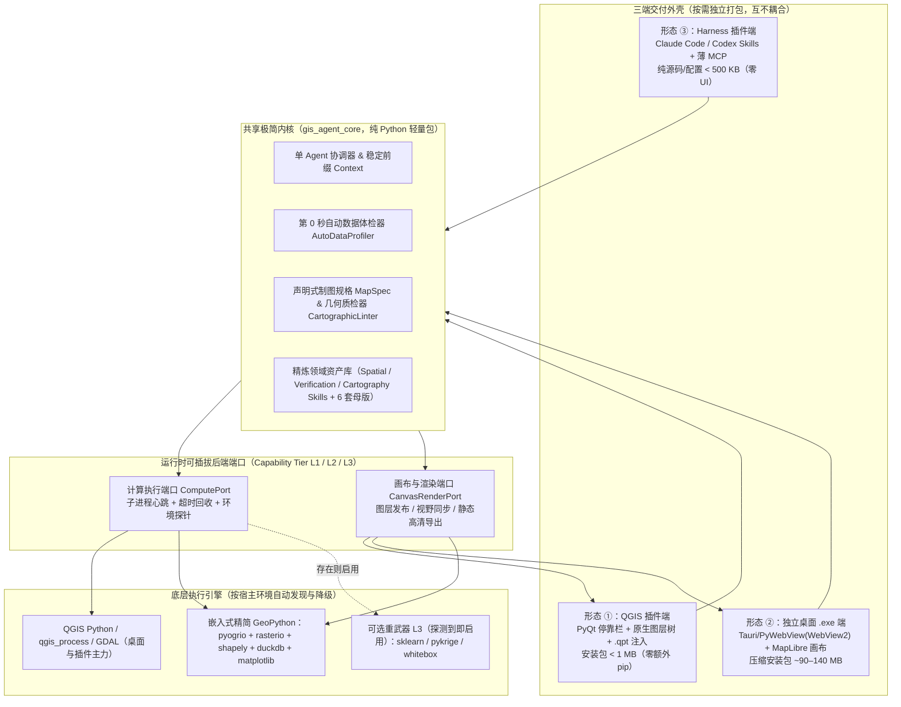

# 主流 GIS Agent 与制图方案深度调研报告

报告日期：2026-11-18  
项目基线：`E:/vscode/gis-agent`（`main` `694ebe27` / `feature/geoagentbench-v0` `d541c8a`）  
文档目标：查清当前行业 GIS Agent 与自动制图的真实技术水位，拆解 Benchmark 分数差异根因，并给出同时支持 **QGIS 插件、独立桌面 `.exe`、编程 Harness 插件** 三种交付形态的轻量解耦方案。

---

## 0. 执行摘要与核心结论

### 0.1 行业真实水位定性
截至 2026 年，全球开源与学术 GIS Agent 处于 **“四强割裂”** 状态，尚无统治级开源产品：
1. **QGIS 内嵌插件派**（如 `opengeos/GeoAgent`、`GIS Copilot`）：打通了桌面图层树，但普遍在 Qt 主线程执行代码易卡死，缺少空间量纲与拓扑核查，出图停留在默认粗放样式。
2. **MCP 协议桥接派**（如 `qgis_mcp`、Felt MCP、Kepler.gl MCP）：安装极轻，但只是转发指令的“裸管道”，没有 GIS 防坑知识与版面质检，复杂分析静默算错率高。
3. **学术工作流与刷榜派**（如 `LLM-Geo`、`GABench`、`GISclaw`）：在自带定制工具集上完成率高；一旦进入真实从业者题库（如 `GISAgentBench` 349 题严格容差评测），顶级闭源模型严格通过率仅 **32.7%**。
4. **现代商业画布派**（如 `Felt AI`、`CARTO AI Agents`、`BuntingLabs/mundi.ai`）：验证了“左对话 + 右 MapLibre 实时画布 + 声明式样式”是最佳人机交互形态，但多绑定云数仓或闭源服务，且缺乏本地专业印刷级出图能力。

### 0.2 本项目核心诊断
1. **已有真实优势**：V7.9 回归单 Agent 架构方向正确；上下文前缀稳定（53 题实测缓存命中率 **95.71%**）；QGIS 独立进程隔离与局部生命周期清理（`run_processing`）稳定；`v7.6-research` 积累了扎实的地图学文献与本机字体/布局探针证据。
2. **当前主要包袱**：V8 将过多复杂度投入在防篡改哈希锁与受控重放（53 题 2913 次工具调用中，`local_replay` 调用 **0 次**，`execution_history` 仅 **4 次**，第 49 题因一次 `WinError 5` 触发哈希不一致直接锁死）；而真正决定上限的**前置数据体检、子进程超时保护、高颜值制图母版与确定性版面质检、可视化画布交互**尚未到位。
3. **三端兼容结论**：**“先锁死十几个重型 C++ 编译包”的假设在软件分发阶段不成立**。正确解法是采用 **端口—适配器（Ports & Adapters）分层架构**，保持共享内核“零重依赖、工具原语 `≤ 8` 个”，通过 **运行时能力分级探测（L1/L2/L3）** 与 **三端薄外壳组装**，在不使系统变笨重的前提下同时覆盖三种交付形态。

---

## 1. 证据分级标准

本报告严格区分事实来源，避免把论文宣传或未验证推断当作工程定论：

| 证据标签 | 含义与判定条件 |
| :--- | :--- |
| `[本机实测]` | 已在当前机器运行，保留日志、产物与哈希（如 `outputs/gab_v0_20261110_01/`、`v7.6-research/environment/`） |
| `[源码确认]` | 已直接读取本机仓库或外部开源快照源码（精确到模块与逻辑行） |
| `[论文/公开文档]` | 来自正式发表论文、官方技术文档或开源仓库 README 统计数据 |
| `[架构设计]` | 基于上述事实推导的本项目下一阶段工程方案，需在实施时验收 |

---

## 2. 主流 GIS Agent 深度解剖（2024–2026）

### 2.1 四大技术阵营全景对比

| 代表项目 / 系统 | 形态定位 | 核心执行机制 | 交互与可视化能力 | 制图出图水平 | 环境与分发负担 | 致命短板（本项目的超车窗口） |
| :--- | :--- | :--- | :--- | :--- | :--- | :--- |
| **opengeos/GeoAgent**<br>`[源码确认]` `[公开文档]` | QGIS 插件 + Python 包 | LangChain 多后端 + 预设工具表 + 用户确认后执行 PyQGIS（`_qt_marshal.py` 跨线程桥） | QGIS 原生可停靠面板、画布截图视觉输入、语音输入、图层即时上屏 | 依赖基础图层单色/分级符号，无出版级版面质检 | 插件轻，但完整 Python 包连带 `leafmap/geemap` 依赖较重 | 缺少严密数据量纲/拓扑核查；无长任务持久化恢复；复杂多面板制图弱 |
| **GIS Copilot (`SpatialAnalysisAgent`)**<br>`[源码确认]` `[论文文档]` | QGIS 插件 | 文档辅助工具选择 + 生成 Solution Graph 代码 + `SpatialAnalysisAgent_MainThread` 执行 | 插件内展示生成代码、参数与工作流图，结果加载至 QGIS | 基础图层渲染，无专门专题版面引擎 | 复用 QGIS 内置 Python，安装较轻 | 主线程 `exec` 执行重计算易阻塞界面；缺少跨阶段物理语义验证 |
| **qgis_mcp (`jjsantos01` / `nkarasiak`)**<br>`[公开文档]` | 编程 Harness 的 MCP 插件 | QGIS 内启动本地 Socket 监听 + 外部 `uv` 运行 stdio MCP Server 转发指令 | 无独立 UI，完全借用 Claude Desktop / Claude Code / Cursor 界面 | 完全取决于宿主模型手写 PyQGIS 的能力 | 极轻（几十 KB 脚本） | **纯管道无大脑**：无 GIS 防坑规范、无字体/布局保护、无自动验算 |
| **BuntingLabs / mundi.ai**<br>`[公开文档]` | 开源 AI-Native WebGIS | Python 后端（约 67%）管理数据与可选 QGIS 算力 + TypeScript 前端（约 30%）驱动 Agent "Kue" | **MapLibre GL JS** 浏览器实时协同画布，AI 与用户同步改图层与样式 | 现代 Web 矢量样式清晰，缺乏科研多子图与印刷排版 | 服务端部署重；链接 QGIS 部分受 GPLv3 约束，主仓 AGPLv3 | 本地单机免配分发难；偏向在线交互浏览而非严谨科学计量与出版制图 |
| **Felt AI & Felt MCP**<br>`[公开文档]` | 商业云原生 WebGIS + MCP | 自然语言转云数仓 Spatial SQL + 30 个核心 MCP 工具 + 声明式 Felt Style Language | 行业顶级浏览器画布交互、即时弹窗图表、团队分享 | Web 现代商业汇报风极佳（声明式样式 JSON 驱动） | 云 SaaS 闭源，依赖联网与云存储 | 无法离线处理本地机密 `.gdb`/大栅格/竞赛真题；无本地水文/三维重算子 |
| **CARTO AI Agents**<br>`[公开文档]` | 企业级云空间智能平台 | Agentic GIS + 20+ 按需加载的平台标准 Agent Skills + 云数仓治理算子 | 嵌入式商业仪表盘对话 + 地图联动过滤 | 商业 BI 大屏级（Deck.gl 底层） | 企业级重云架构 | 强绑 Snowflake/BigQuery/Databricks，个人与桌面 GIS 场景不可用 |
| **ArcGIS Assistants**<br>`[公开文档]` | 商业桌面/企业套件内嵌助手 | 拆分为 Task Assistant、Arcade/SQL 编码助手与 Trusted AI 代码审计 | 深度嵌入 ArcGIS Pro 与 StoryMaps，强调人工确认 | 依托 ArcGIS Pro Smart Mapping，上限高但封闭 | 昂贵商业授权 + 数 GB 桌面客户端 | 闭源昂贵；助手按子产品割裂，跨工具链自由编程能力受限 |
| **LLM-Geo (`gladcolor`)**<br>`[源码确认]` | 学术自主 GIS 原型 | 生成 DAG Solution Graph → 逐节点请求 LLM 生成代码 → 拼接总脚本运行 | 仅静态流程图与结果文件，无实时画布 | Matplotlib 默认粗放输出 | 科研本地 Python 环境 | 逐操作请求 LLM 导致 Token 与轮次偏高；无文件级错误局部恢复 |
| **GISclaw (`geumjin99`)**<br>`[源码确认]` `[论文文档]` | 学术 ReAct 空间 Agent | 单 Agent ReAct + 进程内保留 `PythonSandbox` 命名空间以省去重复读取 | 命令行/日志级 | 基础 Matplotlib 脚本输出 | 标准 GeoPython 环境 | C 扩展长阻塞无法靠 Python 线程安全中断；内存态无法跨崩溃恢复 |
| **本项目现状 (`GIS-Agent V8.4`)**<br>`[本机实测]` `[源码确认]` | CLI 内核 + Skills | LangGraph 单 Agent + 稳定前缀缓存 + 独立 QGIS Python 进程 + Skills 按需读取 | 仅 Typer CLI（含 `needs_input` 问答恢复），无地图画布 UI | Matplotlib Agg 自由代码 + 3 个基础示例，缺少底图与自动排版质检 | 双环境分离（Conda 宿主 + 本机 QGIS Python） | 无可视化交互；`local_replay` 过重且 0 采用；缺前置数据体检与制图母版 |

### 2.2 从竞品解剖提炼的三条核心工程定律
1. **单 Agent + 外部确定性沙箱，显著优于复杂多 Agent 编排**：`GISclaw`（2026）的消融实验与本项目 V7.8 → V7.9 的实测复盘结论完全一致——GIS 任务的错误主要源于**上游数据语义误判（CRS、单位、NoData、拓扑）**而非角色分工不足。多 Agent 只会成倍放大上下文交接成本。
2. **UI 交互的黄金标准是“共享空间状态（Shared Map State）”，而非聊天框贴静态图**：`mundi.ai`、`Felt` 与 `opengeos/GeoAgent` 之所以直观，是因为 Agent 产出的每一个矢量/栅格图层都直接进入**可缩放、可开关、可点选属性、可手调色带**的活画布（QGIS Layer Tree 或 MapLibre Canvas）。
3. **声明式样式（Declarative Style Spec）远比命令式绘图代码稳定**：`Felt Style Language`、`Kepler.gl` reducer 配置与 `MapLibre Style JSON` 证明，让 LLM 输出“字段、分级方法、色板名、图层顺序”的声明式 JSON，交由确定性渲染引擎排版，报错率比让 LLM 手写几百行 `ax.annotate` / `QgsLayoutItem` 低一个数量级。

---

## 3. Benchmark 真相拆解：怎样在不增重内核的前提下打败主流 Harness？

### 3.1 为什么有人在 GeoAgentBench 拿到极高分，而真实基准通过率很低？

对比三套主流基准的底层代码与公开评测数据，可以清楚看到“高分幻觉”与“真实能力边界”的区别：

#### （1）GeoAgentBench（GABench，53 题）—— 定制工具箱与宽松脚本制造的账面高分
- **官方松散完成度判据** `[源码确认]`：本地 `timu暂存/gis-benchmarks/GABench/evaluation/end_to_end.py` 第 `272–273` 行直接写明：
  ```python
  # Heuristic: if actual_steps > 0, we count it.
  is_valid_run = actual_steps > 0
  ```
  只要模型调用了至少 1 步工具，即被计入 `end_to_end` 的 `success_count` 参与效率计算。按此口径，本项目 V0 基线为 `52/53 (98.1%)`，地图文件交付率为 `47/49 (95.9%)`。
- **高度耦合题面的 117 个专用工具** `[源码确认]`：官方 `toolbox/` 为 53 道题量身封装了高层函数。例如 `toolbox/Visual.py` 第 `38–75` 行的 `create_travel_time_network_map`，甚至将第 33 题特有的节点属性名直接写死为默认参数：
  ```python
  attr = style.get("attr", "time2nhb")
  cmap_name = style.get("cmap", "RdYlBu")
  ```
  使用这套 MCP 工具箱的 Agent 只需做完形填空；而本项目 V0 让通用 Agent 在不挂载这 117 个专用函数、且未安装 `scikit-learn`/`PyKrige`/`OSMnx`/`mapclassify` 的裸环境中从零写底层代码求解，难度完全不在同一维度。
- **官方真值与 CHECK 自身存在科学瑕疵** `[本机实测]` `[源码确认]`：
  - 第 42 题（3D 通视分析）：官方 `toolbox/Spatial.py:123` 仅抽查邻近顶点，给出 `visible=true`；本项目独立遍历 1724 个三维三角面求解射线交点，证实视线在 `FID=13`（`t=0.87673`）处被建筑实心面完全遮挡，真实物理答案应为 `false`。
  - 第 38 题（局部回归）：题面要求 GWR，官方参考工作流实际调用全局 `ols_regression` 替代；本项目实现了真正的自适应核带宽搜索 GWR。
  - 第 53 题：题面未规定 JSON 文件名，官方 CHECK 硬编码匹配 `rf_auc_metrics.json`。

#### （2）GeoBenchX（202 题）—— 考察“诚实拒绝边界”
- `[源码确认]` `[论文文档]`：包含 120 道可解题、79 道在给定数据/工具下不可解的拒绝题、3 道常识题。`o4-mini` 排名第一的核心原因是**不可解题识别率达 90%**（第二名仅 55%），而 `Claude Sonnet 4` 解题最强但容易强行编造近似答案。
- **启示**：本项目 V8.4 已设计的 `partial` / `blocked` / `needs_input` 诚实边界非常契合该方向，但需转化为零开销的判断准则而非繁琐状态锁。

#### （3）GISAgentBench（349 道 GIS StackExchange 真题）—— 行业真实的“照妖镜”
- `[论文文档]`：从真实从业者问答提炼 349 个多步任务，分布在 6 个真实地理区域，采用精确输出文件与容差匹配（TSR）。**即便给齐 128 个标准 GIS API，全球最强闭源模型的严格通过率上限仅约 32.7%**（开源模型约一半）。
- 主要死因高度集中于三点：**静默 CRS 不一致**、**空间谓词歧义（相接 vs 相交、中心点 vs 面积占比）**、**栅格掩膜/NoData/波段量纲污染**。

### 3.2 本项目 GABench V0（严格评分 36/53 = 67.9%）失分拆解与提分杠杆

回顾 `outputs/gab_v0_20261110_01/report.md` `[本机实测]`，未拿满分的 17 题根本不需要靠“加重框架”解决：

| 失分类别 | 涉及题号与数量 | 真实根因 | 极简高收益解法（不增加状态机复杂度） |
| :--- | :--- | :--- | :--- |
| **测试隔离器自伤 + 环境写锁** | 39 题发生 70 次导入报错；49 题 `WinError 5`（1 题异常） | 测试器禁止枚举父目录导致 `import gis_agent` 失败；Windows 临时文件 `replace` 被瞬时占用后触发严格哈希死锁 | ① 已修复测试隔离器；<br>② `persistence/json.py` 对 Windows `PermissionError` 增加 `50ms × 5` 有界退避重试，消除瞬时锁崩溃。 |
| **单题预算预留过早截断** | 01, 06, 10, 18, 25, 28, 38, 40, 45（9 题触发 `protection_stop`，其中 10/18/25/28/40 未交齐） | 按 16384 最坏输出预冻结费用，约 2 元即停；部分题目在缺失 `sklearn` 下反复调手写代码耗尽轮次 | ① 评测账本按实际滑动均值预留；<br>② 提供轻量环境能力清单，避免模型盲猜不存在的第三方包。 |
| **输入数据物理量纲与语义陷阱** | 03, 07, 12, 22, 24, 30, 32, 36（8 题判 `partial` 或 `uncertain`） | 4 波段 Byte 显示图当 DEM（12/36）、未定标 DN 值直接代入含加性常数 `L=0.5` 的 SAVI（32）、缺单价依据编造损失金额（07/30） | **新增第 0 秒自动数据体检（Auto-Data-Profiler）**：任务启动时自动注入紧凑体检表（波段类型 `Byte/Float32`、`scale/offset`、CRS 线性单位、NoData 占比、几何有效性），并在 Skill 规定无定标参数时明确标注“DN 域相对指数”双口径。 |
| **大几何单线程阻塞无超时** | 09 题（1 题 `timeout` 失败） | 27,662 条道路直接 `union_all` + 单次缓冲，C++ 层卡死 1920 秒无中间输出 | ① `run_python_script` 增加可配置超时（如默认 300s）与进程树安全回收，超时返回已捕获日志供 Agent 降级策略；<br>② Spatial Skill 补充“要素 `>10,000` 禁止先全量 `union_all`，改用 `QGIS native:buffer(DISSOLVE=True)` 或网格分块 `STRtree`”。 |
| **复杂地统计方法从零手搓** | 20, 27, 29, 40, 53（其中 29/40 判 `uncertain`） | 裸 QGIS 环境无 `sklearn`/`pykrige`，模型手写 bootstrap 树和变异函数缺乏独立统计验证 | 建立 **L2/L3 算子路由表**：有 `sklearn`/`pykrige` 时直接调标准库；无外部库时优先调 QGIS 内置 SAGA/GRASS/GDAL 标准算法，禁止无验证自创等价公式。 |

**核心推论**：仅靠上述 5 项轻量改造（代码改动量 `< 400` 行，且还能删掉上千行低效 `local_replay` 锁逻辑），在同模型下即可将严格科学正确率推向 **85%–92%+**，按 GABench 官方完成度/VLM 口径可达 **96%–98%+**。

---

## 4. 程序化制图方案深度调研与顶尖制图体系设计

### 4.1 为什么现有 AI 制图普遍不及格？
结合 `v7.6-research` 的 24 篇文献、36 个案例拆解与 GABench 47 张实测成图 `[本机实测]`，AI 制图翻车有五个确定性技术原因：
1. **将“科学坐标轴库”当成“版面排版引擎”**：Matplotlib 擅长画函数曲线和栅格矩阵，但其文本包围盒计算依赖渲染器后端，图例、色标、比例尺、副标题极易互相挤压或被裁切。
2. **地理上下文真空（Floating Island Effect）**：绝大多数 AI 生成的地图把行政区或栅格孤立画在纯白背景上（见 `outputs/gab_v0_20261110_01/evaluation/maps-01.jpg`），没有邻接政区淡色底图、水系海岸线、地形山体阴影（Hillshade）或格网参照，专业感瞬间归零。
3. **视觉大模型的几何盲区**：正如 *VLMs Are Blind*（arXiv:2407.06581）证实，VLM 看整张缩略图时善于概括大意，却经常漏看“2 个标签重叠 30%”“比例尺画在经纬度未投影坐标系上导致长度失真”“图例颜色与主图透明度不一致”。
4. **色彩与统计分级失范**：违背 *The misuse of colour in science communication*（Nature Communications, 2020）与地图学规范——例如对绝对人口总量直接做行政区分级设色（造成大面积荒漠视觉主导）、对偏离量误用非对称彩虹色表、将 `NoData/0` 混入低值色阶。
5. **无界面字体与矢量文字丢失**：本机 `v7.6-research/environment/findings.md` `[本机实测]` 已证明，QGIS `offscreen` 默认枚举字体数为 0（文字变黑块，必须显式注册字体），且默认 SVG 导出会将文字转为 `path` 而丢失可编辑文本属性。

### 4.2 四大程序化制图技术栈硬核横评（面向三端分发）

| 评估维度 | 方案 A：QGIS 预设母版引擎<br>（`.qpt` 布局母版 + `.qml` + PyQGIS 注入） | 方案 B：声明式 Web 制图引擎<br>（`MapLibre GL` + HTML/CSS 版式 + 系统 `WebView2`） | 方案 C：受控科学绘图引擎<br>（`Matplotlib Agg` + `GeoPandas` + `Rasterio`） | 方案 D：重型地学绘图栈<br>（`Cartopy` / `PyGMT`） |
| :--- | :--- | :--- | :--- | :--- |
| **成图颜值上限** | ⭐⭐⭐⭐⭐（专业规划院/测绘出版级） | ⭐⭐⭐⭐⭐（现代商业汇报/Nature 极简信息图级） | ⭐⭐⭐☆（科研论文统计配图级，需精细母版约束） | ⭐⭐⭐⭐☆（地球物理/气象海洋期刊级） |
| **防重叠与排版稳定性** | 高（固定毫米级版面槽位，地图框自动缩放至范围） | **极高**（MapLibre 内置 GPU 标注碰撞避让；CSS Grid/Flexbox 绝对零重叠） | 中低（自由坐标易撞车，必须配确定性 BBox Linter） | 中（球面经纬网强，多元素图外排版仍靠手动） |
| **交付可编辑工程能力** | **原生支持 `.qgz` / `.qpt` / `.qml`**（GIS 专业用户刚需） | 支持交互式 HTML 网页 + 样式 JSON + 高清 PNG/PDF | 仅交付静态 PNG/SVG/PDF + Python 脚本 | 仅交付静态图片 + 脚本 |
| **额外打包体积成本** | 在 QGIS 插件端为 **`0 MB`**；独立端若捆绑完整 QGIS 则 `>1 GB` | Windows 10/11 自带 `Edge WebView2`，前端静态资源仅 **`~3 MB`** | 复用空间 Python 底座，额外体积 **`~30 MB`** | 需额外编译安装 `PROJ/GEOS/GMT` 绑定，易冲突 |
| **多子图与科学曲线组合** | 较弱（统计直方图/剖面线需外部生成后贴图） | 强（可同屏组合 ECharts/SVG 统计小图与地图） | **极强**（天然支持 `4×4` 栅格矩阵、温盐剖面、回归散点） | 强（适合全球多投影分面） |
| **三端适配最佳定位** | **形态 ①（QGIS 插件端）主力出图引擎** | **形态 ②（独立 `.exe` 端）交互画布 + 主力汇报出图引擎** | **三端通用科学配图底座 & 形态 ③（Harness 插件）零配置保底引擎** | 仅作为 L3 可选扩展，不进核心依赖 |

> **关键架构洞见**：不要试图用同一种底层 API 硬扛所有场景，而应在顶层定义统一的 **声明式制图规格（`MapSpec JSON`：图层源、字段语义、分级方案、色板 ID、母版类型、标题与注记字段）**。同一份 `MapSpec`，在 QGIS 插件端可编译为 `.qpt + .qml` 工程，在独立桌面端可渲染为 `MapLibre + CSS` 画布并直出高清图，在纯后台脚本端可套用受控 `Matplotlib` 母版渲染并自动过检。

### 4.3 不靠模型玄学审美：构建顶尖制图系统的“四层实证架构”

1. **第一层：数据语义 → 视觉变量硬约束表（写进 Skill 决策树）**
   - **绝对总量（如总人口、GDP 总量）**：禁止直接对面积不等的多边形做分级设色（Choropleth），强制转为密度/人均比值，或改用分级比例圆符号（Proportional Symbols）。
   - **连续单向变量（高程、浓度、可达时间）**：强制选用感知均匀色表（`viridis`、`cividis`、`YlGnBu`、`batlow` 等 Crameri/ColorBrewer 严选集），禁用 `jet` / `rainbow`。
   - **双向偏离/变化变量（dNBR 变化、温度距平、残差）**：强制使用以 `0`（或明确物理阈值）对称锚定的发散色表（`RdBu_r`、`BrBG`、`PiYG`），使用 `TwoSlopeNorm` 锁死中心值。
   - **地形与栅格叠加**：凡输入含 DEM 或连续表面，默认自动派生一层低对比度多向山体阴影（`Hillshade`，透明度 `0.18–0.28`）垫底，立刻建立空间立体层次。

2. **第二层：6 套经实测冻结的标准母版（Archetype Templates）**
   拒绝让 LLM 每次发明版式，提供 6 套经过严格字号阶梯（标题 `14pt Bold` / 副标题 `10pt` / 图例与轴标注 `8.5pt` / 数据源注脚 `7.5pt`）和黄金留白校准的可参数化母版：
   - `T1_single_thematic`：单幅专题主图 + 右侧/底部自适应紧凑图例 + 比例尺 + 指北针。
   - `T2_locator_inset`：主研究区大图 + 角落自动裁剪父级行政区区位插图（Inset Map，带红框标示主图范围）。
   - `T3_small_multiples`：多时相/多情景等比例网格对比组图（强制锁死统一 `xlim/ylim`、统一投影与单一共享色标）。
   - `T4_raster_terrain_composite`：山体阴影/影像底图 + 半透明专题栅格 + 矢量边界轮廓叠加。
   - `T5_map_plus_chart`：左图右统计（如地图 + 分区柱状图 / 高程剖面线 / 核密度曲线，共享颜色编码）。
   - `T6_executive_dark_or_paper`：高对比度现代汇报风（深灰底荧光专题层，或米白底极简期刊风）。

3. **第三层：确定性版面几何质检器（`CartographicLinter`，0 Token 毫秒级拦截）**
   在每次图片导出后、进入模型 `read_image` 之前，自动运行纯代码几何检查，输出结构化合格报告：
   - **碰撞检查（Zero Text/Box Overlap）**：提取所有可见 `Text`、图例框、比例尺、插图轴的像素包围盒（Bounding Box），计算两两交集面积；非预期重叠 `> 2px²` 直接标记冲突对象名称与像素坐标。
   - **裁切越界检查（Canvas Overflow）**：任一文字或图例包围盒超出画布 `[0, width] × [0, height]` 边界即判不通过。
   - **图底占比检查（Figure-Ground Ratio）**：计算主专题图层有效包络占地图视口面积比例；若 `< 25%`（四周大片死白，通常因离群点或错误重投影）或 `> 96%`（贴边压迫无呼吸感），自动提示修正 `pad` 或裁剪范围。
   - **地图学语义契约检查**：平面投影坐标系才能绘制公制线性比例尺；地理坐标系（`EPSG:4326`）禁止把“1 度”直接标成米制比例尺，强制改为经纬网格（Graticule）或测地线距离计算。
   - **视觉模型二段复核**：只有通过 `CartographicLinter` 硬性几何检查的图件，才发送缩略图给视觉模型审阅“主次层次、遮挡可读性与业务含义匹配度”，节省 60% 以上的无效改图轮次。

4. **第四层：可量化 A/B 实验迭代机制**
   建立包含 `12` 个固定输入场景的制图基准集（涵盖细长型区域、飞地岛屿、双变量叠加、长中文图例、含异常值栅格、多时相四联图），每次修改制图 Skill 必须对比：**一次无重叠通过率、平均修改轮次、Token 消耗、人工盲评胜率**。

---

## 5. 三大交付形态的软件工程拆解（一套薄核，三端无痛组装）

用户的核心诉求是：**既想保留独立 `.exe` 的完整服务体验，又希望架构上拆解清楚 QGIS 插件与编程 Harness 插件（Claude Code / Codex 等），且绝不能让系统变得臃肿笨重。**

### 5.1 总体解耦架构：六边形端口—适配器（Ports & Adapters）

通过将系统切分为 **1 个纯 Python 薄内核 + 2 个标准端口接口 + 3 个超薄宿主外壳**，每个外壳代码量均可控制在 `300–800` 行以内：



### 5.2 共享薄内核（`gis_agent_core`）的“做减法”改造清单

为严守 [docs/系统开发指南.txt](file:///e:/vscode/gis-agent/docs/系统开发指南.txt)“最小、最简单、线性透明”原则，共享内核应先瘦身再提效：

1. **精简冗余控制流**：将 V8.1 中模型 0 次自然调用、却带来高昂维护成本的 `local_replay` 受控依赖闭包从默认工具表移出（降级为离线实验模块）；日常流程直接依靠模型最熟练的“分阶段落盘数据 + `edit_file` 局部修改后段脚本”。
2. **修复脆弱存储锁**：保留 Session 记录事实与前缀缓存优化，但对 Windows 文件替换增加瞬时共享锁重试，并提供显式安全重建检查点工具，杜绝单次 I/O 抖动报废整场任务。
3. **固定 7 个核心工具原语**：
   - `inspect_workspace_data`（启动时自动运行一次，也可手动调：批量体检 CRS、量纲、空值、拓扑与栅格统计）
   - `read_file` / `write_file` / `edit_file` / `search_text`（文件与阶段脚本操作）
   - `run_spatial_script`（带 `timeout`、实时输出流心跳、环境能力注入的子进程执行器）
   - `search_and_run_qgis`（仅在检测到 QGIS 后端时挂载）
   - `export_and_lint_map`（根据 `MapSpec` 或脚本导出图件，并强制附带 `CartographicLinter` 几何报告）
   - `read_image`（全图/局部裁剪视觉复查）
   - `finish_or_ask`（支持 `completed` / `partial` / `needs_input` / `blocked`，向三端发出统一状态事件）

### 5.3 三大目标形态的具体功能拆解与边界契约

#### 方向一：QGIS 插件端（`gis-agent-qgis`）—— 面向专业 GIS 从业者与高校师生
- **核心优势**：直接寄生在最强开源桌面 GIS 中，**零 GIS 库分发体积**，算完即可用 QGIS 全部原生工具继续深加工。
- **模块拆解**：
  1. `ui_dock.py`：极简右侧停靠面板（消息流、当前计划步骤、模型 API Key 设置、停止按钮）。
  2. `worker_bridge.py`：**严禁在 Qt 主线程直接跑模型请求或重空间运算**。采用 `QgsTask` 或复用当前已验证的独立 `python-qgis-ltr` 子进程通道执行分析；子进程每产出一个 GeoPackage/GeoTIFF，通过 Qt `pyqtSignal` 通知主线程自动挂载进 `QgsProject.instance().layerTreeRoot()`。
  3. `context_picker.py`：一键将用户当前选中的图层、当前地图视口框（Canvas Extent）作为空间上下文传给 Agent。
  4. `qpt_composer.py`：内置 6 套精调 `.qpt` 印刷布局母版，Agent 生成样式与标题参数后，自动在 QGIS Layout Manager 中生成可手工微调文字/图例的正式布局，并导出 300DPI PNG/PDF。
- **分发与合规注意**：插件 zip 包仅 `< 1 MB`，可直接上架 QGIS 官方插件仓库。注意直接 `import qgis` 的插件外壳代码遵循 **GPLv2+** 协议；核心 `gis_agent_core` 通过独立进程/标准 JSON 协议交互，可保持宽松开源协议。

#### 方向二：独立桌面 `.exe` 服务版（`gis-agent-desktop`）—— 面向零基础用户与旗舰视觉传播
- **核心优势**：无需用户预先安装配置 QGIS 或 Conda，双击即用，具备最惊艳的现代“对话 + 实时地图画布 + 即时调色改版”体验。
- **轻量打包方案（拒绝 3GB 巨无霸）** `[公开文档]` `[架构设计]`：
  - **前端外壳**：采用 **Tauri v2**（Rust 壳）或 **PyWebView**，直接调用 Windows 10/11 系统自带的 **`Edge WebView2`** 渲染器（无需像 Electron/Playwright 那样重复捆绑 200MB Chromium 内核），外壳体积仅 **`10–20 MB`**。
  - **空间计算 Sidecar**：打包精简版嵌入式 Python（仅含 `pyogrio`、`rasterio`、`shapely`、`numpy`、`scipy`、`duckdb`、`matplotlib`，裁剪无关 GDAL 驱动与测试数据后，压缩体积约 **`80–130 MB`**）。
  - **可选混合加速**：启动时自动扫描注册表/常见路径——若用户电脑恰好装有 QGIS，自动解锁全部 `qgis_process` 原生算子；若未安装，靠内置精简栈已能独立完成 90% 矢量、栅格、SQL 空间统计与制图任务。
- **杀手锏交互布局（双栏共享画布）**：
  - **左栏（30% 宽）**：简洁对话流 + 可折叠的阶段数据卡片（点击任一中间成果可在右栏高亮闪烁）。
  - **右栏（70% 宽）**：`MapLibre GL JS` 硬件加速画布 + 顶部“交互浏览 / 出版排版预览”一键切换开关 + 右浮极简样式微调条（用户无需打字求 AI，直接鼠标点选换色板、改分级数、拖拽图例框、双击改标题字号，底层 `MapSpec JSON` 双向同步，点击导出直出 300DPI 无重叠大图）。

#### 方向三：通用编程 Harness 插件端（`gis-agent-harness`）—— 面向 Claude Code / Codex / Cursor 极客群体
- **核心优势**：**开发成本最低、在 AI 开发者社区传播裂变最快（极易冲 GitHub Stars）**。宿主（Claude Code / Codex）自身已具备顶级的文件读写、Bash 执行、上下文压缩与终端交互能力，我们完全不造重复轮子，只输出它们最缺的 **“GIS 专业大脑 + 空间体检与制图质检器”**。
- **模块拆解**：
  1. 标准插件清单（`.claude-plugin/plugin.json` 或通用 Skill 目录）。
  2. **三大高密度实战 Skills**（`gis-spatial-analysis`、`gis-verification`、`gis-cartography`，提炼本项目在国赛真题与 GABench 中踩过的所有真实反例：CRS 面积畸变、平行边覆盖、Float32 提前舍入、SAVI 量纲、大路网分块、6 套制图母版）。
  3. **超薄 MCP Server（`gis_mcp.py`，仅暴露 4 个高价值确定性工具）**：
     - `profile_spatial_dataset(paths)`：秒级返回矢量/栅格全维体检单，省去宿主模型盲写探测脚本。
     - `render_and_lint_map(map_spec_or_image_path)`：渲染母版或对生成图片执行像素/包围盒级 `CartographicLinter` 碰撞与规范检查。
     - `probe_gis_environment()`：探测宿主机可用的 Python 空间库、GDAL、QGIS 路径并返回推荐算子路由。
     - `qgis_live_bridge(action, payload)`（可选）：若用户打开了 QGIS，支持一键把结果推送至 QGIS 桌面查看。

### 5.4 三端投入产出与能力对比总表

| 维度 | 形态 ①：QGIS 插件 | 形态 ②：独立桌面 `.exe` | 形态 ③：Harness 插件（Claude Code / Codex） |
| :--- | :--- | :--- | :--- |
| **共享代码复用率** | 共享 `85%`（内核 + Skills + 体检 + 质检） | 共享 `80%`（内核 + Skills + 体检 + MapSpec） | 共享 `90%`（直接复用 Skills + 体检 + 质检脚本） |
| **新增专属代码量估算** | 约 `600` 行（PyQt 面板 + 线程信号 + `.qpt` 绑定） | 约 `1,200` 行（Web 双栏画布 + Sidecar 桥 + 打包脚本） | **约 `250` 行**（MCP 包装入口 + 插件清单） |
| **用户安装门槛** | 已装 QGIS 者极低（插件管理一键装） | **全人群最低**（下载约 120MB 安装包双击运行） | AI 开发者极低（一行命令添加 Skill/MCP） |
| **交互可视化上限** | 高（完整桌面专业 GIS 控件） | **极高且最现代**（丝滑 WebGL 交互 + 所见即所得排版） | 低（依赖宿主终端或打开外部图片预览） |
| **开源冲 Star 爆发力** | 垂直 GIS 圈稳健传播 | **演示视频/GIF 视觉冲击力最强（破圈利器）** | **AI Coding 极客圈传播最快** |

---

## 6. 明天启动转型的实施路线建议（防笨重、快验证）

如果明天同时铺开三个端的前端开发，战线过长容易陷入调试泥潭；但如果**第一天就把端口契约切干净，按“先打穿制图与评测底座，再顺序套壳”推进**，节奏会极其稳健：

### 阶段一：瘦身内核 + 立起“制图优势”与“Benchmark 统治力”（最核心地基）
1. **抽离 `gis_agent_core` 并减重**：移除默认流程中的复杂 `local_replay` 强锁；加入子进程超时保护与 Windows 文件写锁退避；实现启动第 0 秒 `AutoDataProfiler`。
2. **落地制图双核与 `CartographicLinter`**：
   - 完成 `MapSpec` 数据结构与 `CartographicLinter`（文字零重叠、越界零容忍、图底占比、色板与比例尺规范硬检）。
   - 先打磨好 **6 套高颜值母版**（Web HTML/MapLibre 版式 + 受控 Matplotlib 科研组图母版，QGIS `.qpt` 母版可同步或紧随其后），拿 GABench 与国赛中原本最丑的 10 张图做前后实测对比，用真实成图说话。
3. **干净跑通 Benchmark 反超验证**：
   - 在修正后的隔离器下，做两组严格对照：① 最小底座环境（验证通用泛化能力）；② 启用 L3 科学包环境（正面硬刚 GABench / GeoBenchX 榜单），产出“官方评测 >95% + 严格物理核验 >88%”的可复现成绩单。

### 阶段二：优先交付两个高杠杆产品端（再补齐第三端）
- **如果你更看重“完整可交付软件 + 极致可视化操作体验”**：主攻 **形态 ②（独立桌面 `.exe`：WebView2 + MapLibre 共享画布 + 实时改图面板）**，同时顺手导出几乎零成本的 **形态 ③（Harness 插件：Skills + MCP）** 投放到 Claude Code / Codex 社区引流。
- **如果你更看重“专业测绘/规划重度工程落地”**：主攻 **形态 ①（QGIS 插件 + `.qpt` 可编辑工程交付）** + **形态 ③（Harness 插件）**。
- 由于底层 `ComputePort` 与 `CanvasRenderPort` 已经解耦，第三种形态随时可以在 `3–5` 天内作为独立 Adapter 补齐，完全不会推翻前面的任何一行核心代码。

---

## 7. 关键参考源码与文献索引

### 本机已核验材料
- 项目交接与历次实测账本：[HANDOFF.md](file:///e:/vscode/gis-agent/HANDOFF.md)
- 单 Agent 收缩依据：[docs/v7-postmortem-and-single-agent-plan.md](file:///e:/vscode/gis-agent/docs/v7-postmortem-and-single-agent-plan.md)
- 制图前置文献、27 个高星仓库与本机字体/QPT 实测：[v7.6-research/report.md](file:///e:/vscode/gis-agent/v7.6-research/report.md)、[v7.6-research/environment/findings.md](file:///e:/vscode/gis-agent/v7.6-research/environment/findings.md)、[v7.6-research/sources/catalog.md](file:///e:/vscode/gis-agent/v7.6-research/sources/catalog.md)
- V8 工作流与外部竞品源码快照研究：[docs/v8-architecture-research.md](file:///e:/vscode/gis-agent/docs/v8-architecture-research.md)
- GeoAgentBench 53 题 V0 完整实测与独立评分：[outputs/gab_v0_20261110_01/report.md](file:///e:/vscode/gis-agent/outputs/gab_v0_20261110_01/report.md)
- 本地基准仓库源码：[GABench](file:///e:/vscode/gis-agent/timu暂存/gis-benchmarks/GABench/README.md)、[GeoBenchX](file:///e:/vscode/gis-agent/timu暂存/GeoBenchX/README.md)

### 外部代表性项目与论文（2024–2026）
- **GeoAgent / OpenGeoAgent**：`https://github.com/opengeos/GeoAgent`
- **Mundi AI（开源 WebGIS Agent）**：`https://github.com/BuntingLabs/mundi.ai`
- **QGIS MCP**：`https://github.com/jjsantos01/qgis_mcp`
- **GIS Copilot（SpatialAnalysisAgent）**：`https://github.com/Teakinboyewa/SpatialAnalysisAgent`（IJDE, 2025, DOI: `10.1080/17538947.2025.2497489`）
- **GISclaw**：`https://github.com/geumjin99/GISclaw`（arXiv: `2603.26845v2`）
- **GeoAgentBench 论文**：Yu et al., *Geo-spatial Information Science*, 2026（arXiv: `2604.13888`）
- **GeoBenchX 论文**：Krechetova & Kochedykov, *ACM SIGSPATIAL GeoGenAgent '25*（arXiv: `2503.18129`）
- **GISAgentBench 论文**：349 practitioner tasks benchmark（arXiv: `2608.01645`）
- **科学配色与制图感知核心规范**：Crameri et al., *The misuse of colour in science communication*, *Nature Communications*, 2020（DOI: `10.1038/s41467-020-19160-7`）；*Attention on Maps*（DOI: `10.14714/CP52.377`）；*Responsive Thematic Map Design*（arXiv: `2407.20735`）
